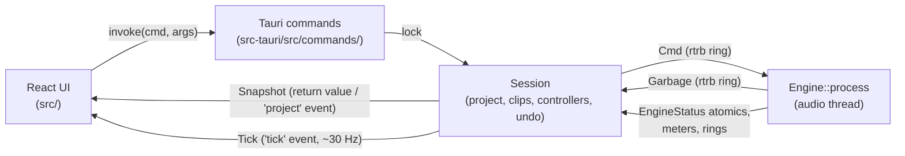
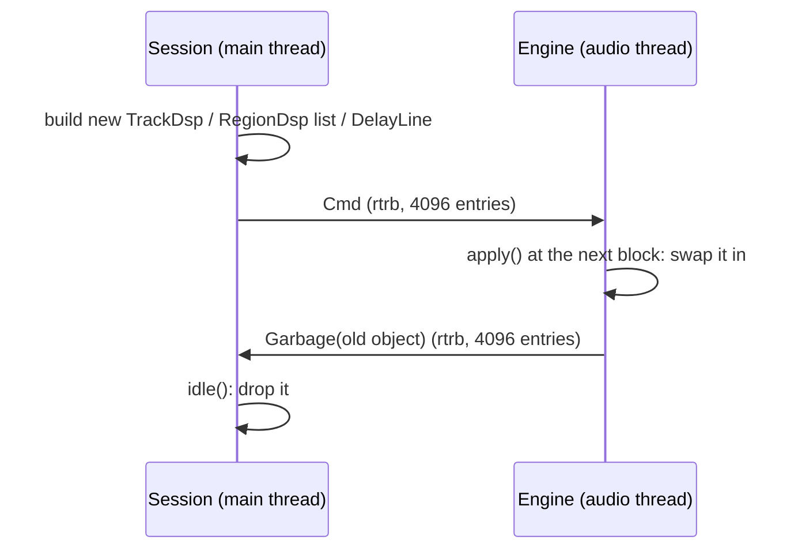
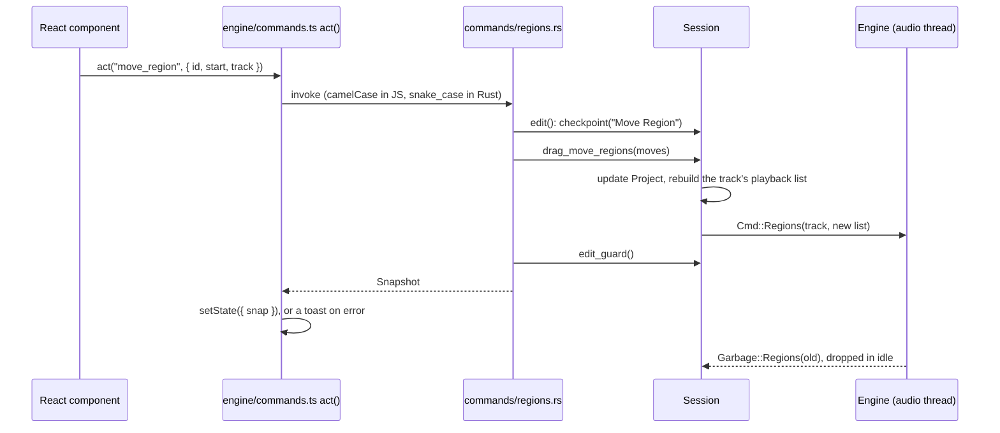
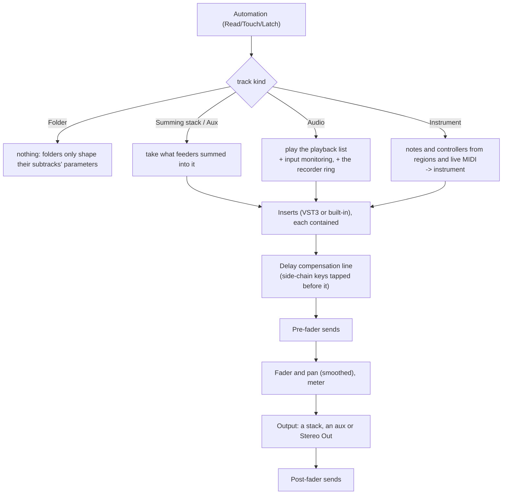
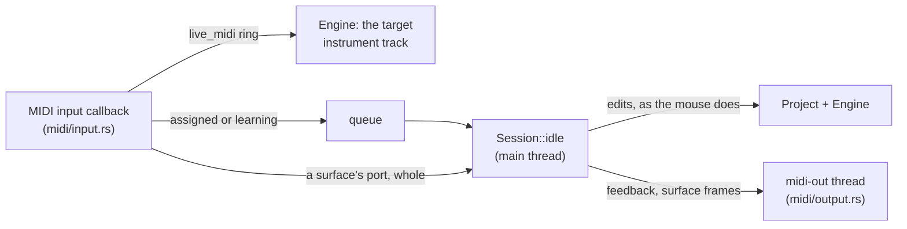

# Marbble architecture

How Marbble is put together: its parts, the source tree, the threads and the rules that keep the
audio thread safe, how an edit and a block of audio travel, and where the project lives on disk.
It is the map; the detail is in the code, where every file starts with a comment saying what it
holds. For building, testing and conventions see [DEVELOPING.md](DEVELOPING.md); for what the
program does see [USER_GUIDE.md](USER_GUIDE.md). The Logic Pro research behind the behaviour is in
[logic-reference.md](logic-reference.md).

Contents:

1. [The parts](#1-the-parts)
2. [The source tree](#2-the-source-tree)
3. [Threads](#3-threads)
4. [Real-time rules](#4-real-time-rules)
5. [The life of an edit](#5-the-life-of-an-edit)
6. [The life of a block](#6-the-life-of-a-block)
7. [The project model](#7-the-project-model)
8. [Files on disk](#8-files-on-disk)
9. [Plug-ins](#9-plug-ins)
10. [Audio devices and recording](#10-audio-devices-and-recording)
11. [MIDI and control surfaces](#11-midi-and-control-surfaces)
12. [The frontend](#12-the-frontend)
13. [Invariants and gotchas](#13-invariants-and-gotchas)

## 1. The parts

Marbble is a Cargo workspace of three crates and a React frontend:

| Part | Path | What it is |
|---|---|---|
| `daw-engine` | `crates/engine` | The audio engine: the project model, the real-time graph, the session that edits the project, devices, recording, MIDI, built-in effects and instruments. No UI code. |
| `vst3-host` | `crates/vst3-host` | VST3 hosting on the `vst3` bindings: loading and scanning bundles, the host's COM objects, the real-time processing wrapper, editor windows. |
| `daw` | `src-tauri` | The Tauri 2 app: the commands the frontend calls, the native menu bar, settings and recent files, and the timers that drive the session. The binary is `daw`; packages also install it as `marbble`. |
| frontend | `src` | React 19 and TypeScript, built with Vite. The Tracks area, rulers, editors and meters are drawn on canvases. |

The engine has two halves that never share mutable data:

- **`Session`** (`crates/engine/src/session/`) is the non-real-time side. It owns the `Project`
  document, the decoded audio clips, the plug-in controllers, the undo history and the recorder.
  Every edit goes through it, on the main thread.
- **`Engine`** (`crates/engine/src/dsp/`) is the real-time graph. It owns one `TrackDsp` per
  track and runs `Engine::process` on the audio thread. It hears about edits only through `Cmd`
  messages.



The frontend never holds the project as its own: it shows the last `Snapshot` the session sent and
asks for every change with a command.

## 2. The source tree

Folders are named for what they hold, by feature. Each folder's entry point (`mod.rs`, or the main
file) says what the folder holds, and `crates/engine/src/lib.rs` is the engine's table of contents.

### The engine: `crates/engine/src`

```text
lib.rs              the table of contents: one line per top-level module
dsp/                the real-time graph: Engine::process and everything it calls
  parallel/           strips on several threads, bit-identical to the serial loop
  pool/               the real-time worker pool, plug-in call tracking, thread priority and placement
session/            the non-real-time half: Session, one `impl Session` per feature
  engine/             the wire to dsp/: sending commands, what the engine plays, the device, PDC, threads
  project/            files, autosave, recovery, settings, alternatives, backups, templates, bounces
  tracks/             the track list, groups, track alternatives, icons, Track On/Off, Freeze
  mixer/              sends and outputs, VCAs, multi-output auxes, meters, channel strip settings
  plugins/            insert and instrument slots, built-ins, presets, side-chains, VST3 state and undo
    sampler/            Marbble Sampler's zones, files, recording and saved instruments
  regions/            region edits, import, moves and drag modes, gain, fades, range edits, arranging
  midi/               Piano Roll content, MIDI file import and export, Step Sequencer patterns
  takes/              recording into take folders, comping, folder commands, the last recording,
                      the MIDI a recording captures
  global_tracks/      the Arrangement, Marker, Tempo and Signature tracks
  automation/         writing lanes while playing, editing them, extra lanes
  control/            controller assignments, feedback, control surfaces
  diagnostics/        the snapshot the Diagnostics window shows
  tests/              session tests across areas and their helpers
model/              the project document's types, the tempo map, VCA rules
edit/               pure editing logic on the document: fades, comps, drag modes, arranging, patterns…
  takes/              take folders: comps, MIDI takes, pieces, recording plans
prefs.rs            Settings and Project Settings types
fx/                 built-in effects and their registry
instrument/         built-in instruments and their registry, one folder per model
synth_dsp/          oscillators, filters, envelopes, LFOs, voice allocation, resampling
audio_io/           the duplex device stream, device lists, restarts on device changes, the recorder, memory locking and use, thread counts
audio_file/         reading (decode/), writing (encode/), clips in memory, WAV repair
midi/               MIDI input and output ports, Standard MIDI Files
control/            controller assignments, feedback messages, the Mackie Control and HUI protocols
library/            what lives outside any project: presets, strip settings, the plug-in database
```

`crates/engine/examples/` holds the headless checks and benches (see
[DEVELOPING.md](DEVELOPING.md#headless-checks)); `examples/common/` has the shared transport
helpers and the all-features project.

### The VST3 host: `crates/vst3-host/src`

```text
lib.rs              the public surface: instantiate, scan, editors
module.rs           loading a bundle and its plug-in factory
scan.rs             finding bundles on disk
plugin.rs           the two halves' types; plugin/ makes and runs them
plugin/             instantiate.rs, processor.rs (audio thread), controller.rs (main thread), multi_out.rs
process.rs          preallocated parameter queues and event lists
host.rs             the host's COM objects (IHostApplication, IComponentHandler…)
stream.rs           an in-memory IBStream for state
editor/             editor windows: linux.rs (X11, with x11_scale.rs), macos.rs, other.rs
keys.rs             keys an editor didn't use, passed on to the app
macos_bundle.rs     CFBundle loading and dyld's messages on macOS
```

### The app: `src-tauri/src`

```text
main.rs             modules, AppState, the window's setup, the list of commands
startup.rs          the --scan-vst3 child mode, display backend and logging, the session at launch
timers.rs           the tick thread, the idle timer with autosave, MIDI device refresh
commands.rs         Snapshot and the wrappers every command shares (edit, try_edit, edit_made…)
commands/           the commands, one file per area (tracks, regions, plugins, project…)
menu/               the native menu bar: spec.rs (the bar as data), mod.rs (build, handle), GTK and macOS keys
windows.rs          detached panel windows and routing menu items to them
diagnostics/        the Diagnostics window, the command it polls, the log kept in memory for it, and Record Everything
settings.rs         settings.json
recent.rs           recent projects
schemas.rs          the GSettings schema GTK's file chooser needs
glib_loop.rs        plug-in editors' file descriptors and timers on GTK's main loop
crash.rs            a last autosave when the app panics
```

### The frontend: `src`

```text
main.tsx            every window's entry point: renders App, or a detached panel's window
app/                the main window's shell: layout and launch, key and menu commands
  controlBar/         the control bar and transport commands
  cpuMeter/           the CPU meter, shown in the status line or the control bar
  detach/             detached panel windows: runtime, pure model, panel kinds and their registry,
                      remembered geometry, the window's root
  menuBar/            keeping the native menu bar in step, one name per command
  statusLine/         the status line: devices, MIDI, and the meter, memory and threads
  updates/            the update check and its notice
engine/             the UI's side of the engine: the document's types, Snapshot and Tick, commands
state/              the global UI store with the tick channel, and the display-frame loop
lib/                pure maths used everywhere: tempo map, musical time and snapping, decibels, clamp
keyboard/           key commands and their display, focus ring, keys in slots, menus, lists, sheets
ui/                 shared pieces: menus, form controls, faders and meters, icons, sheets, tooltips
theme/              the themes (one file each), applyTheme, canvas colours
tracks/             the Tracks area: layout, viewport, zoom, grid snap, track and region commands, context menus
  alternatives/       Track Alternatives
  automation/         automation lanes: parameters, curves, drawing and editing
  canvas/             the Tracks area's canvas: component, drawing, pointer, drag state
  drumReplace/        Drum Replacement and Doubling
  globalTracks/       the Arrangement, Signature and Tempo tracks
  headers/            track headers
  icons/              track icons
  markers/            the Marker track and Marker List
  overview/           the overview strip
  regions/            regions on the timeline: drawing, gain, trim, fades, loops, drag modes…
  ruler/              the ruler and its playhead
  takes/              take folders and comps
  tools/              the Tracks area's tools and the marquee
inspector/          the Inspector pane
editors/            the bottom section's editors, and the MIDI edits they share
  audioEditor/        the Audio Track Editor
  eventList/          the Event List
  noteInput/          Step Input and Musical Typing
  pianoRoll/          the Piano Roll
  stepSequencer/      the Step Sequencer
mixer/              the Mixer and the channel strip: slots, sends, VCAs, meters, routing, widths
plugins/            plug-ins on the UI side: built-in registry, hosting, value formats, slot menus
  panels/             plug-in panels: dock, floating windows, header, presets, shared controls
    settings/           Compare, and Copy and Paste Settings, in the header
  effects/            each built-in effect's panel (dynamics/ and eq/ in their own folders)
  instruments/        built-in instrument panels (sampler/ in its own folder)
controllers/        MIDI controllers: assignments, MIDI Learn, control surfaces
project/            the project as a file: open, save, import, templates, recovery, MIDI files
  bounce/             bounce and export
browser/            the Library and All Files panes
settings/           the Settings window and the app-wide settings
  panes/              one file per Settings pane, and Project Settings
diagnostics/        the Diagnostics window: its tabs, the figures it marks, the log view, Copy Report
styles/             the stylesheet, one CSS file per area; index.css's order is the cascade
```

`tests/` mirrors `src/`: the test of `src/<folder>/<module>.ts` is
`tests/<folder>/<module>.test.ts`. `tests/codebase/` and `tests/styles/` hold guard tests that
read the sources.

### Around the code

`scripts/` has the headless check runner, the version bump, the editor scale check and the feature
list's generator. `features/` lists Logic Pro's features and how far Marbble has each. `nix/`
holds the package and the dev shell, `site/` the website built from these docs, `.github/workflows/`
CI, releases and the website's deploy.

## 3. Threads

| Thread | Started by | What it does | What it may not do |
|---|---|---|---|
| **Main** | Tauri | Synchronous Tauri commands (most edits), the native menu, the GTK main loop, and the 30 ms idle timer (`Session::idle`: plug-in controller idle, latency changes, dropping `Garbage`, taking recorded MIDI off its ring, automation, controller assignments and feedback, control surfaces, taking autosaves). Every VST3 controller and editor lives here. | Block for long. Renders are async commands for that reason. |
| **Audio callback** | cpal | Calls `Engine::process_io` once per device buffer, inside `catch_unwind`. Real-time priority (rtkit on Linux, Core Audio's own on macOS), on the performance cores where a CPU has two kinds (`audio_io::threads::keep_to`). The input stream's callback only fills the input ring. | Allocate, lock, block, do I/O ([Real-time rules](#4-real-time-rules)). |
| **`marbble-dsp-N`** | `Session::sync_parallel` | Plays strips beside the callback when Processing Threads allows and the project is heavy enough ([Multi-core](#multi-core-processing)). | The same as the callback. |
| **`audio-io`** | `audio_io::start` | Builds and owns the cpal streams until the device closes. | |
| **`recorder`** | `audio_io/recorder.rs` | Every 10 ms, drains each armed track's ring into its WAV file, an in-memory copy and the preview peaks. | Touch the engine or the project. |
| **`ui-tick`** | `src-tauri/src/timers.rs` | Every 33 ms, locks the session, builds a `Tick` (playhead, meters, CPU, recording previews, warnings…) and emits it. | Edit anything. |
| **MIDI refresh** | `src-tauri/src/timers.rs` | Every 3 s, connects MIDI devices plugged in since. | |
| **MIDI input callbacks** | midir, `midi/input.rs` | Route each message: a control surface's port to the session whole, assigned controllers to a queue for `idle`, the rest (after the velocity curve) to the `live_midi` ring the engine reads. | |
| **`midi-out`** | `midi/output.rs` | Sends the feedback and surface messages `idle` hands it. | Touch the session. |
| **Async commands** | Tauri's runtime | Renders (bounce, export, Bounce in Place, Freeze), plug-in rescans, waveforms, device lists, folder listings, the Diagnostics window's snapshots (which wait at most 5 ms for the session and skip a refresh rather than wait longer). Renders hold the session and engine locks throughout; edits they make go back to the main thread with `run_on_main_thread`. | Touch plug-in controllers. |
| **Autosave writer** | `src-tauri/src/timers.rs` | Writes a job serialized on the main thread to disk, atomically. | |
| **`activity-log`, `activity-watch`** | `src-tauri/src/diagnostics/activity.rs` | The watch, from launch, looks at the session four times a second (`Session::watch`) and notes what changed in the Diagnostics window's log; while Record Everything is on, the other writes the activity log's lines to its file. | Wait for the session more than 10 ms. |
| **Scan child process** | `library/plugin_db.rs` | `marbble --scan-vst3 <bundle>` loads one bundle in a child process, so a crashing plug-in can't take the app down. | |

On macOS the idle timer is a `CFRunLoopTimer` on the main run loop in its common modes, so it
also fires while a menu is open or a window is being resized; a busy main thread only makes it
fire late. On Windows a helper thread posts the idle work to the main thread every 30 ms, but
keeps at most one post in flight: while the main thread is busy it skips ticks rather than
queueing them.

The session sits behind a `parking_lot::Mutex` in `AppState`. The engine has a mutex of its own,
but the audio callback only `try_lock`s it: while an offline render holds it, the device plays
silence.

## 4. Real-time rules

`Engine::process` and everything it calls run on the audio thread, or on a pool worker with the
same rules. They must not:

- **allocate or free.** Buffers are sized up front: `MAX_BLOCK` = 1024 frames, `MAX_INPUTS` = 32,
  512 MIDI events per track per block. A larger device buffer is processed in sub-blocks.
- **lock, block or wait on another thread.** Communication is through wait-free `rtrb`
  single-producer rings (commands, garbage, live MIDI, recorded MIDI and audio, the analyzer feed)
  and atomics (`EngineStatus`, `Meter`, `FxShared`). Not channels: a `crossbeam_channel` receiver
  can spin while a preempted sender finishes, and at real-time priority that starved the sender
  until the kernel killed the app with SIGXCPU.
- **do I/O or call a plug-in's controller.** Only the processor half of a plug-in
  (`PluginProcessor`) moves into the engine.

**Cmd in, Garbage out.** The session builds whatever the engine needs (a `TrackDsp`, a playback
list, an insert, a delay line) on its own thread and sends it in a `Cmd` (`dsp/cmd.rs`). At the
start of the next callback `Engine::apply` (`dsp/apply.rs`) swaps it in and sends what it replaced
back as `Garbage`, which `idle` drops on the main thread. If the garbage ring were ever full, the
engine leaks the object rather than block.



The queue's edges (`session/engine/sync/`):

- `Session::send` counts commands and `EngineStatus::cmds_done` counts what was applied;
  `wait_for_engine` waits (up to 1 s) for the few places that need the engine caught up. With no
  device running, `send` runs the queue through `process` itself, so headless tests and a
  stopped device keep the graph current.
- A burst over 4096 commands (undoing a huge edit) fills the ring. `send` then waits on the main
  thread, a millisecond at a time, freeing garbage meanwhile. An engine that takes nothing for a
  second gets the command dropped: it is counted in `cmds_dropped` (the checks expect 0), the
  session marks itself out of step, and once the ring empties `idle` stops the transport and
  rebuilds the graph from the project, as Reset Audio Engine does.
- A graph swap (`Engine::replace_graph`: opening a project, a rebuild, a new sample rate) first
  applies what is still queued for the old graph, so no stale command lands on the new one.

**Failures are contained, not fatal:**

- **Denormals.** `process` holds a flush-to-zero guard (`dsp/denormals.rs`) for its whole run;
  pool workers set it for life.
- **Overload.** Callbacks late back to back for more than 60 ms make the engine flush notes and
  play silence for 250 ms without processing (`dsp/status.rs`), so the thread sleeps again before
  the kernel's `RLIMIT_RTTIME` kills the app. The session stops the transport and says "System
  overload". Offline renders are exempt.
- **Panics.** The callback runs `process` inside `catch_unwind`, and each pool task has its own.
  A panicking block is silenced and counted in `engine_errors`; the session shows a toast at most
  every 5 s.
- **Bad plug-in output.** After every instrument, insert and Stereo Out plug-in, `contain()`
  (`dsp/track.rs`) silences NaNs and clamps past ±1000, and the session names the plug-in in a
  toast. The mix is contained once more before the output, which the callback clamps to ±4.

**What the Diagnostics window reads.** Each strip has a `StripLoad` (`dsp/strip_load.rs`), made
with the strip off the audio thread and shared with the session as its `Meter` is: the thread that
plays the strip, the callback or a worker, stores its thread number and its share of the block
(from `spent`, which the block loop measures anyway) with relaxed atomic stores, and nothing else.
The rest of the window's figures are the `EngineStatus` atomics the tick reads already. The session
assembles the snapshot without the engine's lock (`session/diagnostics/`). Logging stays off the
audio thread: the app's logger keeps each line in a small ring behind its own lock as well as
writing it to stderr (`src-tauri/src/diagnostics/`), and nothing the audio thread runs logs.
The window's Record Everything (`src-tauri/src/diagnostics/activity.rs`) writes each command on
its way into Tauri's invoke handler (main.rs `logged`), menu items, key commands, window focus, log
lines, and what `Session::watch` (`session/diagnostics/watch.rs`) says changed four times a second,
to a file in `logs/`, through a channel to a thread of its own; it reads the same atomics as the
window, under a session lock it waits at most 10 ms for.

**Habits inside the engine.** Gains glide through a 5 ms one-pole (`smooth`), so fader moves,
mutes and sends don't click; a render snaps them first so it doesn't depend on what played before.
A muted send keeps its slot at gain 0. `Meter` keeps the peak since the last read with an atomic
`fetch_max` on the float's bits.

## 5. The life of an edit

Every user edit is one Tauri command and one undo step. Moving a region:



- **The frontend** calls `act(cmd, args)` (`src/engine/commands.ts`) for a command that returns a
  `Snapshot`, which goes into the store; `actMade` for one that also returns the ids it made; `call`
  for anything else. A failed command shows its error as a toast. JavaScript passes camelCase
  argument names (`fadeIn`), which Tauri maps to snake_case parameters (`fade_in`); fields inside a
  struct argument keep their serde names, which are snake_case.
- **The command** (`src-tauri/src/commands/<area>.rs`) wraps the session call in one of the
  wrappers in `src-tauri/src/commands.rs`:

  | Wrapper | Undo step | Returns |
  |---|---|---|
  | `snap`, `try_snap` | no | `Snapshot` (or `Result`) |
  | `edit`, `try_edit` | yes | `Snapshot` (or `Result`), `refused` set when `edit_guard` put the edit back |
  | `edit_made` | yes | `Made`: the snapshot and the new ids |

  `key` merges a burst of edits (a fader drag, typing) into one step; `plugins` captures plug-in
  states in the checkpoint, for edits that can remove plug-ins.
- **The session** method changes `self.project`, sends what the engine needs, and marks the
  project dirty. `sync_tracks` is the one call after tracks are added, removed, moved or
  restacked; `push_regions` after a track's regions change; `push_all_params` when one change can
  reach many tracks (stacks, solo, VCAs).
- **The snapshot** carries the project without plug-in state blobs (`Project::for_ui`), the
  selection, path and dirty flags, audio status, open editors, undo and redo labels and the delay
  compensation report. `idle` also sends a fresh one as the `project` event when something changed
  outside a command: an editor opened, automation written, a plug-in's latency changed, a
  controller or surface edited the project.
- **Not undoable, on purpose:** mute, solo, Track On/Off, record enable, input monitoring (Logic's
  performance switches), the transport, cycle and punch ranges, track selection, the metronome.

### Undo

`Session::checkpoint` (`session/undo.rs`) pushes a full clone of the `Project` before an edit and
clears redo. Clones are cheap where it matters: plug-in states are `Arc<str>`, and a MIDI region's
(or take's) notes and controllers an `Arc<Vec<…>>`, shared between steps. An edit to them goes
through `Arc::make_mut`, which copies only the list it changes, so a step holds what its edit
changed rather than every note in the project.

- **Merging:** an edit with the same key as the top step within 1.5 s makes no new step. Keys look
  like `track:<id>:volume`, `send:<id>:<slot>`, `fxparam:<uid>:<id>`.
- **Limit:** Settings › General › Undo Steps (default 100).
- **`restore`** moves to a step by sending the engine only what differs: tracks removed or
  rebuilt, regions, automation, insert order, plug-ins whose instance changed, then the order,
  parameters and globals. Plug-ins that didn't change keep running with their state.
- Clips are never unloaded by undo, so redo can bring their regions back.
- Edits in a VST3's own editor become steps of their own, carrying the plug-in state to load
  (`session/plugins/editor_undo/`).
- `edit_guard`, after every checkpointed edit, runs `frozen_guard`, which puts back anything that
  changed a frozen track's regions or plug-ins and drops the step if nothing else changed, and
  `timeline_guard`, which puts back an edit that took a region past the end of the timeline
  (`MAX_PROJECT_LENGTH`, 2³¹ samples as in Logic Pro), or further past it than it was, and drops
  its step.
- Opening or creating a project clears the history.

**The rule:** anything new sent to the engine must also be resent by `restore` (undo), and built by
`build_track` and `rebuild_graph` (opening a project).

## 6. The life of a block

`Engine::process` (`dsp/process.rs`):

1. Apply every queued `Cmd`.
2. Take live MIDI from its ring.
3. Cut the device buffer into sub-blocks of at most `MAX_BLOCK` frames, also at the cycle end so a
   loop wraps on the exact sample. For each, run `process_block`, copy the Stereo Out bus to the
   output and advance the transport.
4. Publish the position, transport state and the load behind the CPU meter (`BlockLoad`).

`process_block` plays every track **in processing order** with `run_strip` (`dsp/strip.rs`), then
Stereo Out's inserts and fader, then the click, delayed to line up with the compensated music:



- **Processing order** (`Project::process_order`) puts every track before whatever it plays into:
  its summing stack, its output aux, the auxes it sends to, a track it keys. So a bus's input is
  complete when its turn comes, and the serial loop reaches a later strip through
  `split_at_mut`. It is not display order.
- **The playback list.** The engine never sees regions as the user edited them. `regions_dsp`
  (`session/engine/playback.rs`) turns a track's regions into sorted, non-overlapping audio
  segments and plain MIDI regions, applying in order: Freeze (only the freeze file plays), region
  playback parameters, pattern regions realized into notes, take folders expanded into comp
  pieces, crossfades and loop seams placed, and last the track's MIDI settings. A newer region hides older audio under it without
  deleting it, as Logic's No Overlap playback does. So a feature built as a transform here needs
  no new `Cmd` and sounds the same in every render. Code that reads regions directly (Join, MIDI
  export, render ranges) uses `edit::region_params::bake` or `bounds` instead.
- **What a track plays with** comes from `track_params`: a folder's fader and mute reach its
  subtracks, solo follows routing both ways, and a VCA's level and mute are folded in. VCAs never
  reach the engine as objects.
- **Sends** tap after the inserts (pre-fader) or after fader and pan (post-fader), each at its own
  point on the delay line.
- **Automation** is read as late as the strip's delay compensation, so it follows the compensated
  audio: plug-in lanes at the strip's input time, fader, pan and send lanes at its output time. Plug-in values go out twice a
  block so the plug-in can ramp; a parameter the user is holding is left alone.
- **MIDI.** Notes are cut at the region end; a flush (stop, locate, a change of regions or
  instrument) sends note-offs for what's sounding. When playback starts or jumps, controllers are
  chased (the latest value of each before the playhead) and then held notes, as Settings › MIDI ›
  Chase says. Live MIDI goes to the selected instrument track, else the first armed one, through
  that track's MIDI settings (`dsp/live_keys.rs`, from `TrackParams`): each held key remembers the
  note it started, so its note-off ends that note whatever changed meanwhile.
- **Side-chains.** A track that keys another copies its signal into a key buffer as it leaves its
  plug-ins, before its delay line (post-fader, or pre-fader for `sidechain_pre`). A built-in effect
  gets it as `key`; a VST3 on its aux input bus.
- **Instrument outputs.** An aux on a multi-output instrument's extra bus reads it from the
  instrument, which played earlier in the block (`dsp/multi_out.rs`). While the instrument is
  frozen, the aux plays its output's render from its own playback list instead.
- **Track Off** (`dsp/track_off/`): an off track fades out, then runs nothing; its plug-ins are
  told to stop processing but stay loaded. Back on, it fades in and chases.
- **Plug-ins fed silence sleep** (`dsp/idle/`): an insert (Stereo Out's too) whose input and key
  have been silent (below −160 dB) and its output quiet (below −120 dB) for its tail and latency,
  and at least 2 s, isn't called and puts out silence, until its input or key has signal or edits,
  automation or a bus switch's fade wait for it, and then runs that block. Decided from the signal alone, so renders
  match playback; every insert wakes at a reset (renders start with one). Instrument slots don't
  sleep: a plug-in instrument may play on its own with the transport.

### Render ahead

`dsp/ahead/` (#448; Settings › Audio › Render Ahead, `AudioConfig::render_ahead_ms`, off by
default for now): tracks that aren't played live have their
source rendered on render threads up to a lead (about 200 ms) ahead of the playhead, and the
callback's mix plays the block for its position, so a slow block is absorbed by what's rendered.

- `run_strip` is a `Plan`, the strip's source (`play_source`: regions or MIDI and instrument,
  Channel EQ and inserts, plug-in automation) and its mix (`mix`: folder and mix automation, the
  delay line, sends, fader, output). The source writes `src_l`/`src_r`; the mix starts from `l`/`r`.
- A strip that goes ahead (*lent*, at the end of a callback, while playing and eligible: audio or
  instrument, not armed, monitored, the live-MIDI or analyzer target, keyed or feeding auxes)
  trades its source's state into its shell, a spare `TrackDsp` only render threads touch; taking
  it back trades it back, so the two threads never share a strip.
- Render threads follow the playhead's path (`Course`: the callback's frames cut at `MAX_BLOCK`
  and the cycle's end) and mark each block with its position, so what plays is exactly what live
  would. A command that changes a strip's source, or moves the playhead, takes it back first
  (`reclaim_for`); its blocks go and it plays live from the playhead. A block marked for another
  position does the same. Taking back never waits on the audio thread (#471): the strips go out
  of the render threads' table together, each trades back once no render thread is in it, and a
  command whose strips aren't all home yet waits for a later callback (`Ahead::held`, with the
  commands after it, and nothing is lent meanwhile), so it lands a render's time late at most.
- A block not ready: lent strips wait until one deadline for the whole callback (`WAIT_SHARE`,
  three quarters of the buffer from its start), never for a render thread to come out of a strip. If no render thread is on the
  strip it's taken back and plays live; if one is, the strip plays silence for that block and the
  late block is let go when it comes, and after `MAX_SHORT` such blocks the render thread starts
  no more of it (`come_back`) and it comes back once it's out. Strips are lent only after `CALM`
  callbacks in a row on time without a miss, at the end of one that used at most `LEND_SHARE` of
  its time, so a strip's first block has the time it needs (#466).
- The session (`sync_ahead`, from `idle`) starts render threads as the setting says, as many as
  the machine suggests (`audio_io::threads::render_threads`: Automatic's count without the
  device workgroup's limit, whatever Processing Threads says, #469), and keeps live the selected
  track and tracks with a plug-in window open (`Cmd::KeepLive`).
- Lent strips are a table of pointers; a render thread names the strip it looks at as its hazard,
  and a strip taken out of the table trades back only once none does, so a shell is never traded
  or freed under it. One whose render thread doesn't come out within `RECLAIM_WAIT` (a hung
  plug-in) is lost: it plays silence, and the command goes through. A lost strip is never freed,
  nor anything its render thread may read if it returns: its shell owns the source's state, and a
  lent strip holds a count on the tempo map it was lent with, so a new map doesn't free the old
  one under it (#485).

### Delay compensation

The solver is `session/engine/pdc.rs`, the delay lines `dsp/pdc.rs`.

- A strip's latency is its instrument's and inserts' reported latency, bypassed ones included, so
  bypassing doesn't shift the mix. The solver walks processing order: a bus is due when its latest
  input arrives, and each output and send waits in its strip's line until its destination is due.
  Stereo Out's own plug-ins add to the total.
- Only tracks whose compensation changed get a `Cmd::Pdc`; a new line only when the old is too short.
- **Changes glide:** a read tap whose delay changes crossfades to the new position over 15 ms, so
  inserting a latent plug-in while playing doesn't click.
- **Live tracks** (recording, or monitored in Low Latency Mode) skip their delay, and Low Latency
  Mode skips the plug-ins over its limit. Recordings are moved earlier by the total, as the
  performer heard the song that late.
- **Stop** lets what is still in the lines play out.
- A plug-in's latency is reread after a restart flag and polled from `idle`; before a render the
  session waits briefly for VST3 edits to settle.

### Multi-core processing

Settings › Audio › Processing Threads lets independent strips play at once, on a few real-time
workers with the callback working too (`dsp/parallel/`, `dsp/pool/`). The output is bit for bit the
serial loop's, so nothing else needs to know, and switching between the two at any block is
inaudible.

- **One strip, two routes.** `run_strip` is the same code in the serial loop and on the pool. Only
  its `Routes` differ: serially a strip writes straight into later strips' sums; on the pool it
  leaves its output and sends in its own `Outlets`, and a bus adds its feeders' outlets in
  processing order. Float addition isn't associative, so that order is what keeps the bits equal.
- **The graph.** The session builds a `TaskGraph` (`dsp/graph/`) from the project's routes and
  sends it in `Cmd::Graph` after each edit (`Session::sync_parallel`). The engine checks it against
  the routes it resolved itself, so a route can't race. In the blocks between an edit's commands
  and its graph, when it doesn't hold, the engine builds one from those routes in a room the
  workers bring (`GraphRoom`, allocated off the audio thread), and plays serially only if it can't:
  a thread left in a plug-in in a block on that graph holds the room until it's back out.
  A rebuild (a project opened, Reset Audio Engine) swaps the graph in with the strips
  (`Engine::replace_graph`), with any workers it needs started before the plug-ins load, so a heavy
  project's first block is already on the pool. The
  graph's tasks are `Project::process_order`, which outputs, sends and side-chain keys decide, so
  an edit that can change that order sends `Cmd::Order` too, a plug-in leaving a keyed slot among
  them; otherwise the engine keeps its old order, which the graph no longer matches.
- **The pool** has no locks or queues: a task is a bit in an atomic word, and whoever clears it
  owns it. The callback can always take ready work, so a preempted worker costs only its own task.
  Workers park on a futex when idle and nap before `RLIMIT_RTTIME` could catch them.
- **A stuck plug-in** costs its strip, not the engine. After 0.1 s the block is given up (silence,
  an overload); a worker caught inside a plug-in call is left there, demoted to normal priority, and
  its strip and everything it feeds sit out until the plug-in returns
  (`session/engine/left_out.rs`). The controller of that instance is called no more from the main
  thread, nor is its editor: its window still resizes, on Linux and macOS, but the view isn't told
  (`Editor::set_quiet`; on both it hears the window's size once the plug-in is back).
- **When it engages:** two strips with plug-ins can overlap and the load has reached 15 % of the
  buffer. Automatic on Linux is every hardware thread of the performance cores but one core's (14
  on an 8-core hyper-threaded Intel), at most 16; a worker wakes only when a task is ready for it,
  so threads a project can't use cost it nothing (`audio_io/threads.rs` has the measurements).
  Workers keep to performance cores, as the callback does. On macOS it is one per performance core
  (`hw.perflevel0.physicalcpu`; the efficiency cores run everything else) or the physical cores
  less one on an Intel Mac, at most 16 and no more than the device's workgroup suggests
  (`os_workgroup_max_parallel_threads`): 4 on an M1. macOS has no affinity, so there the workers
  reach the performance cores through their policy and the workgroup. Workers get real-time
  priority as the callback does: through rtkit on Linux, and on macOS a Mach time-constraint
  policy for one buffer (`dsp/pool/thread_setup.rs`). On Windows they can't get it yet, and
  Automatic is still 1 there (a number chosen by hand starts workers).
- **The device's workgroup (macOS).** Each worker copies the IO thread's time-constraint policy and
  joins its `os_workgroup` as it starts, leaving when it ends, so the scheduler keeps the group on
  the performance cores and clocks the CPU for the work of all of it (see
  [Audio devices](#10-audio-devices-and-recording)). A worker that can't join plays on outside it; one
  given up on in a plug-in stays in the group until it returns, as only the thread itself can leave.
- **Offline renders stay serial.** `parallel_check` and `soak_check` drive them through the pool
  to prove the identity.
- **Measuring it.** `stress_check` plays a seeded heavy project on the real output at each buffer
  size and thread count and reports late blocks, device gaps, overloads and load percentiles,
  from `EngineStatus` (`late_blocks`, `device_gaps`, `overloads`, `block_loads`); with
  `--baseline` it's a regression gate (`docs/DEVELOPING.md`).

What each piece of a block's state is, and which thread may touch it, is listed in
`dsp/parallel/mod.rs`; the measurements behind Automatic are in `audio_io/threads.rs`.

### Offline renders

`Engine::render` (`dsp/offline.rs`) runs the real graph on the calling thread with the engine lock
held, faster than real time. It saves the transport, turns off cycle, click, live MIDI and Low
Latency Mode, clears the delay lines, starts like playback (automation sent, notes and controllers
chased), plays the range, then the compensation still in the lines, then the tail with the
transport stopped, drops the leading latency and restores everything. It starts and ends with
nothing ringing: built-in instruments and effects are reset, the delay lines cleared at the end
too, and each VST3 it plays (`dsp/tails/`) is fed silence, its notes ended, until its outputs
have been quiet for its reported tail and latency (kept between 0.1 and 2 s; most report none),
or have stopped falling below −30 dB (a noise floor such as tape hiss), for 10 s at most. All the
plug-ins together get 1 s, before the render and again after it; past that the rest are left
ringing, with a warning in the log. `setProcessing` and `setActive` don't reliably clear a plug-in's voices or tail
(LSP's Multi-Sampler, Dragonfly's reverbs), and reloading costs time and, in LSP's sampler,
sometimes samples (#37). Built-in effects are told they're offline, so background work (the
Linear Phase EQ's filter design) lands at the same point every time.

`Isolate` renders one track (with what feeds it) before Stereo Out instead of the whole mix, for
Export All Tracks, Export Region, Bounce in Place and Freeze; tracks keying it play but aren't
captured. Bounces and exports are in `session/project/bounce.rs`; `audio_file/encode/` writes WAV,
AIFF and FLAC through one quantizer (TPDF dither at 16-bit), so every format holds the same samples.

## 7. The project model

`crates/engine/src/model/` holds the saved document; `src/engine/project.ts` and
`src/engine/regions.ts` mirror it in TypeScript. Times are in samples at the project rate. Every
field added after the first release has `#[serde(default)]`, so older projects load.

**Ids.** `Id` is a `u64` from `Project::alloc_id`, saved with the project, so ids are unique and
never reused. Tracks, regions, clips, plug-in instances (`PluginSlot::uid`), groups, markers and
takes share it. `MASTER_ID` = 0 is Stereo Out, which is the `Master` struct, not a `Track`.

**Tracks.** `Track::kind` is Audio, Instrument, Folder (folder stack), Summing (summing stack) or
Aux. A subtrack's `parent` points at its stack's main track. `Project::normalize_tree` keeps
`project.tracks` in display order with every stack's subtracks right below it, drops bad parents
and breaks cycles; auxes are never inside stacks. Every track has 8 send and 8 insert slots.

**Routing** (`session/mixer/routing.rs`). `Track::output` is None (the enclosing summing stack,
else Stereo Out), `MASTER_ID`, or an aux. Sends name an aux by id. Loops are refused at edit time:
`check_route` rejects a send or output to an aux that already reaches the track, and
`prune_routes` drops anything that would close a loop in a loaded file, so `process_order` always
terminates.

**Regions.** `Region` has a start, a length, a mute, a colour and `content`: Audio (a clip, the clip
frame at the region's start, gain, fades and their shapes) or Midi (notes and controllers, relative
to the region). Optional parts:

- `loop_end`: the region repeats up to there (at most 4096 passes).
- `params`: the Region inspector's Quantize, Transpose, Velocity, Gate Time, Delay and the rest,
  applied when the playback list is built (`edit/region_params/`).
- `pattern`: a Step Sequencer pattern (`edit/pattern/`), realized into notes for playback. The
  stored notes stay empty.
- `takes`: a take folder (below).

Within a track a region later in the list is newer and wins where audio overlaps; moving one puts
it last.

**Take folders** (`model/take_folder.rs`, logic in `edit/takes/`, edits in `session/takes/`).
Everything in a folder is in take time, frames from the start of the recorded passes. Each take has
its own clip; `comp` is a sorted list of segments saying which take plays where, and `comps` holds
the named comps (an empty list is the single "Comp 1"). Playback expands the comp into pieces
crossfaded at each boundary. A MIDI take folder plays one whole take, and the region's content
always holds that take's notes, so everything else treats it as a plain MIDI region. Folders on
grouped tracks recorded together follow each other's take and comp choices by pass.

**Automation.** A lane (`model/automation.rs`) has a parameter (volume, pan, mute, a send, a plug-in
parameter) and sorted points in native units (dB, -1..1, 0/1, or 0..1 normalized for plug-ins),
each with an optional curve. `edit/automation/` evaluates, splices and thins them;
`src/tracks/automation/` mirrors the evaluation for drawing. Stereo Out and folder stacks have
lanes too. Writing collects a pass while a control moves and splices it in as one undo step when
the pass ends (`session/automation/write.rs`).

**Global tracks.** Markers (sorted, project data only), the Arrangement track's sections (tiling
the timeline), the Autopunch range, and the tempo and signature maps. Tempo events are in samples
and signature events in bars; empty lists mean the constant `tempo` and `sig_num`/`sig_den`.
`model/tempo/` converts between samples and beats and bars (closed forms for ramps), and
`src/lib/tempo.ts` mirrors it. Regions stay in samples, so a tempo change never moves audio; Move
MIDI Regions with Tempo rescales MIDI to keep its bars.

**Section edits as time maps.** Moving, copying or deleting an Arrangement section, and the
Section Between Locators commands, are described as a list of pieces saying where each stretch of
the old timeline lands (`edit/arrangement/`, `edit/arrange_cmds.rs`). One apply step maps regions
(cutting those that straddle a piece edge), automation, markers and sections through it.

**Freeze.** `Track::frozen` names the freeze file. While set, the playback list is that file alone,
the plug-ins are unloaded from the engine with their state kept, and edits to the track's regions
and plug-ins are refused (`check_unfrozen` before, `frozen_guard` after). An aux on a frozen
instrument's extra output has the render of that output in `Track::frozen_output`, and plays it in
place of the unloaded plug-in's bus (`session/tracks/freeze/outputs.rs`). Freeze files live in
`Freeze Files/`. Unfreezing takes the file's clip out of the project but leaves the file, which the
saved project or an undo step may still play, and notes it (as does an undo, redo or abandoned edit
that leaves a freeze, `note_unfrozen`). Saving and closing delete the noted files nothing names any
more (`freeze/files.rs`), as with Discard Last Recording's files: `session/project/file_refs.rs`
reads every document in the project folder as a project and compares clip paths as files (folders
resolved, either separator, Unicode normalized, any case), and if a document can't be read, nothing
is deleted. Only files inside the project's folder are ever deleted; a Save As forgets the noted
files of the old folder. A freeze carries the project it was rendered in, and a render made before a Save As is
moved into the new folder when it's placed.

**Track MIDI settings.** An instrument track's `midi_settings` (the Track inspector's Transpose,
Velocity, Key and Velocity Limits and Delay; `edit/track_midi/`) change what it plays, never its
notes: the playback list applies them after the regions' parameters, and live input meets them in
the engine. Recording keeps what was played.

**Track alternatives.** `Track::regions` is always the active set; the inactive ones sit in
`Track::alternatives`, so nothing else needs to know about them.

**Older projects.** Projects from before the Channel EQ became an insert are converted on opening
(`model/channel_eq_upgrade.rs`). Marbble was called Fermata until 0.1.0-alpha.5; `.fermata` folders
still open, and `library/old_name.rs` is the one place that knows the old name.

## 8. Files on disk

### The project folder

```text
Song.marbble/
  project.json                       the project (the active alternative), with plug-in states
  project.autosave.json              only while there are unsaved changes
  project.json.bak                   the previous save, when Backups is 0
  recording-<ms>.journal.json        while recording, until the takes are saved
  Audio Files/                       recordings, conversions, joins, bounce-in-place results
  Freeze Files/                      freeze renders
  Samples/                           Marbble Sampler's files
  Alternatives/<name>/project.json   the inactive project alternatives
  Backups/<alternative>/<time>.json  earlier versions, for File › Revert to
```

- Clip paths are relative to the folder, except files used in place (an imported file already at
  the project rate stays where it is). Save As copies the clips into the new folder.
- **Opening decodes only the clips in use** (`Project::clips_in_use`). The rest stay in the document
  and on disk and are decoded when an edit makes them play (`session/project/clip_loading.rs`).
- **Plug-in state** is base64 in `PluginSlot::state`, an `Arc<str>` so undo steps and snapshots
  share it. Saving reads it from every running plug-in; in between the session keeps a recent copy
  of each VST3's (`session/plugins/states/`), for when it can't ask the plug-in.
- A project at another sample rate switches the device to it, as Logic does.
- **Alternatives** (`session/project/alternatives.rs`): the active one is always the top-level
  `project.json`, so autosave, recovery and backups need not know about them. Each step of a
  switch writes atomically; a crash leaves at worst a duplicate, never a lost alternative.
- **Backups** (`session/project/backups.rs`): saving moves the file it replaces into `Backups/`,
  named by its modification time, and keeps the newest N. Opening falls back from `project.json`
  to the autosave, the `.bak`, then the newest backup.
- **Autosave and recovery** (`session/project/autosave.rs`, `recovery/`): when the interval
  has passed and the project is dirty and not recording, `idle` serializes it and a thread writes
  it via a temporary file and a rename. An autosave newer than `project.json` is offered on
  launch; an untitled project autosaves into its not-yet-saved folder in the projects folder. A
  recording journal lets takes interrupted by a crash be recovered.

### Settings and other files

The config folder is `$XDG_CONFIG_HOME/marbble` when that is set (on every system, so the
headless checks can point it at a scratch folder); else, on macOS,
`~/Library/Application Support/io.github.jackmechem.marbble` (the bundle identifier, as Tauri's
`app_config_dir`); else `%APPDATA%\marbble`, else `~/.config/marbble`. `library/config_dir.rs`
works it out, as a pure function of the system, the home folder and the environment, and at
launch moves the folder from where earlier versions kept it: `~/.config/fermata` (the old name)
to `~/.config/marbble`, then, on macOS, that to Application Support. A move is a rename, or, across
volumes, a copy to `<folder>.partial` renamed once complete, so an interrupted one starts over;
when the macOS folder exists already it takes each entry it doesn't have, overwriting nothing.

| File | Written by | Holds |
|---|---|---|
| `settings.json` | `src-tauri/src/settings.rs` | `audio` (the device), `prefs` (the engine's options, `prefs.rs`), `ui` (interface options) and `plugins`. Every field has a default, and a malformed section falls back without losing the others. |
| `recent.json` | `src-tauri/src/recent.rs` | Recent projects, newest first. |
| `plugins.json`, `plugin-scan.json` | `library/plugin_db.rs` | The plug-in scan cache, and the last scan's report. |
| `presets/<effect>/<name>.json` | `library/presets.rs` | User presets of built-in effects and instruments. |
| `channel-strips/<name>.json` | `library/strip_settings.rs` | Saved channel strip settings. |
| `controller-assignments.json` | `session/control/controllers/` | MIDI Learn's assignments, global as in Logic. |
| `templates/<name>.json` | `session/project/templates.rs` | User project templates. |

Marbble Sampler's saved instruments are folders in `~/Music/Marbble Instruments/`.

Interface-only state lives in the webview's `localStorage` under `marbble.*` keys: pane sizes, per
project track heights, Mixer widths and global tracks (`src/tracks/trackLayout.ts`), dialog
options, detached panels (`src/app/detach/panelMemory.ts`). The theme, size and waveform style are
kept in `settings.json`; their `localStorage` copies only let the window open right before the
settings load.

## 9. Plug-ins

A slot holds a `Plugin` (`dsp/track.rs`): a VST3, a built-in effect or a built-in instrument.
Bypass, Low Latency Mode, containment, reordering, copying and Freeze treat all three alike.

### Built-in effects and instruments

- **The contracts** are at the top of `fx/mod.rs` (`Effect`, `EffectInfo`) and
  `instrument/mod.rs` (`Instrument`, `InstrumentInfo`): plain DSP, every buffer allocated in the
  constructor, nothing in `process` that allocates, locks or blocks, parameters in plain units with
  ids stable forever. An instrument must give the same bits after a `reset` for the same seed and
  MIDI; the seed is the slot's id, saved, so an instance's analog character stays with it.
- **Registries.** `fx::registry()` and `instrument::registry()` list them. The menus, panels,
  presets, automation, MIDI Learn, undo, saving and Freeze all work from the entry.
- **In the engine** (`dsp/builtin.rs`) a built-in runs in its slot like a VST3. `FxShared` (an
  `Arc` of atomics, shared with the session) carries meters, live values while a panel watches, the
  latency and the tail. Automation's normalized 0..1 values are mapped through each parameter's
  spec (`to_plain`, `to_normalized`; `src/plugins/fxFormat.ts` mirrors it).
- **In the project** a built-in's values are `PluginSlot::params`, so saving, undo and copying need
  no state blob. Data that isn't a number (Marbble Sampler's zones) is `PluginSlot::state`, built off
  the audio thread and handed over whole with `Instrument::swap_data`.
- **Presets** (`library/presets.rs`, `session/plugins/presets.rs`): factory presets are each
  effect's `PRESETS` in code; user presets are files in the config folder. The slot remembers which
  preset it loaded (`PluginSlot::preset`).
- **Models.** Each instrument model's folder (`instrument/tre/`, `sei/`, `cinque/`, `uno/`,
  `sedici/`, `onda/`, `sampler/`) says at the top what it is modelled on, what was documented and
  what is a guess, and what was measured. `synth_dsp/` holds the parts they share.

### VST3 hosting

`crates/vst3-host` wraps the `vst3` bindings. Its surface is
`instantiate(desc, sample_rate, max_block) -> (PluginProcessor, PluginController)`.

- **Finding and loading** (`scan.rs`, `module.rs`): `$VST3_PATH`, the platform's standard folders
  and folders added in Settings › Plug-ins. A plug-in's id is `<bundle path>|<class id>`; a slot
  whose path isn't there falls back to the same class at another path. Modules are cached and
  never unloaded.
- **Scanning out of process** (`library/plugin_db.rs`): the app runs itself as
  `marbble --scan-vst3 <bundle>` for each bundle, four at a time, with a 20 s timeout. The result
  is cached; a scan runs at startup only without a cache.
- **Two halves** (`plugin/instantiate.rs`): the component and controller are created, connected
  and synced. `PluginProcessor` moves into the engine; `PluginController` stays in the session,
  keyed by the slot's instance id, and is used only on the main thread. They share an `Arc` whose
  drop deactivates and terminates the plug-in; a load that fails part-way terminates it the same
  way (`Unwind`).
- **Processing** (`plugin/processor.rs`, `process.rs`): everything preallocated; on overflow data
  is dropped, never allocated. Each block passes the editor's edits, automation (two points per
  block) and MIDI (CCs through the plug-in's MIDI mapping), with a `ProcessContext` from the tempo
  map.
- **Bus changes while playing.** A side-chain input or an extra output bus can only be switched
  while the component is inactive, and `setActive` belongs to the main thread. So the processor
  fades out and parks, the main thread cycles `setActive` around the change, and the plug-in fades
  back in; the audio thread never waits (`plugin/multi_out.rs`, `session/plugins/sidechain.rs`).
- **Parameters and gestures.** The editor's `performEdit` reaches the processor through a ring.
  Its begin, perform and end gestures also go into a ring that `idle` turns into automation writes
  and undo steps.
- **Editor windows** (`editor/`): an X11 window the plug-in embeds into on Linux, with its run loop
  on GTK's main loop (`src-tauri/src/glib_loop.rs`) and the display's scale passed on
  (`editor/x11_scale.rs`); an NSWindow on macOS, which passes keys the plug-in doesn't use back to
  the app; none yet on Windows. On native Wayland, the main thread's calls into editors go through
  `gl_isolated`, which keeps GTK's and the plug-in's OpenGL contexts apart.

### Moving plug-ins and strip settings

The plug-in, channel strip and region clipboards live in the frontend's store, so they survive
opening another project. `copy_plugin` captures a slot with its VST3 state; pasting makes new
instances. A built-in panel's Copy and Paste Settings and its Compare move settings as the same
copies but keep the instance (`session/plugins/settings.rs`); Compare's memory of the saved
settings is in the store too (`src/plugins/panels/settings/`). Reordering inserts moves the running instances in the engine without reloading them
(`session/plugins/insert_order.rs`). A channel strip setting (`library/strip_settings.rs`) is a
strip's instrument and inserts; pasting one is one undo step. Marbble Sampler's files travel with
copies, strip settings and templates.

## 10. Audio devices and recording

`crates/engine/src/audio_io/`, on cpal.

- **Hosts.** On Linux: PipeWire, PulseAudio, JACK (when a server runs), then ALSA; Windows and macOS
  use the system default (WASAPI, Core Audio). `devices.rs` hides devices that only confuse
  (ALSA's non-`hw:` PCMs, monitor sources).
- **The output callback is the clock** (`callback.rs`). It calls `Engine::process_io` under
  `try_lock` once per device buffer, which takes the input that arrived (through a one-second
  ring) and hands back the output a sub-block at a time, each converted straight into the device
  format; so a buffer of any length needs nothing allocated for it. When the input ring holds
  more than three buffers the excess is dropped; an underflow is padded. There is no resampling
  between devices.
- **The IO thread (macOS, `coreaudio.rs`).** Once the output stream plays, `audio_io::start` finds
  the device's IO workgroup (`kAudioDevicePropertyIOThreadOSWorkgroup`) and waits for the first
  callback, which reads its own thread's time-constraint policy into atomics (one Mach call, no
  allocation). `AudioIo::io_thread` hands both to the workers through `PoolOptions`. The workgroup
  calls are looked up at run time, as they're macOS 11's; without them, on the null device, or on a
  device without a workgroup, the workers only get real-time priority. Each new device brings its
  own: the workers start afresh on every restart. `workgroup_check` plays to the default output and
  checks the workers joined.
- **Reset Audio Engine** (`restart_audio`) reopens the devices after an unplug or driver error.
- **Device changes** (`watch.rs`). The streams' error callbacks only note what cpal reports in
  atomics (`DeviceEvents`), as some of them run on the audio thread (every one on ALSA; on macOS
  overloads and timestamp errors, the rest on cpal's listener threads). A device gone
  (`DeviceNotAvailable`, for either stream) or changed under the stream (`StreamInvalidated`: on
  macOS its sample rate, for a chosen device) reopens it; so does `DeviceChanged` on macOS, where a
  System Default stream follows a new default output by itself but keeps the old device's buffer
  size, latency and IO workgroup. PipeWire reroutes a default stream in its graph, so there it is
  left alone, as are underruns. `Session::idle` (`device_idle`) waits until the events have
  settled for 400 ms, reopens the device with `reopen_audio` (a chosen device that's gone falls back
  to the system default, as at startup) and puts a toast up through the tick's `warning`. A recording
  stops first, except for a moved system output, which waits for the take to end
  (`Reason::waits_for_take`). A restart that opens nothing is retried after 1, 2, 4 s. After three
  restarts within 30 s that opened nothing or didn't hold (another event within 3 s) it gives up
  with a message until the user resets the engine or applies a device; restarts that hold never
  count (`watch::Watch`). Nothing polls: a System Default
  device whose own rate changes is converted by its AudioUnit, and every change cpal can't see
  needs a reset as before. The null device never reports anything.
- **Memory locking** (`memlock.rs`): on Linux, with an unlimited `RLIMIT_MEMLOCK`, the app locks
  its pages as they are first touched, so the audio thread never waits for a swapped-out page.
- **Resident size** (`resident.rs`): the RAM the process holds, on Linux, macOS and Windows, for
  the status line (polled every two seconds through `resident_memory`) and the Diagnostics window.
- **Without a device**, `send` runs the engine inline, and ALSA's `null` device runs as fast as the
  CPU allows; the headless checks rely on both.

**Recording.** `Recorder::begin` (`recorder.rs`) opens the WAV file and a four-second ring, which the
engine fills from the armed track's input. The `recorder` thread drains it into the file, an
in-memory copy (so the take plays at once) and preview peaks for the UI. A full ring counts an
overrun. When recording stops, each take is moved earlier by the measured round-trip latency, the
input ring's fill, Recording Delay and the delay compensation total (MIDI by the output side only),
then placed by Settings › Recording's overlap rules: replaced, into a take folder, or merged
(`session/takes/`). The latency is fixed when recording starts, so an undo during the take can't
move it.

## 11. MIDI and control surfaces



- **Live MIDI** goes through the velocity curve into the `live_midi` ring and plays at offset 0 of
  the next callback, so timing is accurate to one buffer. Recorded MIDI is stamped with the
  block's position and pushed, with a mark at the end of each cycle pass, into a ring to the
  session (`session/takes/midi_capture.rs`). While recording, `idle` moves it into a list, so the
  ring (65,536 entries, seconds of the densest playing) only holds what arrives between two
  idles; what a full ring loses is counted in `EngineStatus::midi_rec_lost` and reported when the
  take is placed. `midi_record_check` records 100,000 messages through it.
- **Controller assignments** (`control/controllers/`, session side `session/control/controllers/`):
  a message an assignment wants (a CC, a 14-bit pair, an NRPN, a note, a program change) is taken
  off the live path and applied in `idle` through the same edit paths as the mouse, so undo,
  groups and automation writing come with it. A target can be a key command: its id goes to the
  main window in the next tick, which runs it with the key's rules.
  Whether a target is a switch (button modes, on/off feedback) is `Session::ctl_is_switch`: the
  fixed switches such as Mute, and a plug-in parameter that is a toggle (a built-in's `ParamKind`,
  a VST3 parameter with one step).
- **Feedback** (`control/feedback/`, `session/control/feedback.rs`) sends values, not events:
  every tick it reads each target's value (or what automation plays over it) and sends only what
  differs from what the controller shows. So every source of change is covered by one path. It
  stays quiet while the controller moves, and is rate-limited.
- **Control surfaces** (`control/surface/` for the Mackie Control and HUI protocols, pure and
  unit-tested; `session/control/surface/` for running them). A unit's input port goes to the
  session whole. Its faders, V-Pots and buttons become the same targets as assignments; each tick
  builds what every unit should show (faders, lights, displays, meters) and sends what changed.
- **Ports by key.** Whatever outlives a replug (assignments, pairings, ports switched off) names a
  port by its name without ALSA's client:port numbers. Marbble's own ALSA ports are never
  connected, or feedback would come back in.
- **Standard MIDI Files** are `midi/smf.rs`, with tempo and signature events.

## 12. The frontend

### State

- **The store** (`src/state/store.ts`) is a small external store: `getState`, `setState`,
  `useStore(selector)` on `useSyncExternalStore`. It holds the last `Snapshot` (`snap`) and the UI's
  own state: panes, zoom, selection, clipboards, open dialogs, theme. `showToast(text, ms?)` puts
  a short message over the status line.
- **The snapshot is read-only.** It is replaced whole on every `act` and every `project` event.
- **Selectors select narrowly** and must return the same value while nothing changed. A selector
  that builds a new array or object on each call re-renders forever and blanks the window
  (`tests/state/storeSelectors.test.ts` catches it); use a shared empty constant or select the
  parts separately.
- **Ticks stay outside React.** `pushTick` keeps the latest `Tick`, its meter maps and the
  recording previews, and calls `onTick` listeners. `src/state/frameLoop.ts` runs one
  `requestAnimationFrame` loop for everything that moves: `framePos` extrapolates the playhead
  from the last tick, and `coalesced` redraws once per frame however often asked.
- **Talking to the engine** goes through `src/engine/`: the document's types (`project.ts`,
  `regions.ts`), what the engine sends (`snapshot.ts`), and the commands (`commands.ts`).

### Drawing

- The Tracks area, ruler, Piano Roll, Audio Track Editor, overview and meters are canvases. Draw
  functions read the store with `getState()` and colours from the canvas theme
  (`src/theme/canvasTheme.ts`), and redraw on store changes, ticks, viewport changes and theme
  switches, coalesced to one per frame.
- Backing stores are sized with `pixelRatio()` (`src/ui/uiScale.ts`), which counts both the display's
  density and the interface size. Canvas text uses `canvasFont(size, weight)`
  (`src/ui/canvasText.ts`), a step of the same type scale as the stylesheet.
- A canvas editor is a component and its parts: the component (`TracksCanvas.tsx`,
  `PianoRoll.tsx`, `AudioEditor.tsx`) owns refs and effects; drawing and pointer handling are plain
  functions beside it that take those refs. Hooks stay in the component. Imperative code reads
  current values through refs, never from a closure over a render. The Event List, a list rather
  than a canvas, is built the same way (`core.ts`, `commands.ts`, `gestures.ts`, `keys.ts`).
- A mouse drag listens on `window` from press to release through `dragWith`
  (`src/ui/pointerDrag.ts`), with `pastDragThreshold` for the distance a press must move to count
  as a drag. The exceptions keep their own listeners: drags that also take a key (the Mixer's
  plug-in slot drag, which Esc cancels) and pointer-event drags (pane splitters, a strip's width
  in the Mixer and a floating panel's edges, which capture the pointer, and painting steps in the
  Step Sequencer).
- The tracks' vertical layout is `src/tracks/trackLayout.ts`; the horizontal scroll is shared
  without React state through `src/tracks/viewport.ts`. Waveforms are fetched once per clip as
  raw min/max bytes and cached (`src/tracks/regions/waveform.ts`).

### Themes and styles

- A theme (`src/theme/`, one file each) is a map of CSS custom properties plus a `CanvasTheme`.
  Themes spread Studio's maps and override what differs, so a new variable needs a value only in
  Studio to exist everywhere. `applyTheme` also sets the window's own light or dark theme, so the
  native menu bar matches.
- `src/styles/` uses only the variables. `index.css` imports one file per area and its order is
  the cascade; `tokens.css` comes first, with Studio's values for the first paint, the six font
  sizes and the focus ring. Guard tests fail on a raw colour, a font size off the scale, or text
  under 4.5:1 contrast in any theme.
- Text that doesn't fit follows shared rules (`text-fit.css`, `src/ui/textFit.ts`,
  `src/ui/PathText.tsx`): one line with "…", paths shortened from the start, names broken onto a
  few lines. Every local bar keeps to one row at any width by giving way in measured steps
  (`src/ui/barFit.ts`, `useBarFit.ts`).
- The window is a one-column grid exactly the window's width; wide content (the Mixer's strips, an
  editor's body) scrolls in its own pane, and the bottom pane shrinks before the divider leaves the
  screen.

### Keys, menus and sheets

- **Key commands** are listed in `src/keyboard/keymap.ts` (`KEY_COMMANDS`, rebindable, with
  `MENU_SHORTCUTS` for the menu's accelerators). The main window has one `keydown` listener
  (`onKey` in `src/app/keyCommands.ts`) that looks the key up and runs its entry in `KEY_ACTIONS`.
  Editors with keys of their own (Piano Roll, Event List, Step Sequencer, Audio Track Editor)
  handle them while focused; Musical Typing takes its letters first, in the capture phase.
- **The native menu bar** is data in `src-tauri/src/menu/spec.rs`. Each item emits a `menu` event
  with its id, which `handleMenu` (`src/app/menuCommands.ts`) runs. The page keeps the bar's ticks,
  enabled states, undo names and keys in step through `set_menu_state`
  (`src/app/menuBar/menuBar.ts`), from the same states the Tracks area's own menus use.
  Accelerators belong to the menu and run before the page sees the key; key commands are handled by
  the page and only *drawn* in the menu bar, so a key is never both. AppKit draws only keys an item
  is bound to, so on macOS the key commands' keys are bound only while the menu bar is open
  (between `NSMenuDidBeginTrackingNotification` and `NSMenuDidEndTrackingNotification`, when the
  page gets no keys) and taken off when it closes (`src-tauri/src/menu/mac_keys.rs`). Text fields
  keep their editing keys (`src/keyboard/textKeys.ts`).
- **Sheets** (anything modal over the window) register with `useSheetKeys`
  (`src/keyboard/sheetKeys.ts`): keys typed in a sheet stay there, keys outside it don't reach the
  app except Esc, Return and Tab, and closing a sheet gives the focus back. `Sheet` (`src/ui/Sheet.tsx`)
  does it for you. `askName` (`src/ui/NameSheet.tsx`) asks for a name; never `window.prompt`,
  `confirm` or `alert`, which macOS's web view doesn't implement.
- **File dialogs** go through `src/project/fileDialog.ts`, which first asks the app whether GTK's
  file chooser schema is installed (GLib would otherwise abort the process; see
  `src-tauri/src/schemas.rs`).
- **Accessibility.** Knobs, faders and sliders are `role="slider"` with keyboard steps that go
  through the same touch path as a drag (`src/keyboard/sliderKeys.ts`); the focus ring shows only
  after Tab (`src/keyboard/focusRing.ts`); slots, menus and lists move the focus with the keys
  (`src/keyboard/keyNav.ts`).

### Detached windows

The Mixer, the Editors, the Event List, the Step Sequencer and plug-in panels can each open in a
window of their own, labelled `panel-<key>`. Every window loads the same frontend; `main.tsx`
renders `DetachedWindow` instead of `App` for a panel's label.

- **The main window decides** what is detached, remembers it and each kind's geometry, and opens
  and closes the windows (`src-tauri/src/windows.rs`). Panel windows ask it with `panel-msg`
  events, and their key commands run in the main window.
- **Each window keeps its own store.** The fields in `SYNCED_FIELDS`
  (`src/app/detach/detachModel.ts`: selections, clipboards, snap, theme…) travel as `ui-sync`
  patches, compared by identity, so replace them, never mutate. Snapshots don't travel through the
  frontend: after a window's edit, Rust sends the session's snapshot to the others
  (`broadcast_snapshot`). `tick` and `project` reach every window anyway.
- **Events for one window** are listened for with `getCurrentWebviewWindow().listen`: Tauri delivers
  an event to every plain `listen()`, whatever window it was sent to.
- **The menu bar** sends an item to the focused panel window, else the main window
  (`route_menu`); on macOS the bar is the app's, so this decides which window it acts on.
- A panel kind is registered in `src/app/detach/panelKinds.tsx` (the `PanelKind` interface is in
  `panelRegistry.ts`); where each kind's window was is kept by `panelMemory.ts`.
- **The Diagnostics window** (`diagnostics`, `src/diagnostics/`) is not a panel: it shares no store
  with the others and asks the app for a snapshot four times a second (`diagnostics`, with the log
  lines after the last it has). It follows the theme and interface size through `localStorage`'s
  `storage` event, and closes with the main window.

## 13. Invariants and gotchas

- **Nothing on the audio thread allocates, locks, blocks or calls a plug-in controller.** New
  engine state arrives in a `Cmd`; what it replaces leaves as `Garbage`.
- **Anything sent to the engine** must also be resent by `restore` and built by `build_track` and
  `rebuild_graph`, or undo and reopening will play something else.
- **Plug-in controllers and editors are main-thread only.** Long work goes in an async command and
  hands its edits back with `run_on_main_thread`.
- **Every saved field gets a serde default**, so older projects and settings load.
- **Processing order is not display order.** Use `process_order` for anything about who feeds
  whom.
- **Ids are never reused** within a project; plug-in instance ids start again in every project, so
  opening one clears every controller first.
- **A frozen track's regions and plug-ins don't change.** Refuse early with `check_unfrozen`;
  `frozen_guard` is the backstop.
- **The UI's snapshot is read-only, and selectors must be stable.**
- **Synced store fields are replaced, never mutated**, and anything users expect to be the same in
  every window (a selection, a clipboard) belongs in the store, not a module variable.
- **No two modules in one folder may differ only by case**: on macOS and Windows an
  extensionless import of "./FxDock" would also match a file named fxDock.ts. So a pure model beside its
  component is named `<thing>Model.ts` (`fxDockModel.ts` beside `FxDock.tsx`).
- **Mirrors.** Some pure logic exists in both Rust and TypeScript, for drawing an edit before it
  happens: the tempo map, automation curves, fades, drag modes, comp edges. Change both; their
  tests share cases.
- **Guard tests** read the sources and enforce rules that would otherwise only fail in the running
  app: every key command and menu item handled (`tests/app/commands.test.ts`), every Tauri command
  the frontend calls registered (`tests/engine/tauriCommands.test.ts`), stable selectors, no
  browser dialogs, every sheet registered, styles on tokens and the type scale, ARIA states on
  toggle buttons.
