# Marbble User Guide

Marbble is a digital audio workstation modelled on Logic Pro. This guide is organised like
Logic's manual: it starts with setting up and recording, then covers editing, the editors,
mixing, exporting, project management, and ends with a complete reference of settings and key
commands.

**Keyboard convention.** Marbble runs on Linux, Windows and macOS. In this guide **Ctrl means
⌘ (Command) and Alt means ⌥ (Option) on macOS**; Shift is Shift everywhere. So "Ctrl+D" is
Ctrl+D on Linux and Windows and ⌘D on macOS. A few commands use the Control key on macOS, as
Logic does; for those both forms are given, for example "Ctrl+R (Control+R on macOS)".

Marbble writes shortcuts the way your platform's menu bar draws them, so a key reads the same
in the menu bar, the in-app menus, tooltips and Settings › Key Commands: "Shift+Ctrl+Z" on
Linux (GTK puts Shift first and names some keys its own way: BackSpace, Return, Ctrl+Right),
"Ctrl+Shift+Z" on Windows and "⇧⌘Z" on macOS. This guide uses the Linux order. Everything
follows any keys you reassign in Settings › Key Commands, the menu bar included.

Contents:

1. [Getting started](#1-getting-started): [First launch](#first-launch) ·
   [Choosing a driver and devices](#choosing-a-driver-and-devices) ·
   [The input level check (Linux, macOS)](#the-input-level-check-linux-macos) · [Monitoring](#monitoring)
2. [The main window](#2-the-main-window): [Control bar](#control-bar) ·
   [Tracks area](#tracks-area) · [Inspector](#inspector) ·
   [Library and Browser](#library-and-browser) · [Status line](#status-line) ·
   [The menu bar](#the-menu-bar) · [Using the keyboard](#using-the-keyboard) ·
   [Separate windows](#separate-windows)
3. [Recording](#3-recording): [Recording audio](#recording-audio) ·
   [Count-in and pre-roll](#count-in-and-pre-roll) · [Cycle recording](#cycle-recording) ·
   [Autopunch](#autopunch) · [Recording MIDI](#recording-midi) ·
   [Latency compensation](#latency-compensation)
4. [Software instruments and Musical Typing](#4-software-instruments-and-musical-typing):
   [Marbble Sampler](#marbble-sampler) · [Marbble Tre](#marbble-tre) ·
   [The other synth models](#the-other-synth-models) · [Musical Typing](#musical-typing) ·
   [Step Input](#step-input)
5. [Editing in the tracks area](#5-editing-in-the-tracks-area):
   [Selecting regions](#selecting-regions) ·
   [Moving, trimming and snapping](#moving-trimming-and-snapping) · [Drag modes](#drag-modes) ·
   [Split and join](#split-and-join) · [Tools and the marquee](#tools-and-the-marquee) ·
   [Loops](#loops) · [Fades and crossfades](#fades-and-crossfades) ·
   [Gain and reverse (audio regions)](#gain-and-reverse-audio-regions) ·
   [Region playback parameters](#region-playback-parameters) ·
   [Colours, names and mute](#colours-names-and-mute) ·
   [Copy, paste, duplicate and repeat](#copy-paste-duplicate-and-repeat) ·
   [Other region commands](#other-region-commands) ·
   [Arranging commands](#arranging-commands) ·
   [Importing audio and MIDI](#importing-audio-and-midi) · [Tracks](#tracks) · [Undo](#undo)
6. [Track stacks, groups, hiding and freezing](#6-track-stacks-groups-hiding-and-freezing):
   [Track stacks](#track-stacks) · [Groups](#groups) · [Hiding tracks](#hiding-tracks) ·
   [Freezing tracks](#freezing-tracks) · [Turning tracks off](#turning-tracks-off)
7. [Take folders and comping](#7-take-folders-and-comping)
8. [Markers and the Arrangement track](#8-markers-and-the-arrangement-track):
   [Markers](#markers) · [The Arrangement track](#the-arrangement-track)
9. [Tempo and time signature](#9-tempo-and-time-signature): [Tempo track](#tempo-track) ·
   [Signature track](#signature-track) ·
   [What follows the tempo map](#what-follows-the-tempo-map)
10. [The Piano Roll, Event List and Step Sequencer](#10-the-piano-roll-event-list-and-step-sequencer):
    [View](#view) · [Tools](#tools) · [Editing notes](#editing-notes) ·
    [Grid and Time Quantize](#grid-and-time-quantize) · [Functions menu](#functions-menu) ·
    [Edit menu](#edit-menu) · [Velocity and controller lane](#velocity-and-controller-lane) ·
    [Playback of MIDI regions](#playback-of-midi-regions) · [Event List](#event-list) ·
    [Step Sequencer](#step-sequencer)
11. [The Audio Track Editor](#11-the-audio-track-editor): [View and zoom](#view-and-zoom) ·
    [Selecting](#selecting) · [Editing regions](#editing-regions) ·
    [Range actions](#range-actions) · [Transients](#transients) · [Info](#info)
12. [Mixing](#12-mixing): [The channel strip](#the-channel-strip) · [Channel EQ](#channel-eq) ·
    [Channel strip settings](#channel-strip-settings) · [Plug-ins](#plug-ins) ·
    [Built-in effects](#built-in-effects) · [Sends and aux buses](#sends-and-aux-buses) ·
    [VCA faders](#vca-faders) · [Plug-in delay compensation](#plug-in-delay-compensation)
13. [Automation](#13-automation):
    [Showing and editing automation](#showing-and-editing-automation) ·
    [Several lanes per track](#several-lanes-per-track) ·
    [The Output track](#the-output-track) · [Automation modes](#automation-modes)
14. [Controller assignments (MIDI Learn)](#14-controller-assignments-midi-learn):
    [Learning an assignment](#learning-an-assignment) ·
    [How assignments behave](#how-assignments-behave) ·
    [The Controller Assignments window](#the-controller-assignments-window) ·
    [Control surfaces: Mackie Control and HUI](#control-surfaces-mackie-control-and-hui)
15. [Bounce and export](#15-bounce-and-export):
    [Bounce Project or Section](#bounce-project-or-section) ·
    [Export All Tracks as Audio Files](#export-all-tracks-as-audio-files) ·
    [Export Selected Tracks as Audio Files](#export-selected-tracks-as-audio-files) ·
    [Bounce in Place](#bounce-in-place) ·
    [Export Region as Audio File](#export-region-as-audio-file) · [MIDI files](#midi-files)
16. [Projects](#16-projects): [The Project Chooser](#the-project-chooser) ·
    [Open, save and close](#open-save-and-close) · [Project templates](#project-templates) ·
    [Project alternatives](#project-alternatives) ·
    [Backups and Revert to](#backups-and-revert-to) ·
    [Autosave and recovery](#autosave-and-recovery) · [Project Settings](#project-settings) ·
    [Metronome](#metronome)
17. [Settings reference](#17-settings-reference): [General](#general) · [Audio](#audio) ·
    [Recording](#recording) · [MIDI](#midi) · [Editing](#editing) ·
    [Plug-ins](#plug-ins-1) · [Key Commands](#key-commands) · [Appearance](#appearance)
18. [Key command reference](#18-key-command-reference): [Transport](#transport) ·
    [Navigation](#navigation) · [View](#view-1) · [Tracks](#tracks-1) · [Editing](#editing-1) ·
    [Windows](#windows) · [Control Surfaces](#control-surfaces) ·
    [Step Input Keyboard](#step-input-keyboard) ·
    [Menu bar shortcuts (fixed)](#menu-bar-shortcuts-fixed) ·
    [Tracks area mouse modifiers](#tracks-area-mouse-modifiers) ·
    [Piano Roll keys](#piano-roll-keys) · [Event List keys](#event-list-keys) ·
    [Audio Track Editor keys](#audio-track-editor-keys) ·
    [Automation (with Show Automation on)](#automation-with-show-automation-on) ·
    [Musical Typing (while its window is open)](#musical-typing-while-its-window-is-open)
19. [Troubleshooting](#19-troubleshooting):
    [Recordings are very quiet (or silent)](#recordings-are-very-quiet-or-silent) ·
    [Crackles, clicks or dropouts](#crackles-clicks-or-dropouts) ·
    [Dropouts when memory runs short](#dropouts-when-memory-runs-short) ·
    [Plug-in windows and Wayland](#plug-in-windows-and-wayland) ·
    [Plug-in windows are small or blurry on a HiDPI screen](#plug-in-windows-are-small-or-blurry-on-a-hidpi-screen) ·
    [Your computer's audio is recorded, or loops back](#your-computers-audio-is-recorded-or-loops-back) ·
    [Recordings are early or late](#recordings-are-early-or-late) ·
    [The CPU meter](#the-cpu-meter) · [The Diagnostics window](#the-diagnostics-window) ·
    ["System overload" and playback stops](#system-overload-and-playback-stops) ·
    ["… stopped responding" and a track goes quiet](#-stopped-responding-and-a-track-goes-quiet) ·
    ["… put out invalid audio" and a plug-in goes quiet](#-put-out-invalid-audio-and-a-plug-in-goes-quiet) ·
    [The playhead or meters freeze during a bounce](#the-playhead-or-meters-freeze-during-a-bounce) ·
    [Plug-ins are missing](#plug-ins-are-missing) ·
    [A blank window on Linux](#a-blank-window-on-linux) ·
    ["File Dialogs Unavailable" on Linux](#file-dialogs-unavailable-on-linux)
20. [Known limitations](#20-known-limitations)

---

## 1. Getting started

### First launch

1. On first launch Marbble scans your VST3 plug-ins. Each bundle is loaded in a separate
   process, so a plug-in that crashes can't take Marbble down. The result is cached; rescan
   from Settings › Plug-ins or the Library.
2. The **Project Chooser** opens (unless Settings › General › At Launch says otherwise). Pick a
   template, give the project a name and a location, and click **Create**. The project is saved
   to its folder straight away, so recordings land in the right place.
3. Open **Settings › Audio** (Marbble › Settings…, Ctrl+,) and choose your driver and devices
   (below).

### Choosing a driver and devices

In Settings › Audio, the driver, devices, sample rate, buffer size, Processing Threads,
Monitoring, Recording Delay and Memory (Linux) take effect when you click **Apply Changes** or
**Done**. Unapplied changes survive switching tabs; closing the window any other way (Esc, a
click outside) drops them. The delay compensation options on the same tab apply at once.

- **Driver.** On Linux the choices are **PipeWire** (recommended), PulseAudio, JACK (listed as
  "JACK (no server running)" when there is no JACK server) and **ALSA (direct hardware)**. On
  Windows and macOS the system's default driver is used (WASAPI, Core Audio). Changing the
  driver resets both devices to System Default.
- **Output Device** and **Input Device.** They can be different devices. Choose
  **None (playback only)** as the input if you only play back.
- **Sample Rate.** Only the rates both devices support are offered.
- **I/O Buffer Size.** 32 to 2048 samples; the time per buffer is shown next to it. Smaller is
  more responsive, larger is safer against crackles.
- **Processing Threads.** How many threads play tracks at once, the audio thread included.
  **Automatic** (the default) adds threads only when a project needs them. **1** keeps everything
  on the audio thread, to rule threads out if you suspect them. The output is identical whatever
  you choose, and a change applies without restarting audio. Bounces and other renders always
  use one thread. Automatic uses up to one thread per performance core on macOS (four on an M1)
  and on Linux every hardware thread of the performance cores but one core's (14 on an 8-core
  Intel with hyper-threading), at most 16; on Windows it stays on one thread
  for now. On Linux and macOS the extra threads get real-time priority, as the audio thread does
  (not yet on Windows). A thread the system refuses real-time priority (on Linux, rtkit not running or its
  limits reached) is left out, and a note under the setting says so.
- **Render Ahead.** Off, 100, 200 or 500 ms. On, tracks you aren't playing or editing are
  rendered that far ahead of the playhead on threads of their own, and the audio thread only
  mixes them, so a heavy project (amp models, big synths) doesn't drop out when one buffer runs
  slow. What you hear is exactly what you'd hear with it off. The selected track, tracks with a
  plug-in window open, record-enabled and monitored tracks, and tracks keyed by a side-chain
  always play live, so what you play or turn there is heard at once. An edit to a track rendered
  ahead (a region, a plug-in, its automation) brings it back live from that moment; a reverb or
  delay on it may jump a little as it does. At 96 kHz and above the lead is at most a quarter of a
  second. Off by default for now.
- **Reset Audio Engine** closes and reopens the devices, for example after replugging an
  interface.
- **When a device changes or goes away**, audio restarts by itself and a message says on which
  device: when you unplug the output (Marbble moves to the system default output), when the input
  goes away, when another app changes the device's sample rate, and on macOS when the system output
  changes while the output is System Default (headphones plugged in, AirPods connected). If no
  device opens, Marbble tries again for a few seconds; if a device keeps dropping out again
  within seconds of each restart, it stops after three such restarts in half a minute and says so;
  choose a device or click Reset Audio Engine. Switching outputs as often as you like is fine.
  A recording in progress stops first, keeping what it captured, unless only the system output
  changed: then the take carries on and the audio restarts once you stop.

The status line at the bottom of the window shows the devices, the sample rate and the buffer
size, or "Audio stopped" with the reason. Click it to open Settings › Audio.

### The input level check (Linux, macOS)

PipeWire and PulseAudio have their own volume control for each recording device, and it is
often below 100%. That lowers everything you record before Marbble sees it, and at 0% or
muted you record silence. With PipeWire or PulseAudio, Settings › Audio checks this level
(using `wpctl`) and warns when the input is muted or turned down, with a **Set to 100%** button.
Marbble also shows a notice at launch when the level is low. Set your recording level with the
gain knob on your interface instead.

On macOS the check reads the input volume and mute of the recording device (the **Input
volume** slider in System Settings › Sound › Input, or the device's Input tab in Audio MIDI
Setup), and **Set to 100%** sets them there. The built-in microphone and some USB devices have
this volume; most audio interfaces don't, and then there is nothing to check. Reading it doesn't
open the input, so it doesn't ask for microphone access.

The check is not available with JACK, with direct `hw:` ALSA devices, or on Windows.

### Monitoring

- A track's **I** button (Input Monitoring) plays its input through Marbble and its plug-ins.
- Settings › Audio › **Monitoring: "Hear record-enabled tracks without pressing I"** (off by
  default) makes armed audio tracks monitor automatically. Leave it off if your interface or
  pedal monitors directly, or you will hear a delayed second copy.

---

## 2. The main window

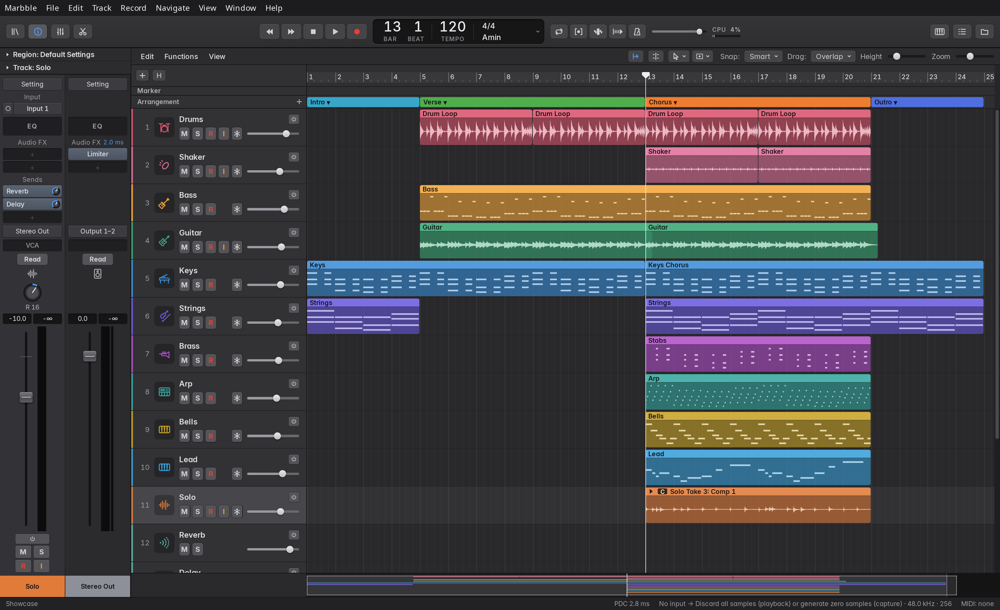

The window is laid out like Logic Pro 12:

| Area | Where | Show or hide |
|---|---|---|
| Control bar | top | always |
| Library | far left | Y |
| Inspector | left of the track headers | I |
| Tracks area | centre | always |
| Mixer, Editors, Event List or Step Sequencer | bottom (one at a time) | X (Mixer), E or P (Editors), D (List Editors); the Step Sequencer from its tab or a pattern region |
| Browser (All Files) | right | F |
| Status line | bottom edge | always |

Drag the dividers between panes to resize them; double-click a divider to reset it. Pane
sizes are remembered. The bottom section never takes the whole window: the Tracks area keeps
its bar, ruler, global tracks, overview and a little of the track list, so the divider stays in
reach.

### Control bar

From left to right:

- **Library, Inspector, Mixer, Editors** buttons.
- **Transport:** Rewind (`,`, to the previous bar line), Forward (`.`, to the next bar line),
  Stop, Play (Space), Record (R). Stop while stopped returns to the left locator when Cycle is
  on, otherwise to the start, and the Tracks area and the open editor scroll sideways to show
  it if it's off screen. Other jumps (Go to Beginning, Rewind, Forward, markers) leave the view
  where it is; **Scroll to Playhead** (the button beside Catch, or Alt+\`) brings the playhead
  into view.
- **The LCD:**
  - **BAR / BEAT:** the playhead position. Drag vertically to move the playhead by bars.
  - **TEMPO:** drag vertically to change it, or double-click to type a value (Enter applies,
    Esc cancels).
  - **Time signature:** click for 2/4, 3/4, 4/4, 5/4, 6/8, 7/8, 9/8 and 12/8.
  - **Key:** click for the major and minor keys.
  - The **chevron** offers "Beats & Project", "Time" (the position as time) and
    "Project Settings…".
- **Mode buttons:** Cycle (C), **Autopunch** (Ctrl+P, Control+⌘P on macOS), **Replace** (red
  when on: recordings replace what they overlap; see [Overlapping recordings](#recording-audio);
  the key command Replace Mode has no key at first), **Count-in** (Shift+K), Metronome (K).
  They are icons (Count-in's is four beats and a play arrow); hover over one for its name and
  key.
- **Master volume** slider, and the **CPU** meter if Settings › Appearance › **CPU Meter** puts
  it here (by default it's in the [status line](#status-line)). See [the CPU meter](#the-cpu-meter).
- **Musical Typing** (Ctrl+K), **List Editors** (D, the Event List) and **Browsers** (F) buttons.

### Tracks area

- **Local menu bar:** Edit, Functions and View menus; on the right, the **Catch** button
  (\`, on by default: the view follows the playhead), **Scroll to Playhead** (shows the
  playhead without moving it), the **Left-click Tool** and **Ctrl-click Tool** pop-ups (see
  [Tools and the marquee](#tools-and-the-marquee)), the **Snap** pop-up (Smart, Bar, Beat,
  Division, Ticks, Off; Smart follows the zoom), the **Drag** pop-up (see
  [Drag modes](#drag-modes)), the **Height** slider (track height) and the **Zoom** slider.
- **Ruler**, from the top:
  - the **cycle strip** (yellow): drag to make a cycle range, drag it or its edges to move or
    resize it, click it to switch Cycle on and off;
  - the **bar numbers**: click or drag to move the playhead. Grab the playhead's head (anywhere
    near it) to drag it from where it is, without it jumping to the pointer; a click on the head
    leaves it in place;
  - the **Autopunch strip** (red): works like the cycle strip, for the punch range;
  - the **marker lane** (see [Markers](#markers)).

  Right-click the cycle strip, the bar numbers or the Autopunch strip for **Move Playhead
  Here** and **Create Marker Here** (at the click, snapped to beats at least), **Cycle** (C),
  **Autopunch**, **Set Locators by Regions** (U) and **Snap**. The marker lane has its own menu.
- **Track headers:** colour, number, icon, name with the power button
  ([On/Off](#turning-tracks-off), grey while the track plays) at its end, the M (Mute), S (Solo), R
  (Record Enable, audio and instrument tracks), I (Input Monitoring, audio tracks) buttons, the
  Freeze (snowflake) button, a group badge, and a volume slider with the track's level meter in its
  line. Short tracks put it all on one line (see below). The **+** button above the headers opens
  New Tracks; the **H** button turns on hide mode. Under them, level with the ruler's marker lane,
  is the **Marker** row. A muted track's regions are drawn grey, as a muted region is; a track that
  is off is dimmed.
- **Tracks:** regions on lanes. Scroll with the wheel (Shift+wheel or a sideways trackpad swipe
  scrolls through time); Ctrl+wheel zooms horizontally around the pointer, Alt+wheel changes
  track heights. With a mouse that has only a vertical wheel, set Settings › Editing › Mouse
  Wheel Scrolls to **Horizontally (time)**: the wheel then scrolls through time and Shift+wheel
  scrolls the tracks. Over the track headers the wheel always scrolls the tracks, and over the
  ruler and global tracks it always scrolls through time. A click without a drag on empty space
  in a lane also moves the playhead there (snapped to the grid); clicking a region only selects
  it. Settings › Editing › Click Moves Playhead sets this: **Anywhere in the tracks** (regions
  too), **Empty space only** (the default) or **Never**.
- **Overview:** the strip along the bottom, in place of a horizontal scroll bar, shows the
  whole project in miniature: a row per track (a closed stack is one row), each region as a
  bar in its colour, the cycle range and markers along the top edge, the playhead, and the end
  of the last region, with the timeline after it shaded darker. The lit box is the part shown
  in the Tracks area.
  - Drag the box to scroll, across and up or down.
  - Click outside the box to centre the view there; keep the button down to go on dragging.
  - Drag the box's left or right edge to zoom: the view shows the time between the edges
    (within the usual zoom limits).
  - The wheel scrolls through time (Shift+wheel scrolls the tracks); Ctrl+wheel zooms around
    the pointer when it's over the box, otherwise around the middle of the view.
  - View › Show Overview (in the main menu bar or the Tracks area's View menu), or right-click
    the strip, hides it and brings back the scroll bar; the same menu item, or a right-click on
    the scroll bar, shows it again. The choice is remembered.

Track headers:

- **Select** a track by clicking its header; Ctrl+click adds or removes a track; Shift+click
  selects a range. Up and Down select the track above or below, scrolling it into view.
- **Rename** by double-clicking the name.
- **Track icon:** click the icon (or right-click › **Track Icon**, the icon on the track's Mixer
  strip, or the Track inspector's **Icon**) for a grid of icons by group: the track types',
  drums (kick, snare, hi-hat, toms, overheads, room, kit, drum machine), percussion, bass,
  guitars and amp, keys, strings, brass, woodwinds, vocals, and effects and buses. The arrow
  keys move through it and Return chooses. The icon goes on every selected track when the one
  you clicked is selected; Edit › Undo takes it back. **Default** gives the track the icon its
  name suggests: a name with a word such as Kick, Snare, Hat, Tom, OH or Overhead, Room, Drums,
  Bass, Gtr or Guitar, Amp, Keys or Piano, Organ, Synth, Strings, Brass, Sax, Vox or Vocal, BV
  or Choir, Verb, Delay or FX shows that instrument's icon ("Kick In 2", "OH L", "Lead Vox"),
  and changes with the name until you choose one. Other tracks show their type's icon. The icon
  is saved with the track, copied by Duplicate Track and kept by templates; channel strip
  settings leave it alone.
- **Reorder** by dragging the header anywhere that isn't a control: the name, the number, the
  icon or empty space (the buttons, the volume slider and a name being edited keep their own
  presses). A track dropped among a stack's subtracks (or right under an open stack's header)
  goes into that stack.
- **Resize** by dragging the header's bottom edge. Alt-drag resizes every track, and
  double-clicking the edge resets the track. Ctrl+Down and Ctrl+Up (or Alt+wheel, or View ›
  Taller / Shorter Tracks, or View › Track Height: Mini, Compact, Small, Medium, Large, Extra
  Large) change all tracks. Tracks go from 22 to 260 px; heights are remembered per project.
- **Short tracks:** from 52 px up the name sits above the buttons. Below that the header is a
  single line with a smaller icon (32 to 51 px), or without the icon and in a smaller size
  (below 32 px). The M, S, R, I and Freeze buttons then move into the **⋯** menu, which lists
  them with check marks (and their keys), plus the lane's parameter while automation is shown.
  A switch that is on stays in the header, so a muted, soloed, armed, monitored or frozen track
  still shows it; click it to turn it off.
- **With Show Automation on** (A), headers 76 px or taller add a line with the automation mode,
  the lane's parameter and a **+** for another lane. On shorter headers these take the volume
  slider's place (the mode and + above the parameter), so M, S, R and I stay where they are;
  the lane itself, the Inspector's strip and the Mixer still set the volume.
- **Button columns:** each button has its column, the same on every header, with a gap where a track
  has no such button (an instrument track has no I, an aux no R, I or Freeze). On one-line headers
  the columns are those of the switches that are on somewhere, so one track's M lines up with
  another's. Regions on short tracks get a slimmer name bar, and on tracks below 32 px a region is a
  bar of its colour with just its name, centred: no waveform, notes or fades. Its edges still trim
  it. An open take folder's take rows keep showing their takes.
- **Volume:** drag the slider (Shift for fine), double-click or Alt-click it for 0 dB; its tooltip
  shows the level. In a group with volume linked, the other members follow. The meter in the line is
  post-fader and on the slider's own scale, so a full-scale signal reaches the thumb and only a
  hotter one passes it; peaks are held for 2 s, in red above 0 dBFS. Its right end lights red while
  the track's clip indicator is on (see [The channel strip](#the-channel-strip)). A folder stack's
  slider has no meter (it moves every subtrack).

### Inspector

The Inspector shows a **Region** section (mute, position, length, loop, the
[playback parameters](#region-playback-parameters), and for audio regions gain and the
[fade rows](#fades-and-crossfades)) and a **Track** section, both collapsed by default, followed
by the selected track's channel strip and the Stereo Out strip.

- **Length** is in bars, beats, divisions and ticks counted from zero, like the Event List, the
  Audio Track editor and the help tags while dragging (4 0 0 0 is four bars), with the time in
  minutes and seconds after it. Position is in bars and beats counted from one, as on the LCD.
- The **Track** section has the track's **Name** (type a new one and press Return; Esc puts
  the old one back), **Color** (click the swatch for the colour grid), **Icon** (click it for
  the icon grid; see [Track headers](#tracks-area)), type, **Input** (audio
  tracks: a pop-up, as on the channel strip) or instrument, **Output** (a pop-up: Stereo Out,
  the stack, or an aux), **Freeze** (as the snowflake button), on an instrument track its
  [MIDI settings](#track-midi-settings) (Transpose, Velocity, Key Limit, Vel Limit and Delay),
  the region or subtrack count and the group. Choosing a track (its header, its Mixer strip, a right-click on its empty
  lane, or Up and Down) deselects the regions on other tracks, so both sections describe the
  same track.

### Library and Browser

- **Library (Y):** the plug-ins for the selected track. For an instrument track it lists
  instruments (the built-in ones by group, then plug-ins by vendor) and loads into the instrument
  slot; for other tracks it lists Audio FX and loads into the first free insert slot. Search
  with the field at the top; **Rescan** rescans plug-ins.
- **Browser (F)**, "All Files": browse folders (double-click to open, the up button for the
  enclosing folder). Drag audio files into the tracks area, or double-click one to import it at
  the playhead on the selected audio track.

### Status line

The project name ("Edited" when there are unsaved changes), the plug-in delay compensation
status, the audio devices, and the number of MIDI inputs. At the right end:

- the **CPU** meter (unless Settings › Appearance puts it in the control bar), see
  [the CPU meter](#the-cpu-meter); before it, in red, how many blocks ran late since you last
  cleared it ("3 late"; click to clear);
- the **memory** Marbble has in RAM ("2.8 GB"), plug-ins and decoded audio included, updated
  every two seconds;
- the **threads** playing tracks right now.

Hover over a figure for what it means; click one to open the
[Diagnostics window](#the-diagnostics-window).

### The menu bar

| Menu | Items |
|---|---|
| Marbble | About Marbble (shows the version), Settings…, Appearance…, Key Commands…, Control Surfaces › (Learn Assignment for Last Touched Parameter, Controller Assignments…), Quit Marbble (Ctrl+Q) |
| File | New…, Open Recent…, Open…, Save, Save As…, Save as Template…, Revert to Saved, Revert to ›, Project Alternatives ›, Project Settings…, Import Audio File…, Bounce Project or Section…, Export Selected Tracks as Audio Files…, Export All Tracks as Audio Files…, Import MIDI File…, Export Selection as MIDI File… |
| Edit | Undo, Redo, Cut, Copy, Paste, Paste at Original Position, Paste Replace, Duplicate, Repeat › (Once to 16 Times), Split Regions at Playhead, Join Regions, Join Regions per Track, Loop Regions, Convert Loops to Real Copies, Pack Take Folder, Set Locators by Regions, Strip Silence…, Section Between Locators ›, Trim ›, Move ›, Name and Color ›, Snap Edits to Zero Crossings, Select All, Select ›, Delete (see [Arranging commands](#arranging-commands)) |
| Track | New Tracks…, New Aux, Duplicate Track, New Track with Same Settings, New Pattern Region, Bounce in Place…, Freeze Track, Unfreeze Track, Track On, Drum Replacement/Doubling…, Create Folder Stack, Create Summing Stack, Group Selected Tracks, Show Output Track, Hide Track, Unhide All Tracks, Delete Track, Delete Unused Tracks, Track Alternatives › |
| Record | Play / Stop, Record, Discard Last Recording, Cycle, Autopunch, Metronome, Count-in, Low Latency Mode |
| Navigate | Create Marker, Delete Marker, Go to Previous Marker, Go to Next Marker, Open Marker List |
| View | Library, Inspector, Mixer, Editors, List Editors, Browsers, Show Automation, Show Used Automation, Show Global Tracks, Show Overview, Musical Typing, Step Input Keyboard, Show Hidden Tracks, Zoom In, Zoom Out, Larger Interface, Smaller Interface, Actual Size, Theme › |
| Window | Minimize, Mixer in Separate Window, Editor in Separate Window, Event List in Separate Window, [Diagnostics](#the-diagnostics-window), then the open windows (the main window and each [separate window](#separate-windows)): choose one to bring it to the front |
| Help | Marbble User Guide, Key Commands…, What's New in Marbble, Check for Updates…, Report an Issue…, Marbble Website. Key Commands opens Settings › Key Commands; Check for Updates… asks GitHub whether a newer version is out on your [update channel](#general) and says what it found; the others open this guide, the changelog, a new issue on GitHub and the website in your browser |

Each item shows its key beside it, as set in Settings › Key Commands. (On macOS the menu holds
those keys only while it's open, so a key typed in a text field always reaches the field.) Settings and modes that
are on are ticked, and items that don't apply are greyed out, as in the Tracks area's menus (Cut
or Delete with no regions selected, Paste with nothing copied), as is a submenu whose items all
don't apply. One-of-several choices (View › Theme, File › Project Alternatives) show a round
radio mark on Linux. The Edit menu is the Tracks area's Edit menu, item for item, with the same
names; a region's right-click menu drops "Regions" from them (Split at Playhead, Join, Loop,
Set Locators). **Quit Marbble** (Ctrl+Q) closes the main window as its close button does,
so it asks first when the project has unsaved changes.

The Edit menu acts on what has focus. In the Piano Roll, Cut, Copy, Paste, Duplicate, Delete
and Select All act on notes, and Edit › Select's All Following, Inside Locators, Muted, Same
Colored, Equal and Invert Selection (and their keys) select notes, as in Logic; in the Event
List they select events (see [Edit menu](#edit-menu)). In the Audio Track Editor with a range
selected, Cut, Copy, Delete and Split act on the range. While a bounce is rendering, menu
commands are ignored.

**Sheets and key commands.** While a sheet is open (Strip Silence, Group Settings, a name or
value to type, Settings, Bounce…), key commands don't reach the tracks or editors behind it,
even after you click one of its sliders or buttons: **Esc** closes it and **Return** presses
its default (highlighted) button. Controller Assignments is the exception, as Logic's window
is: Learn Assignment (Ctrl+L), Controller Assignments (Shift+Ctrl+L) and the transport keys
still work while it is open, while editing keys (Delete, Cut, Paste…) don't.

### Using the keyboard

**Tab** moves the keyboard focus through the window's buttons and controls (Shift+Tab goes
back), and a blue ring shows where it is. The ring appears only once you press Tab, never
after a click.

**Knobs, faders and sliders** take the keyboard once they have the focus: the channel strip's
fader, pan knob and send knobs, the track headers' volume sliders, the master volume, VCA
faders and the knobs of the built-in effects.

| Key | Does |
|---|---|
| Up or Right arrow | Raises the value one step (a hundredth of the travel); Shift for a tenth of that |
| Down or Left arrow | Lowers it one step; Shift for a tenth of that |
| Page Up / Page Down | Ten steps up or down |
| Home / End | The lowest or highest value (a fader: -∞ or +6 dB) |

A key change is like a short drag: it writes automation in Touch and Latch, and a run of
presses on one control undoes as one step. Key commands with Ctrl, Alt or Cmd still reach the
app. Screen readers hear each control's name and value ("Volume, -6.0 dB", "Pan, L 12"), and
the buttons that show only an icon read their tooltip.

Tooltips show when the pointer rests on a control for a moment, and at once as you move along
to the next one; a click, the scroll wheel or a key press puts them away. With Tab, the focused
control shows its tooltip too.

Once Tab has moved the focus, **Return** and **Space** press the focused button instead of
going to the beginning and playing, and the slots and lists below take their keys. After a
click they are key commands again.

**Channel strip slots** (Setting, Input, the Channel EQ, Audio FX, Sends, Output and VCA, in the
Mixer and the Inspector) are Tab stops too:

| Key | Does |
|---|---|
| Return or Space | What a click does: opens the plug-in's panel or editor, or the slot's menu |
| Alt+Down | Opens a filled plug-in slot's menu (the arrow beside its name) |
| Delete or Backspace | Empties the slot: No Plug-in for a plug-in, Remove Send for a send (undoable) |
| Up / Down arrow | The slot above or below in the strip |
| Menu key or Shift+F10 | The slot's right-click menu |

A plug-in slot's power button and a send's level knob come next in the Tab order.

**Menus** work from the keyboard: Up and Down move through the items (Home and End to the ends),
typing a name's first letters goes to it, Right opens a submenu and Left or Esc closes it,
Return or Space chooses, and Esc or Tab closes the menu. Opened from the keyboard, a menu starts
on its checked item or its first; opened with the mouse, the arrows step into it. Closed from
the keyboard, the focus goes back to what opened it.

**The Tracks area** (where the regions are) is a Tab stop too. While it has the focus, Left and
Right select the region before or after on the selected track (Up and Down still select the
track), and Return opens the selected region in its editor, as a double-click does.

A sheet (the Marker List, Project Alternatives, the Project Chooser, Settings, Bounce…) takes the
focus as it opens, as a dialog does, so the next Tab goes to the first control in it; closing it
gives the focus back to what had it. Controller Assignments, which leaves the transport keys to
the window, doesn't.

**Lists** are one Tab stop each, landing on the selected row: the Library's plug-ins, the Project
Chooser's recent projects, Project Alternatives and the Marker List.

| Key | Does |
|---|---|
| Up / Down arrow | The row above or below (it selects it, except in the Library) |
| Home / End | The first or last row |
| Letters | The next row whose name starts with them, as in a menu |
| Return or Space | What a click or double-click does there: loads the plug-in, opens the project, switches to the alternative, goes to the marker |
| Delete or Backspace | Removes the row where the mouse can: a recent project from the list (as ×), an alternative (as Delete…, which asks first), a marker (undoable) |
| Esc | Closes the sheet the list is in |

In the Marker List, Tab goes on from a row into its name, length and buttons, and then out of the
list.

### Separate windows

The Mixer, the Editors, the Event List, the Step Sequencer and the built-in effect panels (the
Channel EQ's included) can each have a window of their own, for example on a second monitor.

- **Open in Separate Window:** click the pop-out button at the right end of the panel's bar
  (the Mixer's, the Piano Roll's, the Audio Track Editor's, the Event List's or the Step
  Sequencer's), or in an effect panel's title bar, docked or floating. Window ›
  Mixer in Separate Window, Editor in Separate Window and Event List in Separate Window do the
  same, and the Piano Roll's, Audio Track Editor's and Event List's View menus have the item too.
- **Attach to Main Window:** the same button in the separate window (pop-in), the same menu
  items, or the window's close button. The Mixer, the Editors, the Event List and the
  Step Sequencer go back to the bottom section; an effect panel opens in the main window as
  Settings › General › Open Effect Panels says (docked or floating).
- **One place at a time:** while a panel has its own window, it isn't shown in the main window.
  X (Mixer), E (Editors), an insert slot or a Channel EQ thumbnail bring its window to the
  front instead (with Open Effect Panels set to Separate windows, the slot or thumbnail closes
  it).
- **Effect panels in separate windows by default:** Settings › General › Open Effect Panels ›
  Separate windows opens every built-in effect panel in its own window.
- **Everything stays live.** Meters, the playhead, the selection (the editor follows it), the
  theme, the interface size, the settings and the clipboards (regions, channel strip settings
  and plug-ins: copy in a separate Mixer, paste in the main window) are the same in every
  window. Key commands and the menu bar work there as in the main window; the Edit menu acts on
  the separate window's editor while it is in front.
- **Effect panels opened from a separate Mixer** (clicking an insert slot there) float inside
  the Mixer's window.
- An effect panel's own × (or Esc) closes it altogether, window and all. So does removing the
  effect or deleting the track.
- **Remembered:** each kind of window (the Mixer, the Editors, each type of effect) reopens
  where it was last, with its size, on the same monitor if it is still connected (otherwise on
  the nearest one, moved and shrunk to fit). The Mixer, the Editors, the Event List and the Step
  Sequencer reopen in their own windows at the next launch if they were detached when Marbble
  quit. Separate windows close with the main window.

---

## 3. Recording

### Recording audio

1. Create an audio track (Track › New Tracks…, Ctrl+Alt+N, type **Audio**), or use the Record
   Audio template.
2. Choose the input in the channel strip's **Input** slot: the mono/stereo button and the input
   pop-up ("Input 1", "Input 1–2"...).
3. Record-enable the track with **R** in its header (or Ctrl+R, Control+R on macOS, for the
   selected track).
4. Press **R** (or Shift+R, or the Record button). Press R again, or Space, to stop.

- Recording while playing punches in on the fly.
- Recordings are WAV files in the project's `Audio Files/` folder, named after the track and
  take number ("Vocals#03.wav"; see Settings › Recording › Take Names). The format is 32-bit
  float by default, or 24-bit (Settings › Recording, or per project in Project Settings).
- Regions draw live while you record.
- A record-enabled audio track is silent while recording (you hear its input only if it is
  monitored), so you don't hear the old take over the new one.
- A frozen track can't be record-enabled.

**Overlapping recordings** (Settings › Recording › Overlapping Recordings › Audio) says what a
new take over existing regions does:

- **Create take folders** (the default, as in Logic): the regions it overlaps are packed with the
  new take into a take folder, and a recording over a take folder adds a take to it. The new take
  is heard wherever it has audio; the older takes keep playing where it has none (a punch-in
  part-way over a region, say). Each armed track gets its own folder. Muted and looping regions
  are left as they are. One Undo takes the whole recording back. See
  [Take folders and comping](#7-take-folders-and-comping).
- **Put the new take on top:** the older audio stays underneath and is hidden where the new one
  plays.
- **Create a new track:** the take goes on a new track below with the same settings.
- **Replace what's underneath:** the older regions are trimmed; their files are kept.

Settings files from before Create take folders existed keep putting takes on top until you
choose otherwise. MIDI has its own setting (see [Recording MIDI](#recording-midi)).

The **Replace** button in the control bar (beside Autopunch) works like Logic's: while it is on,
every recording replaces what it overlaps, audio and MIDI alike, whatever the two Overlapping
Recordings settings say.

A newer region always hides the older audio it overlaps during playback, as in Logic. The
older regions are not deleted; move or trim the newer one to hear them again. Regions that
crossfade are the exception: both play across the crossfade.

### Discarding and marking takes

- **Discard Last Recording** (Ctrl+., also in the Record menu) throws the last recording away: it
  stops first if you are still recording, takes the recording off every track it went to, and
  returns the playhead to where playback started. Each track goes back to how it was before, regions
  packed into a take folder included. On a track you have edited since, only the recorded take goes.
  It is one Undo step. The audio files are deleted once nothing can bring them back: when you save
  with no undo step left that needs them, or when you close the project (unless the saved project
  still uses them).
- **Mark Take as Good** (Alt+G) and **Mark Take as Bad** (Alt+B): pressed
  while recording, they mark the take being recorded, which lands marked. After recording they
  mark the newest take of the last recording on each track it went to; with that gone, the take
  heard in the selected take folders. A recording over nothing becomes a take folder of one take
  so it can carry the mark. In a cycle recording the newest pass is the one marked.

### Count-in and pre-roll

- **Count-in** (the control bar's Count-in button, or Shift+K) plays the click for 1 to 4 bars
  before recording (Settings › Recording › Count-in), even with the metronome off.
- With Count-in off, **Pre-roll** (Settings › Recording, in seconds, 0 by default) starts
  playback that far before the playhead so you hear a lead-in; recording still starts at the
  playhead.

### Cycle recording

With **Cycle** on, recording starts at the left locator (or carries on if you are already
playing inside the cycle) and loops. When you stop, the passes become **takes in a take
folder** ("Take 1", "Take 2"...). A last pass stopped part-way is kept if it got at least a
beat in. Recording the same cycle range again adds its passes to the same folder. A single pass
becomes a normal region (or, with Create take folders, a take in the folder of what it
overlaps). Passes over other audio join it the same way, as
[Overlapping recordings](#recording-audio) describes.

MIDI recorded in cycle mode goes into one region over the passes, unless Settings › Recording
› Overlapping Recordings › MIDI is set to Create take folders (see
[Recording MIDI](#recording-midi)).

### Autopunch

Autopunch records only between the punch-in and punch-out points, so you can start playback
early and replace just a phrase.

- Turn it on with the Autopunch button next to Cycle (Ctrl+P, Control+⌘P on macOS). With no range
  yet, it takes the cycle range, or the two bars from the playhead.
- The range is the red strip in the ruler: drag in the strip to set it, drag it or its edges to
  move or resize it, click it to turn Autopunch off and on.
- While recording, armed tracks keep playing their regions before and after the range, and
  input is captured only inside it. The take is trimmed exactly to the range, after latency
  compensation. MIDI notes that start outside the range are dropped, and none lasts past the
  punch-out.
- With Cycle on as well, every pass is punched and the takes go into a take folder over the
  punch range.
- Recording refuses to start when the playhead is past the punch-out, or when the punch range
  is outside the cycle.

### Recording MIDI

Arm an instrument track and record as for audio. MIDI goes to the selected instrument track
(or, if the selected track isn't one, the first armed instrument track). Notes, controllers,
pitch bend and aftertouch are recorded into a region that spans whole bars. Notes still held
when you stop end at the stop position. Settings › Recording › Overlapping Recordings › MIDI
says what happens over an existing MIDI region:

- **Create a new region** (the default): the recording is a region of its own, on top.
- **Merge into the existing region:** the notes and controllers go into the region they
  overlap, which grows to hold them.
- **Replace in the recorded range:** from where recording started (or the punch-in) to where
  it stopped, the notes and controller events of the regions underneath are removed and the
  recording is merged in their place. A note that started earlier is shortened to end where
  recording started, and a controller that changed inside the range gets its old value back
  after it, so what follows plays as before. A region left empty inside the range is removed.
  In cycle mode the whole cycle (narrowed by Autopunch) is replaced. A recording in which
  nothing was played changes nothing. The **Replace** button in the control bar does the same.
- **Create take folders:** each pass of a cycle recording becomes a take, and a recording over
  MIDI regions packs them into a take folder with the new take (see
  [MIDI take folders](#7-take-folders-and-comping)).

### Latency compensation

Marbble measures the input and output latency of the devices while running and moves every
recording earlier by the round trip, so it lines up with what you heard:

- audio is moved by input latency + output latency + the audio waiting in Marbble's input
  buffer + the manual **Recording Delay** (Settings › Audio, -500 to 500 ms, positive moves
  recordings earlier) + the plug-in delay compensation total;
- MIDI is moved by the output latency plus the plug-in delay compensation total.

Settings › Audio shows the measured values and the total shift. If recordings still land
early or late (some drivers misreport latency), record a click or a clap through a cable and
adjust Recording Delay.

---

## 4. Software instruments and Musical Typing

- Create an instrument track (New Tracks › **Software Instrument**). Its **Instrument** slot
  holds Marbble Synth by default, a built-in polyphonic synthesizer that responds to pitch bend,
  sustain, modulation (vibrato) and expression. Choose another built-in instrument (see
  [Marbble Sampler](#marbble-sampler), [Marbble Tre](#marbble-tre) and
  [the other synth models](#the-other-synth-models)) or a VST3 instrument in the New Tracks
  dialog, the Library, or the strip's Instrument slot.
- **MIDI input:** every connected MIDI input is routed to the selected instrument track (if
  the selected track isn't an instrument track, to the first armed one). Devices plugged in
  later are picked up within a few seconds. Settings › MIDI switches individual inputs off,
  turns MIDI Thru off (MIDI is then recorded but not played, for keyboards with their own
  sound) and sets a velocity curve.
- **VST3 instruments** receive controllers and pitch bend through their MIDI mapping.

### Marbble Sampler

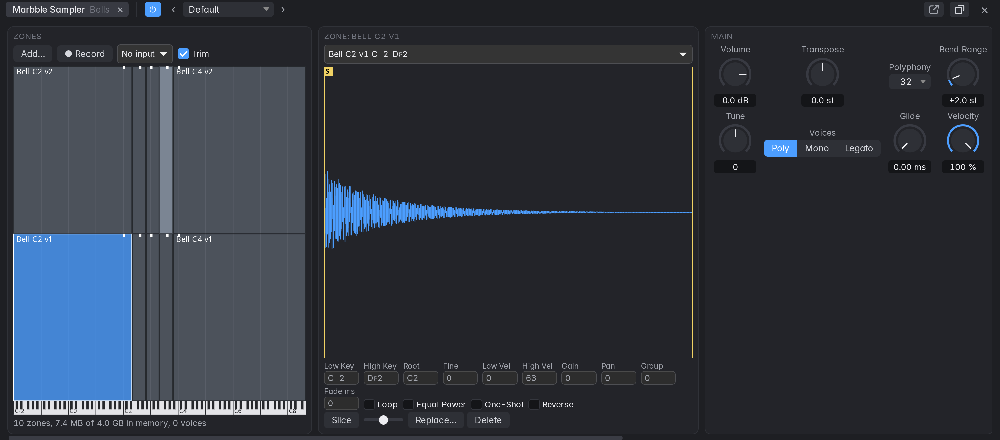

Your own instrument from your own sounds. Put **Marbble Sampler** on a software instrument
track from the instrument slot, the New Tracks dialog or the Library (under Samplers). Its panel
docks at the bottom: zones on the left, the selected zone's waveform and settings next, then the
instrument's sections in a row, scrolling sideways if the dock is narrow. It has been tested by
measurement only: nobody has listened to it yet.

**Getting a sound in**

- **Drop a file on the panel,** or choose **Add…**. One file takes the whole keyboard, with its
  pitch on C3 unless its name or file says otherwise, and plays right away. Dropped on the zone
  map, it sits on that one key.
- **Several files at once** map themselves when every one has a note in its name (`Piano_C3`,
  `Bass F#2`, with C3 as middle C), splitting the keyboard between them. Files on the same note
  become velocity layers, ordered by a layer in the name (`v1`, `v2`, or `pp`, `mf`, `ff`), and
  `rr1`, `rr2` become round-robin turns. Otherwise they go up one key each.
- **Record:** choose an input, press **Record**, play or sing, and press **Stop**; the zone is
  playable at once. The transport doesn't start, and you don't hear the input through Marbble
  meanwhile. **Trim** moves the zone's start and end in past the silence (the file keeps
  everything). A silent take is refused, with a message.
- **From the arrangement:** an audio region's menu has **Convert to Sampler Track**. **Whole
  Region** puts the region on one key, with a MIDI note playing it where it was, and mutes the
  original. **Slice at Transients** gives each hit its own key from C1 up, with MIDI playing
  them in time, so you can rearrange them. The region's gain comes along; its fades and playback
  parameters don't.
- **An SFZ file:** drop or choose it, and it replaces the zones. Marbble reads regions, groups,
  key and velocity ranges, loops, tune, volume, pan, envelopes and sequence positions; anything
  else (filters, key switches, release samples…) is ignored and listed under the zone map.
  SoundFonts (.sf2) aren't read.

**Building an instrument**

- **The zone map** has keys across and velocity up. Drag a zone to move it (with its root), or
  its edges to change its keys and velocities. Play the keys under the map to try it. Red zones
  can't play.
- **The waveform:** drag **S** and **E** for where the zone starts and ends, **L** and **R** for
  its loop. Scroll to zoom, double-click to see all of it. The loop is shaded, its crossfade
  drawn as a wedge.
- **The zone's settings,** next to its waveform: key and velocity ranges, **Root**, **Fine**
  (cents), **Gain**, **Pan**, **Group** (zones with the same round-robin number on the same key
  and velocity take turns), **Loop**, **Fade** (the loop's crossfade in ms, blending in audio
  from before the loop's start, so it needs some there), **Equal Power** (for a loop whose two
  sides don't line up; leave it off for anything with a pitch), **One-Shot** (plays to its end
  whatever the key does, until the song stops) and **Reverse**.
- **Slice** cuts the selected zone at its transients, one per key from C1. The slider sets how
  easily it finds a hit.
- **The sections** apply to the whole instrument: **Main** (volume, tune, Poly, Mono or Legato,
  polyphony up to 64, glide, bend range, velocity), **Amp Envelope**, **Filter** with **Filter
  Envelope**, and **LFO** to pitch and filter, free or synced, with the mod wheel adding
  vibrato. They automate and learn MIDI as any plug-in's do. An SFZ's zones keep their own amp
  envelopes.

**Keeping it**

- **Save Preset…** in the panel's preset menu saves the instrument with a copy of all its
  samples, in a folder of its own in `~/Music/Marbble Instruments`. It's then listed under User
  in every project, and loading it copies the samples into that project. Share the folder to
  share the instrument.
- **In a project,** samples are copied into its `Samples` folder when they arrive, so moving the
  project or deleting the original changes nothing (a library takes its size on disk again).
- **A missing sample** is named when the project opens and shows red in the panel; everything
  else plays. **Replace…** points its zone at another file, resetting the zone's start, end and
  loop.
- **Factory presets** shape the sound (a slow pad, a pluck, a filter) and leave your zones
  alone.
- **Channel strip settings and templates** keep a copy of the sampler's samples too, and loading
  one copies them into the project. So does copying the strip or the sampler and pasting it into
  another project.

**Limits**

Samples play from memory (no disk streaming), up to 4 GB for the session, about 6 hours of
48 kHz stereo; the panel shows how much is used. Past that a sample refuses to load and says
why, and the rest play. Files at any sample rate and bit depth play in tune. Full polyphony, 64
stereo voices, took about 10 % of one core in a test (27 % through the ladder filter); playing
far above a sample's pitch costs more.

### Marbble Tre

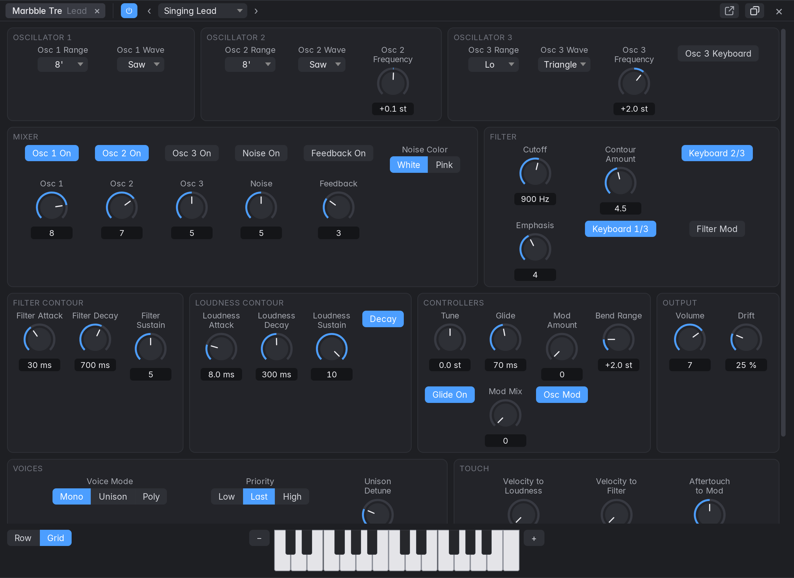

A three-oscillator monophonic synth modelled on a classic 1970s synth, the Minimoog Model D
(Marbble isn't affiliated with its maker, and this hasn't been compared with one). Choose it
under **Vintage Synths** in the instrument slot, the Library or New Tracks. Clicking the slot's
name opens its panel in the bottom section, whatever Open Effect Panels says, with the presets
in its header and a small keyboard along the bottom (− and + move it by octaves); the header's
button floats the panel. **Row** and **Grid**, beside the keyboard, lay the sections out in a
row (the short ones stacked; the mouse wheel moves along it) or in lines that fill the panel.
The bottom section starts with Row and a floating panel with Grid, and each remembers its
choice. A fade along the edge shows there is more to scroll to. Controls are named within their
section (Range under Oscillator 1); tooltips and automation lanes use the full name (Osc 1
Range). A light before a knob's name switches that part on and off (Osc 1 in the Mixer, Glide),
and one before a section's title the whole section (Onda's oscillators and filter, Sedici's
operators). Right-click a control for Learn MIDI Assignment. Everything on the panel is saved in
the project, can be automated in a lane, and undoes.

- **Oscillators:** a range (Lo, 32' to 2'), a wave, and for 2 and 3 a Frequency knob of ±7
  semitones. Turn Oscillator 3's **Keyboard** off and put it in **Lo** to make it an LFO.
- **Mixer:** a level for each oscillator and noise, with its switch in the light by its name. With
  two or three oscillators past about half way the sum overdrives the filter, which is how this kind
  of synth gets fat. **Feedback** sends the output back into the mixer for more.
- **Filter:** a 24 dB low-pass. **Emphasis** past 8 makes it whistle by itself, in tune when both
  **Keyboard** switches are on. **Contour Amount** is how far the Filter Contour opens it.
- **Contours:** Attack, Decay and Sustain, one for the filter and one for loudness. With the
  Loudness Contour's **Release** switch (the original's Decay switch) on, a released key fades at
  the Decay time; off, the note ends at once.
- **Controllers:** Glide, the pitch bend's range, and the modulation: **Mod Mix** blends osc 3 with
  noise, the mod wheel (and **Mod Amount**, which is where it rests) sets how much, and **Osc Mod**
  and the Filter's **Mod** say where it goes.
- **Voices** (not on the original): Mono is one note, the lowest key down, without restarting the
  contours when playing legato, as the instrument does. **Priority** and **Trigger** change those.
  **Unison** stacks voices on one note, with **Unison Detune** and **Stereo Spread**. **Poly** plays
  chords. **Touch** sets what velocity and aftertouch do; off to start with.
- **Drift** is how much each voice wanders and differs from the next. A render repeats exactly, and
  a duplicated track has its own differences.

**Presets:** the pop-up in the panel's header lists factory presets and yours. **Save As** keeps the
current sound as your own preset, in every project.

### The other synth models

Four more models of old instruments are under **Vintage Synths**, and a wavetable synth is under
**Modern Synths**. Each works like Tre: a panel, factory and user presets, automation, MIDI
learn, undo and saving. None has been compared with what it's modelled on, and Marbble isn't
affiliated with any of those makers.

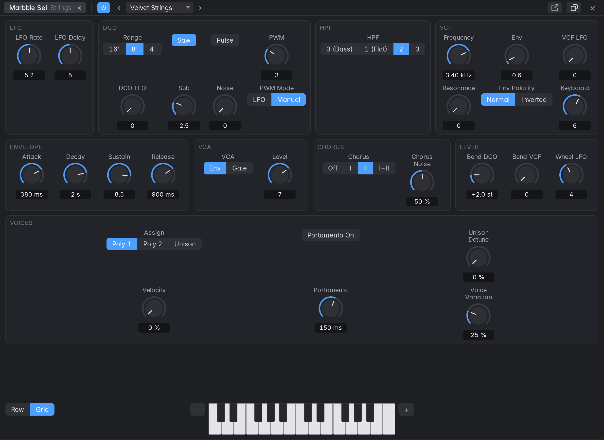

**Marbble Sei** (modelled on the Roland Juno-106 family): six voices of one oscillator each, with a
saw, a pulse and a sub an octave down.

- One envelope drives the filter and the **VCA** (set the VCA to **Gate** for an organ-like note).
  One **LFO** moves everything together, with a **Delay** from the first key down.
- **HPF:** position 0 lifts the bass, 1 is flat, 2 and 3 thin it.
- **Chorus:** the stereo chorus is half of its sound. **I** and **II** are slow and deep, **I+II**
  fast and shallow. **Chorus Noise** is its hiss, which comes with the notes.
- **Assign:** **Poly 1** moves on to the next voice, so released notes ring on, **Poly 2** takes the
  lowest free one, and **Unison** plays all six on one note (they don't beat unless you add **Unison
  Detune**).

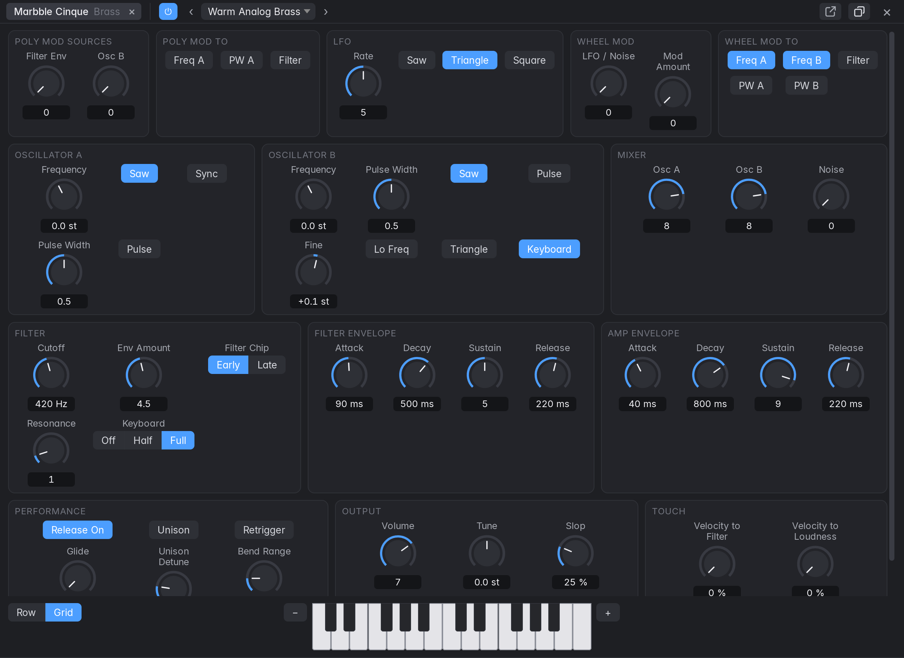

**Marbble Cinque** (modelled on the Sequential Prophet-5): five voices of two oscillators each.

- **Poly Mod** is what to try first: **Filter Env** and **Osc B** are its sources, and **Freq A**,
  **PW A** and **Filter** say where they go, separately in each voice. Osc B still runs with its
  mixer knob down, so it can be only a modulator. With **Sync** on Osc A and Filter Env into Freq A
  you get the sweeping sync lead this kind of synth is known for.
- **Wheel Mod:** the mod wheel (or **Mod Amount**, where it rests) brings in the LFO, or noise, by
  **LFO / Noise**, at whichever of the five switches are on.
- **Filter Chip** chooses between two filter characters. **Slop** is how much each voice wanders and
  differs.

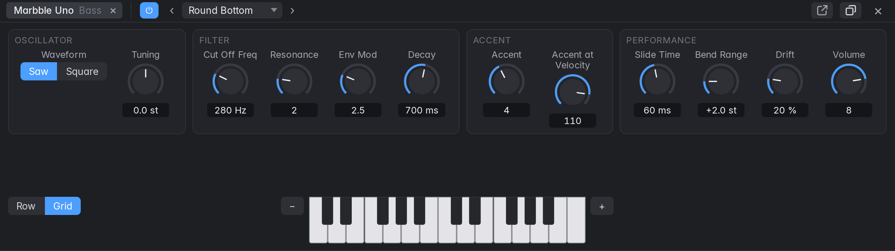

**Marbble Uno** (modelled on the Roland TB-303): one voice, one oscillator, and few knobs, made for
a bass line played from a MIDI region.

- **Overlapping notes slide:** make a note end just after the next begins. Neither the filter nor
  the volume restarts. With any gap between them, the next is a fresh note.
- **High velocity accents:** a note at or above **Accent at Velocity** (110) is louder and snappier,
  whatever Decay says. How far is **Accent**. With **Resonance** up, accents close together climb:
  that's the instrument's trick.
- The filter doesn't follow the keyboard, and a held note fades away by itself after a few seconds,
  as on the original.

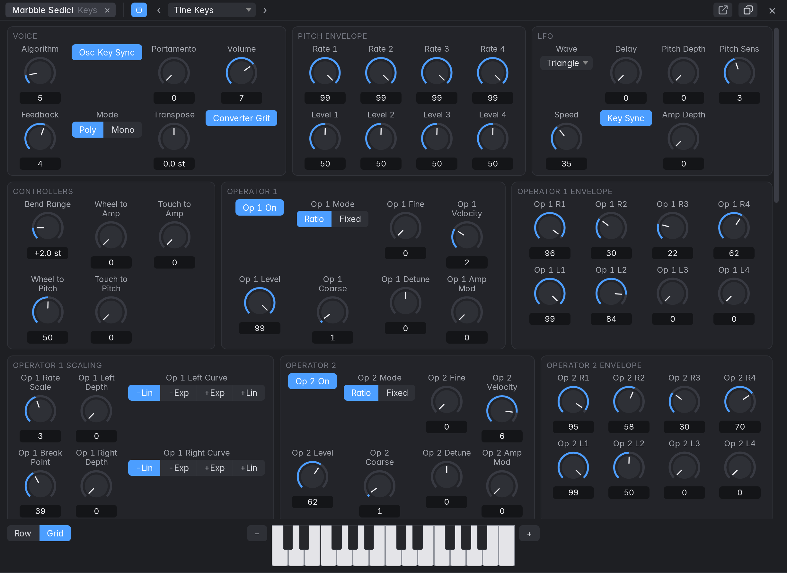

**Marbble Sedici** (modelled on the Yamaha DX7): sixteen voices of six-operator FM.

- **Algorithm** chooses which of the 32 ways the operators connect, numbered as on the original's
  panel. An operator that goes to the output is heard; others change its tone, more as their
  **Level** goes up.
- Each operator has its own envelope of four **Rates** and **Levels**: it runs to Level 1, then 2,
  then 3 and holds, and to Level 4 on key up. **Scaling** makes it louder, softer or faster across
  the keyboard.
- **Coarse** and **Fine** give a ratio to the note's pitch. **Feedback** makes an operator gritter
  or buzzier.
- **Converter Grit** turns the original's low-resolution sine and converter on or off. It runs at
  the original's own sample rate whatever your project's is, so high FM sounds fold just as they do
  there.
- **Level 4** above zero keeps a note sounding after key up, as on the original, until the transport
  stops.

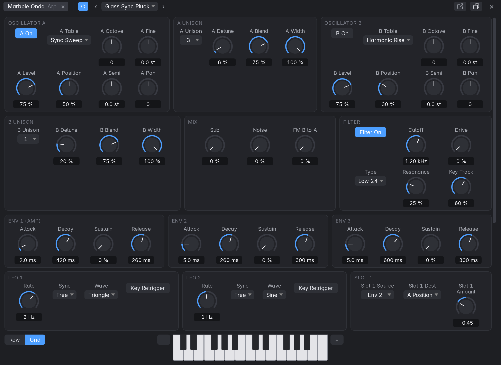

**Marbble Onda** (a modern wavetable synth): two oscillators reading tables made into it, with
position, unison, and modulation you route yourself.

- **Table** chooses the sound, and **Position** moves through it. Each oscillator has up to 7
  detuned **Unison** copies, spread in stereo by **Width**.
- **Type** chooses the filter. **Env 1** is the volume.
- **Env 2, Env 3, LFO 1** and **LFO 2** do nothing until a **Slot** routes them: choose a source, a
  destination and an amount. Slots can also take velocity, the key, the wheel and aftertouch.
  Positions and cutoff are the usual places to start.
- An LFO's **Sync** locks it to the tempo. **Key Retrigger** gives each voice its own, starting at
  the key.
- High settings are heavy: sixteen voices with seven copies in each oscillator is about a third of a
  core.

### Musical Typing

**Musical Typing** (View › Musical Typing, Ctrl+K, or the keyboard button in the control bar)
plays the selected instrument track from the computer keyboard. Keys are mapped by their
position, so it works on any keyboard layout:

| Keys | Plays |
|---|---|
| A S D F G H J K L ; ' | White keys from C up (A = C) |
| W E T Y U O P | Black keys (W = C♯, E = D♯, T = F♯, Y = G♯, U = A♯, O = C♯, P = D♯) |
| Z / X | Octave down / up (starts at C3) |
| C / V | Velocity down / up by 10 (starts at 100) |
| Tab (hold) | Sustain pedal |

- The four-octave on-screen piano can be clicked or swept; clicking lower on a key plays
  louder. The **Sustain** button latches the pedal.
- While the window is open these keys play notes instead of running their usual commands;
  combinations with Shift, Ctrl or Alt still work (Shift+S still selects similar regions).
  Typing in a text field, and type-ahead in an open menu or in a list the keyboard moved to
  (the Library, recent projects, Project Alternatives, the Marker List), are not affected.
- Notes played this way are recorded like notes from a MIDI keyboard. The MIDI velocity curve
  doesn't apply to them.
- With the Step Input Keyboard open, they are entered as steps too (see below).

### Step Input

The **Step Input Keyboard** (View › Step Input Keyboard, Shift+Ctrl+Alt+K, or the button with the
note and arrow in the Piano Roll's bar; Logic's ⌥⌘K opens the Marker List here) enters notes one
step at a time, as in Logic: each note goes in at the playhead, as long as the chosen note value,
and the playhead moves on by that value. Notes go into the track the Piano Roll shows (the selected
region's track, or the selected instrument track): into the region under the playhead, or one that
ends less than a bar before it (which grows), or else a new one-bar region. The transport must be
stopped.

- **Note value:** 1/1 to 1/128, with **Dotted** (half as long again) and **Triplet** (two thirds
  as long). Lengths follow the tempo map, so a quarter is a quarter whatever the tempo does.
- **Velocity:** ppp (16) to fff (127) for the on-screen keyboard. With **As Played** on (the
  default), notes from a MIDI keyboard or Musical Typing keep the velocity they were played
  with; off, they get the one chosen here.
- **Rest** moves on a step without a note. **Back** deletes the last step and moves the playhead
  back to it (a rest just moves back).
- **Chord:** notes held down together always go in as one chord, and the playhead moves on
  when every key is up. With Chord on, the playhead stays put after the keys are released, so
  you can click a chord in one note at a time; turn Chord off (or press Rest) to move on.
- **Sustain** lengthens the notes of the last step by one step and moves on.
- **Quantize** snaps the playhead to the step grid (counted from the bar line) before each step.
- The on-screen keyboard spans four octaves (− and + move it); click a key to enter a note.
- Notes from a **MIDI keyboard** and from **Musical Typing** are entered while the window is
  open, and still sound as usual.
- Each step is one undo step (a chord's notes share it). Move the playhead yourself at any time
  and steps continue from there. The notes just entered are selected.

While the window is open, **1** to **8** choose the note value (1/1 to 1/128), **9** Dotted,
**0** Triplet, **N** Rest and **Shift+Backspace** Back. Chord, Sustain and Quantize have key
commands without keys. All of them are in Settings › Key Commands › Step Input (see the
[key reference](#step-input-keyboard)).

---

## 5. Editing in the tracks area

### Selecting regions

- Click a region to select it; Shift+click adds or removes regions. Clicking empty lane space
  deselects. Ctrl+A (Edit › Select All) selects all regions.
- Double-click a region to open it in its editor: the Piano Roll for a MIDI region, the Audio
  Track Editor for an audio region, the Step Sequencer for a pattern region. With the Event
  List showing, a MIDI region stays in it.
- With a group whose Editing setting is on, clicking a region also selects the regions at the
  same place on the other members.
- Drag across empty lane space to draw a rubber band: every region it touches is selected.
  Shift+drag adds to the selection. A click without dragging still deselects.
- Right-click a region › Select › All on Track, All Following on Track, or All.
- Edit › **Select** picks regions by criteria (All Following, Inside Locators, Muted, Same
  Colored…); see [Arranging commands](#arranging-commands).
- Ctrl-drag draws a marquee, a time range across tracks, instead of
  selecting whole regions, while the Ctrl-click Tool is the Marquee (the default); see
  [Tools and the marquee](#tools-and-the-marquee).
- Alt-drag a selection to copy it: the originals stay put, the copies
  are drawn where they'll land and become the selection, and the copy is one undo step. Some
  Linux window managers use Alt+drag to move windows; if that happens, use Copy and Paste,
  Duplicate or Repeat, or change the window manager's modifier.

### Moving, trimming and snapping

The pointer changes over a region's hot zones:

| Where | Drag to |
|---|---|
| The body or the name bar | Move the region (and the rest of the selection). Drag up or down to move it to another track of the same kind. |
| Lower left or right edge | Trim the start or end (of every selected region: see below). |
| Top left or right corner, below the name bar (audio) | Set the fade-in or fade-out length. |
| Top right corner of the name bar | Set where a loop stops (see Loops). |
| The gain handle at the top centre of the name bar (audio, shown on hover) | Change the region gain (see Gain and reverse). |

- Moves, trims and loop ends follow the **Snap** setting (Smart, Bar, Beat, Division, Ticks or
  Off). **Division** is a quarter of a beat, the third number of the position display: a
  sixteenth in 4/4, a thirty-second in 6/8. **Ticks** is 1/240 of a division (960 to a beat).
  Smart snaps to divisions, beats or bars depending on the zoom. Fades are never snapped.
- **Trimming a selection:** with several regions selected, dragging one's start or end trims
  the same edge of each by the same amount, audio and MIDI alike, in one undo step. The region
  you drag snaps; the others follow it by as much, each stopping at its own limits (the start
  or end of its audio file, the project's start, a minimum length).
- **Across tempo changes**, a snapped move counts in bars and beats: the region you drag snaps
  to the grid where it lands, and the others in the selection keep their distance from it in
  bars and beats, so a region dragged from a 120 BPM section into a 90 BPM one still lands on
  its beat. Alt-drag copies do the same. With Snap off, the others keep their distance in time.
- **Drag below the last track** to make a new track: a dashed lane appears under the last track
  with the region on it, and on release a new track of the same kind (audio or software
  instrument) holds the region, with the source track's settings, as Move to New Track, but below
  every track and outside any stack. Each source lane of a selection that falls past the end gets
  its own track; regions still landing on tracks move as usual. Alt-drag copies do the same. It's
  one undo step, and the automation stays on the source track.
- A moved region comes to the front, so it plays over whatever it now overlaps.
- The **Drag mode** decides what happens to the regions an edit overlaps or leaves a gap
  between; see [Drag modes](#drag-modes).
- **Move Automation with Regions** (Settings › Editing): with **Always**, moving a region
  along its track (drag or nudge) takes the track's automation under it along, replacing the
  automation where it lands; the place it left is bridged with a straight line, and the curve
  elsewhere is unchanged. **Ask** asks (Move / Don't Move) when a move would take automation
  along. **Never** (the default) leaves automation where it is. Moves onto another track,
  copies, and neighbours that a Shuffle mode moves leave their automation behind.
- **Nudge:** Alt+Left / Alt+Right move the selected regions by the Nudge Value (Settings ›
  Editing; 1/16 note by default). A run of nudges is one undo step. A bar, beat or note value
  is counted through the tempo map: the first selected region moves by exactly that many bars
  or beats, and the others keep their bars and beats, across tempo changes too. A nudge by
  milliseconds or samples moves every region the same number of samples (the earliest stops
  at the project start, and the others with it).
- **Nudge by sample:** Alt+Shift+Left / Alt+Shift+Right move the selected regions by one
  sample, whatever the Nudge Value is: for lining up a close mic with an overhead by ear or by
  waveform. The Nudge Value can also be 1, 2, 5, 10 or 50 samples.
- **Snap Edits to Zero Crossings** (Edit menu, also in the Tracks area's and Audio Track
  Editor's Edit menus; a key command with no key by default): with it on, splits, trims and
  range edits of audio regions (Split at Playhead, the Scissors, the marquee, the Audio Track
  Editor's range actions and splits) move to the nearest point within 5 ms where the audio
  crosses zero (both channels summed) or is silent, so the cut doesn't click. Each region is
  cut at its own crossing, so regions on different tracks split at slightly different points.
  Where there is no crossing within 5 ms, the edit stays where it was asked. MIDI regions and
  take folders are cut where asked. The setting is saved with the project and isn't an undo
  step.
- Regions on a frozen track can be selected but not changed.
- The timeline ends where Logic Pro's does, 2³¹ samples in: about 12 h 25 min at 48 kHz (13 h
  31 min at 44.1 kHz, 6 h 12 min at 96 kHz). An edit that would put a region past it (a move, a
  resize, a paste, a loop or Repeat Regions) is put back and says why; the Loop switch loops the
  last region no further than the end.

### Drag modes

The **Drag** pop-up in the Tracks area's bar, next to Snap, sets the drag mode, as in Logic. It
decides what moves, trims, nudges, deletes, pastes and Alt-drag copies do to the other regions
on the track. It applies to audio and MIDI regions, each edit stays one undo step, and while
you drag, the regions are drawn where the drop will leave them. The mode is saved with the
project and isn't an undo step.

- **Overlap** (the default) leaves overlapping regions as they are.
- **No Overlap:** of two regions an edit leaves overlapping, the one that starts first is
  shortened to end where the other starts, whichever of them you moved. A region dropped
  into the middle of a longer one cuts the longer one off there (its tail is not kept); a
  region dropped over the start of a shorter one is itself cut off there; a region dropped
  exactly at another's start replaces it. Lengthening a region stops at its neighbour.
- **X-Fade** crossfades audio regions that an edit leaves overlapping, over the overlap
  (type X), or over the Crossfade Time (Settings › Editing) where they just touch, and removes
  such a crossfade when an edit pulls the two apart.
- **Shuffle L** keeps the regions on a track butted together. Deleting a region pulls the
  regions after it left by its length. Trimming either edge keeps the region's start in
  place and moves the regions after it by as much as it grew or shrank. A region dropped on
  another goes before it if it lands on that region's first half and after it on the second
  half, so dragging a region across its neighbour swaps the two; dropped in a gap, it snaps
  to the end of the region before it (or stays put if there is none). Regions after it move
  only as far as needed to make room, and the place it left closes up. Several regions
  dragged together move as one block. Pastes and copies go in the same way.
- **Shuffle R** is the mirror image: deleting pulls the regions *before* the gap right, a
  trim keeps the region's end in place, and a dropped region snaps to the start of the
  region after it (judged by where its end lands). Where that would push regions before the
  start of the project, the whole track's regions move right instead.

### Split and join

- **Split at Playhead** (Ctrl+T, Edit menu or the region menu) splits the selected regions at
  the playhead (all regions under it when none are selected). Splitting a MIDI region keeps its
  controllers consistent: the right part starts with the values in effect at the cut.
- **Join** (Ctrl+J) joins the selected regions on each track into one. MIDI notes are merged;
  audio is mixed, as it plays (newer regions winning), into a new file.

### Tools and the marquee

As in Logic, the Tracks area has two tools: the **Left-click Tool**, used for plain clicks, and
the **Ctrl-click Tool**, used while Ctrl is held. Choose them from the two pop-ups in the
Tracks area's bar; the defaults are the Pointer and the Marquee. The pointer takes the shape of
the tool under it.

Press **T** to open the Tool menu at the pointer, then the tool's letter to make it the
Left-click Tool. T again (T T) or Esc picks the Pointer. The letters only pick tools while
the menu is open, so they keep their usual key commands otherwise.

| Tool | Letter | Click (or drag) on the tracks |
|---|---|---|
| Pointer | T | Select, move, trim, loop and fade, as described above. |
| Pencil | P | Click empty space on a software instrument track to make an empty MIDI region one bar long, at the clicked position (snapped). On a region it moves and trims like the Pointer. |
| Eraser | E | Deletes the region clicked, or the whole selection if the region is selected. |
| Scissors | I | Splits the region at the pointer (snapped), or every selected region if it is selected; a line shows where. Alt+click cuts the region into equal pieces as long as the part before the click. The pieces are selected. |
| Glue | G | Click a selected region to join the selection (as Join). Click or Shift+click other regions to select what to join. |
| Mute | M | Mutes or unmutes the region clicked, or the whole selection if it is selected. |
| Fade | A | On an audio region: drag over its start or end to set the fade-in or fade-out over the dragged length (dragging over an existing fade changes it). Drag across the place where it meets the next region to crossfade the two over the dragged length. Alt+click removes the fade (or crossfade) at the nearer end. |
| Marquee | R | Drag to mark a time range across one or more tracks (snapped). Shift+drag extends the marquee; a click without a drag removes it. |

With the Eraser, Scissors, Glue, Mute and Fade tools, a drag on empty lane space still draws a
rubber band. Every tool's edit is one undo step, and deleting with the Eraser follows the
Drag mode, as Delete does.

**The marquee** is drawn in the theme's selection colour. While it is there:

- **Delete** (Backspace) removes the part of the regions inside it, splitting them at its
  edges; in the Shuffle drag modes the regions close the gap.
- **Ctrl+C** copies the parts inside, **Ctrl+X** cuts them, and **Ctrl+V** pastes at the
  marquee's start on its top track (Paste keeps the time from the marquee's start to the first
  region). The Tracks area's Edit menu does the same.
- A click with the Pointer inside it splits the regions at its edges and selects the parts
  inside; a click anywhere else, or **Esc**, removes it. Drawing a marquee deselects regions.

### Loops

As in Logic, a looping region repeats its own content from its end up to its **loop end**:

- **Loop** (L, the region menu, or the Inspector's Loop box) loops the selected regions up to
  the next region on the track, or for four times the region's length when nothing follows.
  Press L again to turn it off.
- Point at the top right corner of the region (the pointer becomes a circular arrow) and drag
  to set where the loop stops; dragging back to the region's end removes the loop.
- Repetitions are drawn lighter, with a notch at each pass. Click a repetition to select the
  region and drag it to move the region (the loop moves along). Trimming changes what repeats
  and keeps the loop end.
- The fade-in shapes the start of the region and the fade-out the end of the loop. Loop
  repetitions play beneath other regions on the track, so a region over a loop always wins.
- **Convert Loops to Real Copies** turns the repetitions into regions. Split, Join, Repeat and
  Paste work on the whole looped length; splitting a loop converts it first.

### Fades and crossfades

- **Fades:** drag the handles at the top corners of a selected or hovered audio region (a
  looped region's fade-out is set from the menu or the Inspector), use the
  region menu's **Fade In** and **Fade Out** submenus (None, 10 ms, 50 ms, 250 ms, 1 Beat,
  1 Bar), or type lengths in the Inspector.
- **Inspector rows**, as in Logic's Region inspector:

  | Row | What it sets |
  |---|---|
  | **Fade In** | The fade-in length in ms. Click the label to choose **Fade In** or **Speed Up**. |
  | **Curve** | The fade-in's curve, -100 to 100. |
  | **Fade Out** | The fade-out length in ms. Click the label to choose **Fade Out** or **Slow Down**. |
  | **Type** | **Out** (a plain fade-out), or a crossfade with the following region: **X** (the two levels add up to unity), **EqP** (equal power, for material that isn't the same on both sides) or **X S** (S-shaped). |
  | **Curve** | The fade-out's curve, -100 to 100 (also shapes an X crossfade). |

- **Curves:** 0 is a straight line. Positive values bow outwards (a fade-in rises quickly,
  a fade-out holds its level longer), negative values inwards. The default, 50, is a quarter
  sine.
- **Speed Up and Slow Down** change the playback speed over the fade, like a tape starting or
  stopping, following the curve; the level fades with it. The audio after a Speed Up and before
  a Slow Down plays where it always did. They are drawn with a dashed curve.
- **Crossfades:** a crossfade type on a region whose end meets the next region on the track
  (touching or overlapping) crossfades the two over the Fade Out length, centred on the
  junction (or the middle of the overlap). Choosing a crossfade type for a region without a
  fade-out gives it the Crossfade Time (or the overlap). The next region's own fade-in isn't
  used meanwhile; its Fade In rows are dimmed. Followed by a gap, the type fades out like Out.
- Region menu › **Crossfade** (Crossfade Time, None, 10 ms, 20 ms, 50 ms, 250 ms, 1 Beat)
  crossfades each selected audio region with the one that follows it, as EqP unless it already
  has a crossfade type; None removes it. It is greyed out when no selected region is followed
  directly.
- **Take folders and loops crossfade too.** A take folder crossfades with its neighbours like
  any audio region, using the takes its comp plays at its ends. A looping region crossfades at
  its loop end, from its last repetition into the region that starts there.
- **Crossfade Loop Repetitions** (region menu, for looping audio regions) crossfades each
  repetition into the next over the Crossfade Time (equal power), so a loop whose end doesn't
  meet its start doesn't click at every seam. Logic has no such option; it's off by default.
- **Settings › Editing › Crossfade Time and Crossfade Curve** (20 ms and 50 by default), as
  Logic's settings of those names: the crossfades between takes in a take folder, the ones the
  X-Fade drag mode makes between regions that just touch (overlapping regions crossfade over
  the overlap), and the Crossfade menu's first entry. The curve shapes take folder boundaries
  on both sides and the X crossfades the X-Fade mode makes.
- A crossfade plays audio from the outgoing region's file past its end and from the incoming
  one's before its start. Where a file has none to spare, the crossfade slides and shortens to
  fit; where neither has any, the two regions fade out and in at the junction, over half the
  length each (a short dip rather than a click).
- Crossfades are drawn across the junction: both regions' curves, crossing. Drag the handle at
  the crossfade's start (on the outgoing region) to lengthen or shorten it about its centre.
- Playback, Bounce, Export, Bounce in Place, Freeze and Join all render fades and crossfades
  identically.
- **Anti-click fades:** Settings › Editing › Anti-click Fades gives new recordings and imports
  short fades (0 ms by default).

### Gain and reverse (audio regions)

- **Gain:** region menu › Gain › +6, +3, +1, -1, -3, -6 dB, Reset to 0 dB, or Normalize (the
  loudest sample reaches 0 dBFS); or the Inspector's Gain field. Gain ranges from -96 to +30 dB.
- **Gain handle:** hovering over an audio region shows its gain in a small handle at the top
  centre of its name bar (on regions wide enough to hold it). Drag the handle up or down to
  change the gain, 0.25 dB a pixel, or 0.05 dB with Shift; the waveform grows and shrinks as
  you drag, and you hear the change while playing. Every selected audio region changes by the
  same number of dB from where it was, within that range (-96 shows as −∞). Double-click the
  handle to set them to 0 dB. A drag is one undo step.
- Waveforms in the tracks area are drawn at their region's gain.
- **Reverse** writes a reversed copy of the audio to a new file, so the original stays intact.

### Region playback parameters

As in Logic's Region inspector, a region can play differently from what it holds, without
changing its notes. With one or more regions selected, the Inspector's Region section shows:

| Row | MIDI regions | Values |
|---|---|---|
| **Quantize** | Moves each note's start to the nearest grid point, counted from its bar line (note lengths stay). Follows tempo and signature changes. | Off, 1/1 to 1/64 Note, and the triplets 1/3 (half-note triplets) to 1/96 Note |
| **Q-Swing** | Moves every second grid point while quantizing: above 50 % later, below earlier (66 % is close to a triplet feel). | 0–100 %, 50 % = straight |
| **Transpose** | Semitones; notes stop at 0 and 127. | -96 to +96 |
| **Velocity** | Added to every velocity; the result stays within 1–127. | -99 to +127 |
| **Dynamics** | Compresses (3:1 … 1.25:1) or expands (0.8:1 … 0.33:1) velocities around 64, before the Velocity offset. Fixed plays every note at 64. | Fixed, 3:1 … 1:1 … 0.33:1 |
| **Gate Time** | Scales note lengths. Fixed makes every note a 1/64 note; Legato lasts each note until the next one starts. | Fixed, 10–200 %, Legato |
| **Delay** | Plays the region earlier (negative) or later, in ticks (960 to a quarter note, following the tempo) or ms; the menu beside the value switches the unit and converts it. Audio regions have this row too. | ±3840 ticks, ±2000 ms |

- Set a value with several regions selected and it goes to every one of them (MIDI rows to
  the MIDI regions). A row whose regions differ shows `*` (number fields show the first
  region's value). Steps on one field in quick succession are one undo step.
- The parameters apply wherever the region plays: playback, Bounce, Export, Bounce in Place,
  Freeze, Join and Export as MIDI File. Notes a negative delay or quantize moves before the
  region's start still play.
- The Tracks area draws a MIDI region's notes as they play. The Piano Roll shows and edits
  the notes as they are stored.
- Region menu › **Apply Region Parameters** writes the parameters into the regions and resets
  them, as one undo step: the notes move, change pitch, velocity and length; the region grows
  to keep notes a delay moved past its edges, though never back past the project start (a
  looped region keeps its length, its notes are kept inside it); an audio region moves by its
  delay. The region plays exactly as before.

### Track MIDI settings

As in Logic's Track inspector, a software instrument track can play differently from what its
regions hold and what you play into it. The Inspector's Track section shows, for an instrument
track:

| Row | What it does | Values |
|---|---|---|
| **Transpose** | Semitones; notes stop at 0 and 127. | -96 to +96 |
| **Velocity** | Added to every velocity; the result stays within 1–127. | -99 to +99 |
| **Key Limit** | The lowest and highest note the track plays; notes outside are left out. Type a note name (`C3` is middle C) or a number. | C-2 to G8 |
| **Vel Limit** | The softest and hardest velocity the track plays; notes outside are left out. | 1 to 127 |
| **Delay** | Plays the track earlier (negative) or later, in ticks (following the tempo) or ms, like the Region inspector's Delay. | ±3840 ticks, ±2000 ms |

- The limits look at a note as it arrives, before Transpose and Velocity, so two tracks can
  split one keyboard (or a drum pad's soft and hard hits) between them.
- They apply to the regions, after the regions' own [playback
  parameters](#region-playback-parameters), pattern regions and take folders included, and to
  live input: MIDI keyboards, Musical Typing, Step Input and the notes the editors play as you
  click them. Delay applies to the regions only. A key held while a value changes still ends the note it started.
- Recording keeps what you played, as Logic does: the settings change how the take plays, not
  its notes. Bounce, Export, Bounce in Place and Freeze play the settings; Export as MIDI File
  and Apply Region Parameters don't write them into the notes.
- Each change is one undo step (steps on one field in quick succession are one). A frozen
  track's settings can't change until it is unfrozen.

### Colours, names and mute

- Region menu › **Color** sets a region colour (Track Color resets it). Region menu ›
  **Rename…** renames one region.
- **Mute** regions with Ctrl+M (Control+M on macOS) or the region menu. Muted regions don't
  play.

### Copy, paste, duplicate and repeat

- **Cut, Copy, Paste** (Ctrl+X, Ctrl+C, Ctrl+V): Paste places the copied regions at the
  playhead on the selected track, keeping their spacing and their relative tracks. Regions that
  don't fit the track they would land on (audio on an instrument track) are skipped.
- **Duplicate** (Ctrl+D): with regions selected (and the last click on a region), puts a copy
  straight after the selection; otherwise it duplicates the selected tracks.
- **Repeat** (Edit › Repeat or the region menu): copies the selection 1 to 16 times straight
  after itself.
- Right-click empty lane space › **Paste Here** pastes at that point.

### Other region commands

From the region menu:

- **Move to New Track:** moves the regions onto a new track with the same settings.
- **Set Locators by Regions** (U): sets the cycle range to the selection.
- **MIDI:** Quantize to 1/4, 1/8, 1/16 or 1/32 notes; Transpose by an octave or a semitone;
  Export as MIDI File….
- **Bounce in Place…** and **Export as Audio File…** (see
  [Bounce and export](#15-bounce-and-export)).
- **Delete** (Backspace or Delete).

Right-click **empty lane space** for Paste Here, Create MIDI Region (one bar) and Create Pattern
Region (on instrument tracks), Import MIDI File Here… / Import Audio File Here…, Select All on
Track, Select All and New Tracks….

### Arranging commands

Logic's arranging commands are in the menu bar's Edit menu and in the Tracks area's own Edit
menu, which are the same. Each is one undo step.

**Edit › Select** (on the tracks in view):

- **All Following** (Shift+F): every region starting at or after the first selected region,
  or the playhead when nothing is selected. **All Following of Same Track** does the same on
  that region's track (or the selected track).
- **Inside Locators** (Shift+L): the regions wholly between the locators (loops included).
- **Muted Regions** (Shift+M), **Overlapped Regions** (those overlapping another region on
  their track).
- **Same Colored Regions** (Shift+C): regions showing a colour one of the selected regions
  shows, their own or their track's.
- **Equal Regions** (Shift+E): the same content: audio playing the same stretch of the same
  file, or MIDI with the same notes and controllers. **Similar Regions** (Shift+S): audio from
  the same file, or MIDI playing the same pitches in the same order whatever the timing.
- **Invert Selection** (Shift+I).

**Edit › Section Between Locators** works on the whole project between the locators (the cycle
range), or, with a marquee, between its edges on its tracks only. Regions across an edge are
cut there; automation (Stereo Out's too), markers and Arrangement track sections move with
their time, as when the [Arrangement track](#the-arrangement-track) moves a section. The tempo
and signature tracks stay as they are.

- **Insert Silence Between Locators** (Ctrl+Alt+Z, Control+⌘Z on macOS): everything from the
  left locator on moves right by the locators' length.
- **Cut Section Between Locators** (Ctrl+Alt+X, Control+⌘X on macOS): the section goes and what
  follows moves left to close the gap (Logic's Snip). The section is also copied to the
  clipboard.
- **Repeat Section Between Locators** (Ctrl+Alt+R, Control+⌘R on macOS): a copy of the section
  goes straight after it, and what followed moves right. The copies are selected.
- **Insert Cut Section at Left Locator** (Ctrl+Alt+V, Control+⌘V on macOS): puts the section
  cut last back in at the left locator (or the marquee's start), with its automation and
  markers, moving what follows along (Logic's Splice). Only within the project it was cut
  from: once another project is open (or the same one is opened again), there's nothing to insert.

**Edit › Trim** (on the selected regions):

- **Trim Region Start to Playhead** (Alt+[) and **Trim Region End to Playhead** (Alt+]). An
  audio region can't grow past either end of its file.
- **Trim Region End to Next Region**: shortens or lengthens each region to end where the next
  region on its track starts.
- **Fill Within Locators**: lengthens each region starting between the locators up to the next
  region, or the right locator. With nothing selected, every region between the locators.
- **Remove Overlaps**: a selected region still playing when the next selected one starts is
  trimmed to end there.
- **Resize to Same Length**: every region takes the length of the first one selected.
- **Crop Regions Outside Locators** (or **Outside Marquee**): the regions are trimmed to the
  locators (or the regions under the marquee to it), and selected regions wholly outside go.

**Edit › Move:**

- **Move Region to Playhead** (; — Logic's Pickup Clock): the selection moves so its first
  region starts at the playhead, keeping its spacing, in the drag mode.
- **Remove Gaps**: the selected regions on each track are butted together from the first.
- **Delete and Shuffle**: deletes the regions, and the ones after each on its track move left
  to close the gap, whatever the drag mode.

**Pasting and joining:**

- **Paste at Original Position**: back where the regions were copied from, on their own tracks.
- **Paste Replace** (Shift+Ctrl+V): pastes as Paste does, first removing whatever lies under the
  pasted range on the tracks it lands on.
- **Join Regions per Track**: joins the selection separately on each track (Join Regions does
  the same).

**Strip Silence…** (Edit menu): splits the selected audio
regions around the parts that sound, leaving out the silence between them. The sheet shows the
first selected region's waveform with the parts kept lit, the cuts and the threshold drawn, and
updates as you change:

- **Threshold**, in percent of full scale (and dB): a sample counts as sound when it reaches it,
  after the region's gain.
- **Minimum Time**: a quiet stretch must last this long to count as silence (never less than
  25 ms, so a low note's zero crossings don't cut it).
- **Pre-Attack Time** and **Post-Release Time**: each part starts this much earlier and ends
  this much later, so attacks and tails aren't clipped.

The defaults are Logic's (4 %, 0.1 s, 0.02 s, 0.1 s); Defaults puts them back, and the sheet
remembers your last settings. A region that is silent throughout is removed. Take folders are
left alone.

**Name and Color** (Edit › Name and Color): **Name Regions by Track**, **Name
Tracks by Region** (each track takes the name of its first selected region), **Color Regions by
Track** (Shift+Alt+C: the regions drop their own colour) and **Color Tracks by Region**.

### Importing audio and MIDI

- **Drag files** from the desktop file manager or the Browser:
  - onto the **track headers**: new tracks inserted at that point, starting at bar 1;
  - onto an **audio track's lane**: placed there at the snapped position;
  - onto another lane: a new track after it, at that position;
  - **below the tracks**: a new track at the end.
  - Several files become consecutive regions on a lane, or one track each on the headers.
- Accepted audio: WAV, AIFF, FLAC, MP3, OGG Vorbis, M4A/AAC/MP4 and CAF. A WAV file already
  at the project's sample rate is used where it is; anything else is converted (with
  high-quality resampling) into the project's `Audio Files/`.
- The silence an encoder adds at the start and end of MP3 and AAC files is trimmed, so the
  audio starts exactly on time. For M4A/MP4 files Marbble reads it from the file's iTunes
  gapless tag (`iTunSMPB`) or, without one, from its edit list.
- **File › Import Audio File…** (Shift+Ctrl+I) imports one audio file at the playhead onto the
  selected audio track (or the first audio track). The lane menu's Import Audio File Here…
  accepts several files.
- MIDI files (`.mid`, `.midi`, `.smf`, `.kar`) can be dropped the same way; see
  [MIDI files](#midi-files).

### Tracks

From the Track menu, the track header's right-click menu, or keys:

- **New Tracks…** (Ctrl+Alt+N): Audio or Software Instrument, the number of tracks (1 to 64),
  the input (with **Ascending**, each extra track takes the next input), the instrument, and
  whether the new tracks are record-enabled and monitored. New tracks go below the selected
  track.
- **New Aux** (see [Sends and aux buses](#sends-and-aux-buses)).
- **Duplicate Track** copies settings, plug-ins with their current settings, automation and
  regions. **New Track with Same Settings** copies everything except the regions and
  automation.
- **Rename Track**, **Track Color** (a grid of 20 colours, named in their tooltips), **Track Icon**,
  Track On, Mute, Solo, Record Enable, Select All Regions on Track, Export Track as MIDI File…,
  Reset Track Height.
- **Track Alternatives** (Track › Track Alternatives, or the right-click menu): other sets of
  regions for an audio or instrument track, as in Logic. **New Alternative** starts an empty
  one, **Duplicate Alternative** a copy of the current regions; they are named A, B, C….
  Once a track has more than one, its header shows a pop-up with the current one's name:
  click it to switch (the regions swap, and the track plays the new set), or to **Rename…**
  or **Delete** one (deleting the current one switches to another; the last one stays). Each
  is an undo step; inactive alternatives are saved with the project. A frozen track's
  alternatives can't change. Arrangement track moves and the Section Between Locators edits
  move every alternative's regions with their time, not just the active one's; Insert Cut
  Section puts each alternative's part back into the alternative it was cut from.
- **Delete Track** (Ctrl+Backspace) and **Delete Unused Tracks** (tracks without regions;
  stacks that still hold tracks and auxes that something feeds are kept). Deleting a stack
  deletes its subtracks.
- **Select Previous / Next Track:** Up and Down arrows. **Mute / Solo the selected track:**
  M and S.

### Drum Replacement and Doubling

**Track › Drum Replacement/Doubling…** (or the audio track header's right-click menu) turns the
hits on a recorded drum, a kick or snare mic say, into MIDI notes playing a sample on a new
track, to replace the recording or to layer a sample with it. It works on the track's selected
regions, or on all of it when none are selected. Take folders are read through their comp.

- **Instrument:** Kick, Snare, Tom High, Tom Mid, Tom Low or Hi-Hat. It sets the note (General
  MIDI's: C1 for the kick, D1 for the snare, and so on) and the sample.
- **Mode:** **Replace** mutes the recorded track; **Doubling** keeps both playing.
- **Threshold:** how loud a hit must be to count. The hits it keeps are marked on the track's
  regions as you move it, and the sheet says how many there are and how loud the loudest is.
  A soft hit on top of a still-ringing drum reads by how much it adds, so the bleed of a
  hi-hat into a kick mic stays under the threshold.
- **Notes At:** **Attack Start** (the default) puts each note where its hit begins, which is
  where a drum sample begins too, so the sample lines up with the recording and stays in phase
  with the overheads when doubling. **Peak** puts it at the hit's loudest moment, for a sample
  that starts at its peak. **Timing Offset** moves every note, in milliseconds, for a sample
  with a slower start (negative is earlier). The markers move with these too.

**Create Track** adds a software instrument track right below with Marbble Sampler, playing a
kick (or the chosen drum) that Marbble makes for the project, in `Samples/Drum Replacement`. A
MIDI region over the same span has a note at each hit, its velocity from the hit's level:
the loudest hit is 127, and the rest play as much quieter as they were recorded. The notes edit
like any others in the Piano Roll. To use your own sample, drop it on the note's key in the
sampler's panel and delete the made one. It's one undo step.

### Undo

Ctrl+Z and Shift+Ctrl+Z undo and redo every edit: regions, tracks, names, colours, volume,
pan, EQ, plug-in slots and settings, sends, automation, recordings, imports, markers, take
folders and Project Settings. The Edit menus show what will be undone, and a toast confirms it. A
run of drags on one control counts as one step.

That includes a parameter moved in a VST3's own window, with its name in the step ("TONE3000:
Gain"). Each drag there is one step, and Undo and Redo put the plug-in and its window back. Moves of
a parameter while automation is being written belong to that pass's **Write Automation** step
instead; a controller assignment moving a VST3's parameter, and automation playing it, make no step.
A plug-in that doesn't announce its drags gets a step for each burst of edits, and one that keeps
moving a parameter by itself gets none for it. A preset loaded inside a plug-in is one step if the
plug-in tells the host that its parameters changed; if it doesn't, the load makes no step.

Not undoable, as in Logic: mute, solo, record enable, input monitoring, the transport, the
cycle and Autopunch ranges, and the metronome and count-in switches.

The history holds 100 steps by default (Settings › General › Undo Steps) and is cleared when
another project is opened or created.

---

## 6. Track stacks, groups, hiding and freezing

### Track stacks

Select tracks and choose **Create Folder Stack** (Shift+Ctrl+D) or **Create Summing Stack**
(Track menu, or the track menu › Create Track Stack):

- A **Folder Stack** groups tracks under a collapsible main track. Its fader moves every
  subtrack by the same amount, and its mute and solo apply to all of them. It has no audio of
  its own, so no plug-ins, sends or meter. Its volume and mute can be automated (see
  [Automation](#13-automation)).
- A **Summing Stack** is also a bus: its subtracks play through its own plug-ins (a Channel EQ
  among them, if you add one), pan and fader. Soloing a subtrack keeps its stack audible. A
  subtrack's output can still be set to Stereo Out or an aux, to skip the stack.
- The disclosure triangle shows or hides the subtracks. A collapsed stack's lane shows where
  its subtracks have regions. Stacks can be nested.
- Drag a track under a stack's header, or between its subtracks, to put it in. **Remove from
  Stack** takes it out; **Flatten Stack** removes the stack and keeps its tracks.
- Auxes can't go into stacks.

### Groups

**Group Selected Tracks** (Ctrl+G, or the track menu › Group) makes a group and opens **Group
Settings**, which you can reopen by clicking a member's group badge:

- Name, colour, and **Group on** (off makes members act alone without dissolving the group,
  like Logic's group clutch).
- What the members share: **Volume** and **Pan** (as relative moves), **Mute**, **Solo**,
  **Record Enable**, **Track Selection** (clicking one selects all), and **Editing
  (Selection)** (selecting a region selects the regions at the same place on the others, and
  their take folders switch and comp together; see
  [Take folders and comping](#7-take-folders-and-comping)).
- **Delete Group** dissolves it. A group nobody is in is removed.

### Hiding tracks

- **Hide Track** (Ctrl+H, Control+H on macOS) hides the selected tracks and selects the next
  one. Hidden tracks keep playing, and hiding a stack hides its subtracks. The mixer leaves
  hidden tracks out too.
- **Show Hidden Tracks** (H, or the H button above the headers) shows them dimmed and puts an
  H button on every header for hiding and showing tracks one by one.
- **Unhide All Tracks** brings them all back.

### Freezing tracks

Freeze renders a track's instrument and plug-ins to a file and plays that instead, with the
plug-ins unloaded, so a heavy track stops using CPU.

- Click the **snowflake** on an audio or instrument track header, or use Track › Freeze Track
  or the track menu. With several tracks selected it freezes them all. A progress toast shows
  the render.
- The render is pre-fader, so volume, pan, mute, sends and their automation stay live.
  Plug-in automation is baked in. It covers the track's first region to its last plus up to 4 s
  of tail (longer for a built-in reverb or delay).
- While frozen, the regions and plug-ins can't be changed, and the track can't be
  record-enabled. Its regions are veiled, and edits are refused with a message.
- **Unfreeze** (the snowflake again, Track › Unfreeze Track, or the track menu) loads the
  plug-ins back with exactly their settings.
- Freeze and Unfreeze can be undone. Frozen tracks stay frozen when the project is saved and
  reopened. A duplicate of a frozen track is live.
- An instrument whose extra outputs have auxes (see
  [Multi-output instruments](#multi-output-instruments)) freezes those outputs too, each into a
  file of its own, and each aux plays its output's file while the instrument is frozen, through
  its own plug-ins, fader and sends, which stay live.
- Freeze files are in the project's `Freeze Files/` folder. Unfreezing doesn't delete a track's
  file at once, since the saved project, a backup or Undo may still need it. Saving or closing
  the project deletes it once none of them uses it any more (if a project document in the
  folder can't be read, nothing is deleted). Marbble never deletes anything else in the folder.

### Turning tracks off

The **power button** at the end of a track's name, or on its Mixer strip, turns the track off,
as in Logic. It's grey while the track plays and lit while it's off. Mute only silences a
track, whose plug-ins go on using the CPU; an Off track runs nothing at all, so heavy tracks you
aren't listening to (spare takes, say) cost nothing.

- An Off track plays no regions and runs no instrument, plug-ins or sends. Its
  header and strip are dimmed, its regions faded, and its meters fall to nothing. Its plug-in
  latency leaves the delay compensation (the other tracks glide to their new delays, also while
  playing).
- The plug-ins stay loaded: you can open their editors and change them while the track is off.
  When it's back on they carry on with those settings, their tails cleared, and the track fades
  in without a click. A VST3 that ignores the host's request to clear itself may still ring out.
- Switch the selected tracks at once with **Track On** in the track's right-click menu or the Track
  menu (ticked while every selected track is on). The key command Toggle Track On/Off has no key at
  first; give it one in Settings › Key Commands. In short tracks the button is in the **⋯** menu,
  and shows in the header while the track is off.
- **Stacks:** turning a folder or summing stack off turns everything in it off too. Each subtrack
  keeps its own switch, which counts again when the stack is back on.
- **Auxes:** an Off aux passes nothing. Tracks sending to it play on and just lose that send.
  Stereo Out has no power button.
- **Side-chains:** an effect or VST3 keyed from an Off track hears silence.
- **Mute and Solo** work independently: an Off track that is unmuted stays silent, and comes back
  with whatever Mute and Solo are set to.
- **Recording:** an Off track can't record or monitor its input. It keeps its R button, and
  Record leaves it out (and says so if no other track is enabled). You can't turn tracks on or
  off during a recording; stop first.
- **Bounces and exports** leave Off tracks out, and a frozen track that is off plays nothing.
  Freeze, Bounce in Place and Export Region ask you to turn the track on first.
- On/Off is saved with the project. Like Mute it isn't an undo step of its own. Duplicates of
  an Off track are off too.

---

## 7. Take folders and comping

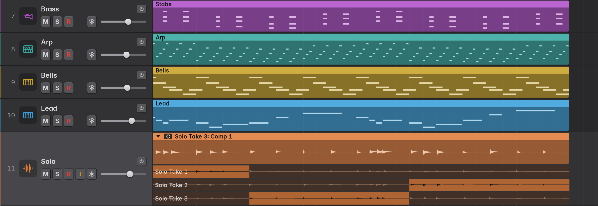

Take folders follow Logic's Quick Swipe Comping.

- **Making one.** Record with Cycle on (each pass becomes a take), record over audio with
  Settings › Recording › Overlapping Recordings › Audio set to **Create take folders** (the
  default: the regions underneath and the new take go into a folder, and recording over a folder
  adds a take), or select several audio regions and choose **Pack Take Folder** (Ctrl+F on Linux
  and Windows, Control+⌘F on macOS; also in the Edit and region menus): one take per region,
  each where it was.
- **Packing takes from several tracks.** Takes recorded one per track (Overhead 1, Overhead 2
  and so on) pack the same way: select their regions on all the tracks and choose Pack Take
  Folder. The folder goes on the topmost of the tracks, its takes in track order (the top
  track's region is Take 1), and the bottom track's take is heard. Marbble then offers to
  delete the tracks left with no regions; Keep leaves them. The pack and the delete are an
  undo step each.
- **The comp.** A folder plays its *comp*: which take is heard where. A new folder starts with
  the newest take, older takes filling in where it has no audio. Where one take hands over to
  another they crossfade over the Crossfade Time (Settings › Editing, 20 ms equal power by
  default), so boundaries don't click.
- **Several comps.** A folder can keep several comps and switch between them, as in Logic. The
  take folder menu lists them (the one heard is ticked; choose another to hear it), with
  **Create New Comp** (a fresh comp: the newest take wherever it has audio), **Duplicate Comp**
  (a copy of the comp heard, to try changes on), **Rename Comp…** and **Delete Comp** (the last
  comp stays). Comps are named Comp 1, Comp 2 and so on. Swipes change the comp heard; Flatten,
  Flatten and Merge and Unpack use it. The folder's name bar shows the comp's name (or the
  take's, when one take plays throughout).
- **Opening a folder.** Click the disclosure triangle at the start of the folder's name bar
  (anywhere in the bar before the badge).
  The track grows by one row per take below its lane. The badge next to the triangle shows the
  take heard (or **C** for a comp).
- **Comping.**
  - Drag across a take row to put that stretch of the take into the comp (snapped to the grid).
    Comp parts are drawn bright and the rest dimmed; the closed folder draws the comp's
    waveform.
  - Click a take row to hear that take throughout. A click on a part of a take that is already
    in the comp selects that *comp section* instead (outlined); a swipe selects the section it
    makes.
- **Editing comp sections** (in the comp heard, as in Logic):
  - Drag the edge of a section in its take row (the pointer becomes a resize arrow). Where one
    section hands over to the next, the border moves and both sections change; an outer edge,
    next to a gap or the folder's end, lengthens or shortens its section. A section can't pass
    its neighbour or reach past its take's audio.
  - With a section selected, **Up** and **Down** move it to the take above or below (takes with
    no audio there are skipped), and **Delete** removes it, leaving a silent gap. Right-click a
    section for **Move Section to Take Above**, **Move Section to Take Below** and **Remove
    Section**.
  - **Select Previous Take** and **Select Next Take** (Alt+Shift+Up and Alt+Shift+Down) switch
    every selected take folder one take up or down (from the take heard longest, in a comp).
- **Grouped tracks comp together.** When tracks are in a group that is on and links **Editing
  (Selection)**, their take folders follow each other, as in Logic: choosing a take, swiping a
  comp, and choosing, creating, duplicating, renaming or deleting a comp in one folder does the
  same in the folders at the same place on the others, as one undo step; so do the comp section
  edits (on the folders with a section edge or section at the same place). Record the drum mics
  together and Take 2 is Take 2 on every mic. Takes recorded together are matched by their
  pass (a take only one of the tracks recorded is left alone on the others); folders packed by
  hand are matched by take number. Turn the group off (its clutch) to comp one folder alone.
- **The take folder menu** (click the badge, right-click a take row, or region menu › Take
  Folder): the takes (pick one to hear), Open / Close Take Folder, Rename Take, **Rate Take**,
  **Take Color**, Delete Take, Delete Unused Takes, **Delete Bad Takes** (the takes marked bad; a
  folder of nothing but bad takes keeps its newest), **Flatten** (the comp becomes ordinary
  regions, one per stretch), **Flatten and Merge** (the comp is rendered to one new audio file),
  **Unpack to New Tracks** (every take on its own new, muted track, and the comp flattened in
  place), and the items below.
- **Rating and colouring takes.** Mark a take good (★) or bad (✗) from the take folder menu
  (Rate Take), by right-clicking its row (the menu then starts with that take's Good, Bad and
  Color), or with the Mark Take keys (see [Discarding and marking
  takes](#discarding-and-marking-takes)). The mark shows before the take's name in its row and
  in the menu; choose it again to clear it. A take's colour (Take Color, or Color on its row)
  tints its row; Folder Color goes back to the folder's. With Settings › Recording › Take
  Colors › Color takes automatically on, each take gets its own colour as it's recorded.
- **Unpack to Existing Tracks** puts the takes on the tracks below the folder's instead, one
  per track in take order (Take 1 on the next track), muted, next to what those tracks already
  have; tracks of another kind (an instrument track under an audio folder), hidden and frozen
  tracks are passed over. Where there aren't enough tracks, new ones with the folder track's
  settings are added below the last. The comp is flattened in place, as with Unpack to New
  Tracks.
- **Export Active Take to New Track** copies what the folder plays (the take heard, or the
  comp flattened into regions) onto a new track below, with the folder track's settings and
  named after the take or comp. The copy is muted so the song sounds the same; the folder is
  unchanged. **Move Active Take to New Track** does the same but moves it: the copy plays,
  the take (or comp) leaves the folder, and the folder is muted. Moving a folder's only take
  moves the whole folder out; moving its only comp leaves a fresh one (the newest take
  wherever it has audio). With a comp heard the items read Export / Move Active Comp.
- Every Unpack, Export and Move is one undo step.
- A folder moves, trims, splits, loops, fades, crossfades and changes gain like any audio
  region. Every comp edit can be undone, folders are saved with the project, and bounces,
  exports and Bounce in Place render the comp.
- **MIDI take folders.** With Settings › Recording › Overlapping Recordings › MIDI set to
  **Create take folders**, each pass of a MIDI cycle recording becomes a take (passes where
  nothing was played are left out), and recording over MIDI regions packs them into a folder
  with the new take; recording over a MIDI take folder adds takes to it. As in Logic, a MIDI
  folder plays one whole take: click a take row or choose it in the take folder menu (there is
  no swipe comping and no comp list). Editing the folder's notes edits that take. Flatten
  leaves a plain region of the take heard, Unpack to New Tracks puts every take on its own
  muted track. The control bar's **Replace** button wins: with it on, a recording replaces what
  it overlaps instead.

---

## 8. Markers and the Arrangement track

### Markers

The marker lane at the bottom of the ruler is Logic's Marker track.

- **Create Marker** (Alt+', or Navigate › Create Marker) adds a marker at the playhead,
  rounded to the nearest bar. Double-clicking empty marker lane creates one there.
- Each marker is a bar in its colour with its name at the start. A marker lasts until the
  next one, or for a **length of its own**: right-click › Length (1 to 16 bars, or To Next
  Marker), type one in the Marker List, or drag the end of its bar (snapped; at least a
  beat). A marker with its own length has a stronger bar with a visible end.
- Click a marker to select it and go to it; with Cycle on, the cycle takes the marker's span
  too. Drag it to move it (snapped), or up into the cycle strip at the top of the ruler to
  set the locators by it. Double-click it to rename it. With a marker selected, Delete
  removes it.
- Right-click a marker: Go to Marker, Set Locators to Marker (the cycle covers its section),
  Rename…, Length, Color, Delete, Marker List…. Right-click empty lane: Create Marker Here,
  Marker List….
- **Go to Previous / Next Marker:** Alt+, and Alt+. (Navigate menu).
- **Navigate › Delete Marker** removes the marker at or before the playhead.
- **Marker List** (Ctrl+Alt+K, Navigate › Open Marker List): every marker with its colour,
  position, an editable name and length (bars beats divisions ticks; leave it empty to reach
  the next marker, which is shown dimmed), Go To and Delete, plus Create Marker. The selected
  marker is highlighted.
- Markers are saved with the project, and every marker edit can be undone.

### The Arrangement track

The top global track, as in Logic: show it with View › Show Global Tracks (G). Its sections
mark out the song's form and move it around.

- Named sections — Intro, Verse, Chorus, Bridge, Outro and so on — that follow each other
  without gaps. The **+** button in the header adds one after the last (eight bars, named
  Intro, Verse, Chorus, Bridge, Outro in turn); double-click empty lane does the same, and
  right-click it › Add picks the name.
- Click a section to select it and every region in it. Click its name for the name pop-up
  (Intro, Verse, Pre-Chorus, Chorus, Bridge, Solo, Break, Interlude, Outro, Rename…), or
  double-click the section to type a name. Each name has its own colour; right-click › Color
  sets another.
- Drag a section's right edge to resize it (in bars). The later sections move along; the
  regions stay where they are.
- **Drag a section** to another place in the order to move it **with its content**: the
  regions on every track in it (cut at the section's edges), the automation and the markers
  go with it, and the sections it passes close up or make room. Hold **Alt** (Option) while
  dragging to insert a **copy** instead; everything after the copy moves later. The moved or
  copied section's regions are selected afterwards.
- Right-click a section: Name, Color, Select Regions in Section, Set Locators by Section, Go
  to Section, **Delete Arrangement Marker** (only the marker; the section before takes over
  its time) and **Delete Arrangement Marker and Content** (its regions, automation and markers
  go, and everything after it moves earlier to close the gap).
- Each of these is one undo step. Tempo and signature changes stay where they are when
  sections move: rearrange sections with the same tempo, or fix the tempo track afterwards.
  A section move refuses to cut a frozen track's regions; unfreeze the track first.
- Sections, like markers, sit at fixed positions in time: changing the tempo doesn't move them.

---

## 9. Tempo and time signature

A project has a base tempo (5 to 990 BPM) and time signature, set in the control bar's LCD or in
File › Project Settings › General. Changes along the timeline live in the **Global Tracks**.
Show them with View › Show Global Tracks (G); they sit between the ruler and the tracks: the
[Arrangement track](#the-arrangement-track) at the top, then the Signature and Tempo tracks.

Each of the three shows or hides on its own, as in Logic's Global Tracks configuration: right-click
the global tracks' headers (or the Marker label beside the ruler, which works while they're hidden),
or use the Tracks area's View › Global Tracks, and tick the ones to show. Picking one there while
the global tracks are hidden shows them with it. Until you choose, a project shows the ones it uses
(arrangement sections, a tempo change, a signature change after bar 1), or all three when it uses
none. The choice and the Tempo track's height are remembered for each project. (The marker lane
is part of the ruler and always shows.)

### Tempo track

- Click the tempo line (or double-click anywhere in the lane) to add a tempo change at the
  snapped position, starting at the tempo in effect there, and drag straight away to set it. A
  single click away from the line adds nothing.
- Drag a point up or down to change its tempo (Shift for 0.01 BPM steps), or sideways to move
  it. A drag locks to whichever direction you move first.
- Double-click a point, or select it and press Delete, to remove it. The first point can't be
  removed.
- Right-click a point › **Ramp to Next Tempo** to glide smoothly to the next change instead of
  jumping. Ramps are exact: beats, the click and MIDI all follow the curve.
- Drag the lane's bottom edge (or its header's) to resize it; it starts 40 px tall.

### Signature track

- Double-click empty space to add a time signature change at that bar, or double-click a label
  such as "7/8" to edit it. Changes always start on a bar line.
- Right-click a label to delete it.

### What follows the tempo map

These follow tempo and signature changes: the ruler's bar numbers, the grid and Snap, quantize,
nudge,
the metronome (including subdivisions and accents on each bar), count-in (it uses the tempo and
signature at the punch point), the bar/beat display, markers, cycle and punch defaults, the
Bounce dialog's bar range, the Piano Roll and the Audio Track Editor, and the tempo and position
reported to plug-ins.

**The LCD** shows the tempo and signature at the playhead, live while playing. Changing the tempo
there (drag, or double-click and type) edits the tempo change in effect at the playhead; the
signature menu edits the signature of the playhead's bar.

**Regions stay where they are in time.** Recorded audio and MIDI keep their position when the
tempo changes, so audio never drifts. To keep MIDI on its bars and beats instead, turn on
right-click › **Move MIDI Regions with Tempo** in the Tempo track before editing: tempo edits
from the Tempo track or the LCD then move and stretch MIDI regions, notes and controllers to
keep their musical positions, on every track alternative, not just the active one. Audio,
frozen tracks, automation and markers never move.

**MIDI files** carry their tempo and signature changes: importing into a project with no
regions adopts the file's tempo map; importing into a project that already has regions places
the notes using the file's own timing. Export writes the project's tempo map and signatures
(ramps become steps every sixteenth note, with exact durations).

---

## 10. The Piano Roll, Event List and Step Sequencer

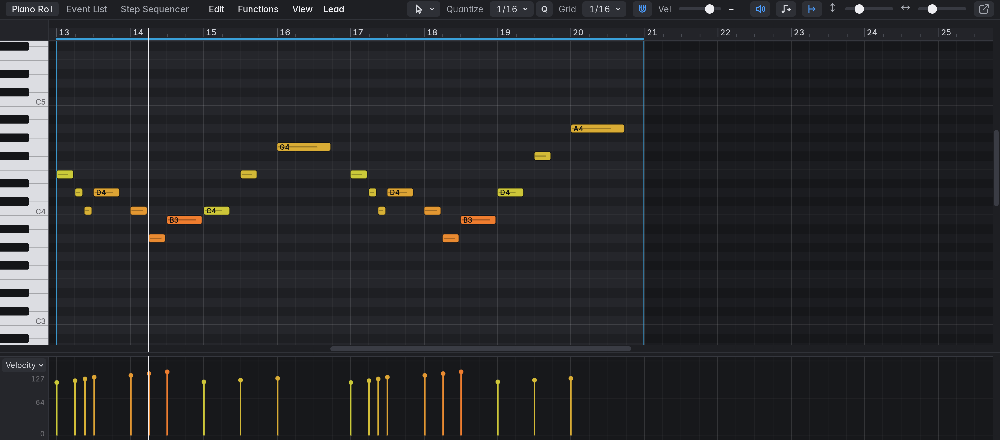

The Editors pane (E or P) follows the selection: it shows the Piano Roll for a software
instrument track and the Audio Track Editor for an audio track. MIDI regions have two more
editors, the [Event List](#event-list) and the [Step Sequencer](#step-sequencer) (for pattern
regions); the tabs at the left of the editor's bar switch between the three. Double-clicking a
region in the Tracks area opens the editor for it. The Piano Roll is
modelled on Logic's, with ideas from Ableton's MIDI editor, Cubase's Key Editor and FL
Studio's piano roll.

The editors' bars fit their pane at any width and interface size. When the pane is narrow the
captions (Quantize, Grid, Vel, Height, Zoom; Gain, Wave and Zoom in the Audio Track Editor; Length,
Rate and Swing in the Step Sequencer) give way first; then the sliders get shorter; what still
doesn't fit moves to a second row of the bar.

### View

- Every MIDI region on the track is shown in project time, with bars and beats. The region
  selected in the tracks area is in focus; the others are dimmed but still editable. The area
  outside regions is shaded.
- **Keyboard:** C3 is middle C (MIDI 60), as in Logic. Click a key to hear it (further right
  is louder; drag for a glissando) and to select every note of that pitch; Shift+click adds to
  the selection.
- **Ruler:** click or drag below the top strip to move the playhead (snapped to the grid when
  Snap is on). In the top strip, drag to create a cycle range, drag inside it to move it or near
  its ends to resize it; click it to switch Cycle on and off.
- **Zoom:** Ctrl+wheel or the **Zoom** slider zooms in time, Alt+wheel or the **Height** slider
  changes the row height; Ctrl+Right / Ctrl+Left and Ctrl+Down / Ctrl+Up do the same from the
  keyboard. **Z** (View › Zoom to Fit Region) fits the focused region and its pitch range.
- **Opening a region** scrolls to its notes: their pitch range is centred, with a couple of rows
  of room when there is space for them; a range taller than the view shows from its highest note
  down.
- **Scroll:** over the notes the wheel scrolls the pitches and Shift+wheel scrolls through time;
  with Settings › Editing › Mouse Wheel Scrolls set to Horizontally it's the other way round.
  Over the ruler and the controller lane the wheel always scrolls through time.
- **Catch Playhead** (button and View menu) pages along with the playhead.
- **View menu:** Color by Velocity (Logic's violet-to-red scale) or Color by Region; Highlight
  Scale (shades the rows of the project key's scale); Show Velocity / Controller Lane and Lane ›;
  Catch Playhead; **MIDI Out (Hear Edited Notes)**; the zoom commands.
- Note names appear on notes when they are large enough. The view settings are remembered.

### Tools

Choose a tool from the tool pop-up in the local bar, or press **T** and then the tool's
letter within two seconds (T T is the Pointer).

| Tool | Letter | In the note area |
|---|---|---|
| Pointer | T | Select, move, copy and resize notes; double-click empty space to create a note. |
| Pencil | P | Click empty space to create a note, drag right to set its length. On a note it moves or resizes like the Pointer. |
| Eraser | E | Deletes the note clicked and every note the drag passes over. |
| Velocity | V | Drag up or down on a note to change the velocity of the selection. |
| Mute | M | Click a note to mute or unmute it (the whole selection if it is selected); drag across notes to mute or unmute them all. |
| Scissors | I | Click a note to split it at the pointer (snapped; Alt for free). Splits the whole selection when the note is selected. |
| Glue | G | Click a note to join the selected notes of the same pitch into one. |
| Line | L | Draws lines in the velocity and controller lane; behaves as the Pointer in the note area. |

Ctrl+click with the Pointer (or Line) works as the Pencil, like Logic's secondary tool.

### Editing notes

- **Select:** click a note; Shift+click adds or removes it. Drag on empty space (with the Pointer,
  Velocity, Scissors or Glue tool) for a rubber band; Shift adds. Click empty space to deselect.
- **Move:** drag notes. The grabbed note snaps to the grid; hold Ctrl to move freely. Drag up
  or down to change pitch (you hear each new pitch with MIDI Out on). Hold **Alt** during the drag
  to copy instead.
- **Resize:** drag a note's right edge to change its length, or its left edge to move its start.
  Alt or Ctrl for no snapping.
- **Create:** with the Pencil, click (or drag to set the length); with the Pointer, double-click
  empty space. New notes are one grid step long and use the last velocity you set. A help tag
  shows the pitch, position or length while you drag.
- **Regions grow:** notes drawn or moved past a region's edges grow it to the next bar line. A
  note drawn on empty space within a bar of a region goes into that region; farther away, a new
  one-bar region is made.
- **Right-click** a note for Cut, Copy, Paste, Duplicate, Delete and the Functions menu.
- Each edit is one undo step; a run of arrow-key nudges or transposes merges into one.

### Grid and Time Quantize

- **Grid:** 1/1, 1/2, 1/4, 1/8, 1/16 (default), 1/32, 1/64 and the triplets 1/2T to 1/32T. It
  sets the snap and the Pencil's note length. Snapping counts from each bar line, so odd meters
  line up. The **Snap** button turns snapping off.
- **Time Quantize:** the Quantize pop-up in the local bar opens a panel with the value,
  **Strength** (0 to 100%, default 100), **Swing** (0 to 100%, default 0; it delays every
  second grid step) and **Quantize note ends** (off by default). **Q** (or the Q button, or
  Functions › Quantize) quantizes the selected notes, or all of them when none are selected.
  Functions › **Quantize to** › picks a value and quantizes at once.

### Functions menu

All functions act on the selected notes, or on every note when none are selected.

| Item | What it does |
|---|---|
| Quantize, Quantize to › | Time quantize (above). |
| Scale Quantize to *key* | Moves notes outside the project key's scale to the nearest scale note (natural minor for minor keys). |
| Transpose › | Octave Up, Semitone Up, Semitone Down, Octave Down, Other… (any number of semitones). |
| Velocity › | Set to 32, 64, 80, 100 or 127; Scale 50% to 150%; Set to…; Scale by…. |
| Humanize › | Light (±5 ms, ±5 velocity), Medium (±10), Strong (±20), Custom…. Lengths are not changed. |
| Note Length › | Legato (each note extends to the next one), Remove Overlaps (same-pitch overlaps), Set to Grid, Set to 1/1 to 1/32. |
| Mute / Unmute Notes | Ctrl+M. Muted notes stay in the region but don't play. |
| Delete Duplicates | Notes with the same pitch and start; the louder one stays. |
| Reverse | Plays the notes backwards within their span. |
| Split at Playhead | Splits the notes under the playhead. |
| Glue Same Pitches | Joins the selected notes of the same pitch. |

### Edit menu

Undo and Redo; Cut, Copy, **Paste at Playhead**, Duplicate (a copy straight after the
selection), Delete; Select All, Deselect All (Esc), Invert Selection, Select Same Pitch, Select
Highest Notes, Select Lowest Notes (of each chord), Select Muted Notes, Select Inside Locators;
Export Region as MIDI File…. The Piano Roll has its own note clipboard, separate from the region
clipboard.

The Edit › Select key commands act on the notes while the Piano Roll has focus (and on the
listed events while the Event List has it): **All Following** (Shift+F, from the first
selected note, or the playhead), **Inside Locators** (Shift+L), **Muted** (Shift+M), **Same
Colored** (Shift+C: the velocity of a selected note, which sets its colour), **Equal**
(Shift+E: the pitch of a selected note; for controllers, the same controller and value) and
**Invert Selection** (Shift+I). Overlapped, Similar and All Following of Same Track still act
on regions.

### Velocity and controller lane

The lane below the notes shows velocity or a controller. It takes a third of the height under the
ruler at first and keeps its share as the editor is resized; drag the bar above it to change the
share (from a tenth to four fifths, and never under 40 px). Choose what it shows with the lane
button: **Velocity**, **Modulation (CC 1)**, **Expression (CC 11)**, **Sustain (CC 64)**, **Pitch
Bend**, **Aftertouch**, **Volume (CC 7)**, **Pan (CC 10)**, any other controller already used, or
**Other Controller…** (any number 0 to 127). Lanes that hold data are marked with a dot.

**Velocity:**

- Drag a note's stalk to set its velocity; the rest of the selection moves by the same amount.
- Drag on empty space (or use the Line tool) to ramp the velocities of the selection (or all
  notes) along a line.
- The Pencil draws velocities freehand.
- The **Vel** slider in the local bar sets the selection's velocity (it shows their average;
  with no notes selected it reads "No notes").

**Controllers, pitch bend and aftertouch:**

- Double-click to add a point (snapped; Alt for free).
- Click a point to select it (Shift adds); drag selected points to move them in time and value
  (Ctrl for no snapping). Drag on empty space for a rubber band.
- The Pencil draws freehand; Shift+Pencil, Ctrl+Shift-drag (⌘⇧ on macOS) or the Line tool
  draws a ramp of points along the **Line Curve** shape: Linear, Exponential (slow then
  fast), Logarithmic (fast then slow) or S-Curve. While you drag, the line shows the curve. A
  line that starts or ends on an existing point starts or ends exactly there, so drawing from
  one point to another joins them.
- **Ramp Density** sets how many points a ramp gets: one per 1/8, 1/16, 1/32 (the default) or
  1/64 note. A value that doesn't change isn't repeated.
- **Create Ramp** fills the gap between each pair of neighbouring selected points with a ramp
  along the Line Curve, replacing the points between them.
- **Thin Out** removes the selected points (all of the lane's points when none is selected)
  that lie on the line between the points either side, keeping the shape with fewer events.
- Line Curve, Ramp Density, Create Ramp and Thin Out are in the lane button's menu and the
  lane's right-click menu (on controller, pitch bend and aftertouch lanes).
- The Eraser, or Alt+click with the Pointer, removes points.
- Backspace or Delete removes the selected points (after clicking in the lane).

### Playback of MIDI regions

- Muted notes are skipped. Controllers play with the notes, and the values in effect are sent
  when playback starts or jumps, so a region played from the middle sounds as it does from its
  start. Notes are chased too: starting (or jumping, or cycling back) in the middle of a long
  note starts it, with its velocity after the region's playback parameters. Both can be turned
  off in Settings › MIDI › Chase.
- Stopping releases the sustain pedal and re-centres pitch bend.
- Split, join and trim keep controllers consistent: the later part of a split starts with the
  values in effect at the cut.
- A region's playback parameters (Quantize, Transpose and the rest; see
  [Region playback parameters](#region-playback-parameters)) apply as it plays. The Piano Roll
  shows the notes as stored; region menu › Apply Region Parameters writes them in.
- Notes can be entered one step at a time with the [Step Input Keyboard](#step-input).

### Event List

Logic's Event List, for exact MIDI editing: every note and controller event of the selected
MIDI regions as a line of numbers. Open it with **D** (View › List Editors, or the List Editors
button at the right of the control bar), or with the **Event List** tab at the left of the
Piano Roll's bar (the **Piano Roll** tab goes back). It shares the Editors' height, and the
note selection is shared with the Piano Roll: notes selected in one are selected in the other.

- **What it lists:** the regions selected in the Tracks area (on the first one's track), or
  every MIDI region of the selected software instrument track when none is selected.
- **Columns:** **Position** (bar, beat, division and tick, 240 ticks a division, following
  tempo and signature changes), **Status** (Note, Control, Pitch Bend, C-Press), **Ch**
  (always 1), **Num** (the note, as C3 = middle C, or the controller number; for pitch bend the
  low 7 bits), **Val** (velocity, or the value; for pitch bend the high 7 bits, so 0 64 is the
  centre) and **Length/Info** (a note's length, counted from 0 as in Logic: "0 1 0 0" is one
  beat; a controller's name; a pitch bend's offset from the centre).
- **Filter buttons** under the bar show or hide Notes, Pitch Bend, Controller and Chnl
  Pressure events (also in the View menu).
- **Selecting:** click an event; Shift+click selects a range, Ctrl+click adds or removes one;
  Up and Down move through the list. With MIDI Out on, clicking a note plays it.
- **Editing:** drag any value up or down; a position or length changes by the part you drag
  (bars, beats, divisions or ticks), and every selected event of that type changes by the same
  amount. Or double-click a value and type it: a position as "5 2 1 1", "5.2.1.1" or just "5"
  (missing parts are 1), a length as "0 1" (missing parts are 0), a note as "C3", "F#2", "Bb1"
  or a MIDI number. Enter applies, Esc cancels, and values are kept in range. A moved event
  takes its place in the list when you let go, and a moved note keeps its length in beats.
  Each edit is one undo step.
- **Adding:** the **+** button adds an event of the type shown beside it at the playhead (in
  the region there, or the nearest listed one; a one-bar region is made when the track has
  none nearby). It copies the selected event of that type, if there is one, as Logic's Create
  does; otherwise a note is C3, velocity 100, a beat long, and a pitch bend is centred.
- **Backspace** deletes the selected events. The Edit › Select key commands (Shift+I Invert
  Selection, Shift+F All Following…) act on the listed events, as in the Piano Roll.
- **The playhead:** the event at the playhead is highlighted, and with **Catch** (the button
  and View menu) the list scrolls to keep it in view during playback.
- **Separate window:** the pop-out button at the right of the bar, the View menu, or Window ›
  Event List in Separate Window; it can then sit beside the Piano Roll on another screen.

### Step Sequencer

Logic's Step Sequencer: drum patterns and riffs as rows of steps. It edits **pattern
regions**, MIDI regions that play the notes their pattern makes.

- **Creating a pattern region:** Track › New Pattern Region (on the selected software instrument
  track, at the bar of the playhead), right-click an instrument track's empty space › Create
  Pattern Region (at the bar clicked), or the button the Step Sequencer shows when no pattern
  region is selected. Made at the playhead, it goes in the first bar from there that no region
  on the track covers, so it never lands on top of one. A new one is a bar long, with sixteen
  1/16 steps. Its rows suit the instrument:
  - if the track already plays notes (in MIDI or pattern regions), a row for each pitch it
    plays, up to 16 of the most played;
  - otherwise, on a **kit** (the Sampler, or an instrument or track named like one: Drums, Kit,
    Perc, Beat, 808…), rows for a General MIDI drum kit: Kick (C1), Snare (D1), Clap (D♯1),
    Closed Hi-Hat (F♯1), Open Hi-Hat (A♯1), Low Tom, Hi-Mid Tom and Crash;
  - on any other instrument, an octave of the project key's scale from C3, highest at the top.

  A kit's rows are named for their drums and list from the lowest up; a pitched instrument's
  rows are named by note, and + adds the next note down. In the Tracks area a pattern region
  shows its rows, with a dot wherever a note plays.
- **Opening it:** double-click a pattern region, or click the **Step Sequencer** tab beside
  Piano Roll and Event List on the editors' bar. Selecting a pattern region while the Piano
  Roll is shown switches to the Step Sequencer, and selecting a MIDI region there switches
  back. It edits the selected pattern region and can be opened in its own window with the
  pop-out button.
- **Steps:** the edit mode buttons under the bar choose what clicking does. **Note On** turns
  steps on and off; **Tie** ties a step to the one before it, so that note plays on through
  it. Drag across steps to set a whole run to what the first one got. **Velocity** and
  **Gate** (the note's length in percent of a step) show a bar in every step: click or drag
  along a row to set each step's bar to the pointer's height, which also turns it on. A
  drag is one undo step. Turning a step on plays its note.
- **Rows:** each row's header has **M** (mute) and **S** (solo), the row's name (click it to
  choose a General MIDI drum or any note; **Learn** sets it from the next note played on a
  MIDI keyboard or with Musical Typing), its own **step rate** and its own **length** in
  steps. Rows of different lengths repeat on their own, so a three-step row against a
  sixteen-step one makes a polymeter. Right-click a header to add a row below, duplicate,
  clear or delete it; **+** on the bar adds one at the bottom.
- **The pattern:** **Length** (1 to 64 steps), **Rate** (1/4 to 1/32 and their triplets) and
  **Swing** (0 % is straight; every second step of a straight row moves up to half a step
  later, about 66 % is the triplet feel) apply to every row that doesn't set its own.
  Changing the length lengthens the region too, while it is exactly as long as the pattern.
  With **Loop** on (the default) the pattern repeats to the region's end; off, it plays once.
  Each row counts its steps from the region's start, and a looped region (the region's Loop)
  starts the pattern over on every repetition.
- **While playing**, the step each row is on is outlined.
- **Delete** and Backspace do nothing while the Step Sequencer has focus, so they can't remove
  the pattern region being edited.
- **Functions** menu: Add Row, Clear Pattern, and **Convert to MIDI Region**, which writes the
  notes the pattern plays into the region (also in the region's right-click menu). A MIDI
  region's right-click menu has **Convert to Pattern Region**: a row for each pitch, each
  note on the nearest 1/16 step (up to 64 steps) with its velocity, longer notes tied on.
- The notes a pattern plays follow the tempo map and the region's playback parameters, and
  play everywhere a MIDI region does: bounces, exports, Bounce in Place, Freeze, MIDI file
  export and Join. Splitting or trimming the start of a pattern region starts its pattern
  again at the new start. An Arrangement track move or a Section Between Locators edit that
  cuts a pattern region doesn't change what it plays: each piece plays on from where it was
  cut. The Piano Roll and Event List don't show a pattern region's notes
  (convert it to edit them there).

---

## 11. The Audio Track Editor

With an audio track selected, the Editors pane (E) shows all of the track's regions on the
project timeline, drawn large, like Logic's Audio Track Editor, with the non-destructive range
tools of Logic's Audio File Editor.

### View and zoom

- A bars/beats ruler (click or drag it to move the playhead; its top strip shows the cycle), the
  playhead (it follows Catch), the selected region highlighted, and a dB scale beside the
  waveform.
- The waveform is drawn with the region's gain applied; red marks at its top and bottom show
  where the audio reaches 0 dBFS after that gain.
- **Zoom:** Ctrl+wheel or the **Zoom** slider zooms in time; the wheel scrolls along the
  timeline. Alt+wheel, the **Wave** slider (double-click to reset) or Ctrl+Down / Ctrl+Up zoom the
  waveform's amplitude (1× to 32×) to see quiet passages.
- **Z** zooms to the selection (or the region, or all the track's regions); press it again to
  go back. The editor keeps its own zoom, separate from the tracks area's.

### Selecting

- Drag across the waveform to select a time range. It follows the Snap setting (Smart snapping
  stops at sixteenths, and holding **Alt** while dragging is always free).
- Shift+click or Shift+drag extends the selection from its nearer end.
- Double-click a region to select all of it. A plain click selects the region under it.
- Esc deselects.

### Editing regions

Drag a region's name bar to move it, its lower edges to trim it, and the handles at the top of
the waveform to set fades, as in the tracks area (fade curves and crossfades are drawn the same
way, and a crossfade's handle works the same). The **Gain** field in the local bar sets the
selected region's gain: drag it (Shift for fine), scroll it (±0.5 dB), or double-click for 0 dB.

### Range actions

The Functions menu, right-click inside the selection, or keys. Each acts on every region under
the selection, as one undo step:

| Action | Key | What it does |
|---|---|---|
| Split at Selection | Ctrl+T | Splits at both ends (at the playhead without a selection). |
| Split at Transients | Shift+Ctrl+T | Splits at every transient in the selection (or the selected regions). |
| Trim Region to Selection | Alt+T | Keeps only the selection. |
| Silence Selection | Alt+Backspace | Splits and mutes the middle part (unmute it to bring it back). |
| Delete Selection | Backspace | Removes the middle part and leaves a gap. |
| Normalize Selection | Alt+N | Splits and sets the middle part's gain so its peak reaches 0 dBFS. |
| Reverse Selection | Alt+R | Splits and reverses the middle part (into a new file). |
| Fade In to Selection | Alt+I | Fades in over exactly the range, splitting the region where the range doesn't start at its edge. |
| Fade Out to Selection | Alt+O | The same at the end. |

- **Copy** and **Cut** (Ctrl+C, Ctrl+X) put the selected audio on the clipboard as a region
  (Cut also deletes it); **Paste at Playhead** (Ctrl+V) pastes it.
- **Play Selection** (Shift+Space) plays from the selection's start and stops at its end. With
  Cycle on, it sets the cycle to the selection and loops it. **Set Locators by Selection** only
  sets the cycle.
- Looped regions are converted to real copies first. Only Reverse writes a new file; the
  original stays intact.

### Transients

The transient button (or View › Show Transients) marks the onsets found in the audio. View ›
**Transient Sensitivity** sets how readily they are found: Low, Medium (default), High or Very
High. **Split at Transients** chops the selection (or the selected regions) at every marker in
one step, for slicing drums. A ringing kick isn't marked twice, and each marker sits at the
start of the attack.

### Info

The bar under the menus shows the region's name, start, length (in bars and as time), gain,
and its file's sample rate, channels and name, plus the selection's range.

The editor's own keys apply after you click in it; elsewhere the usual ones do. See the
[key reference](#audio-track-editor-keys).

---

## 12. Mixing

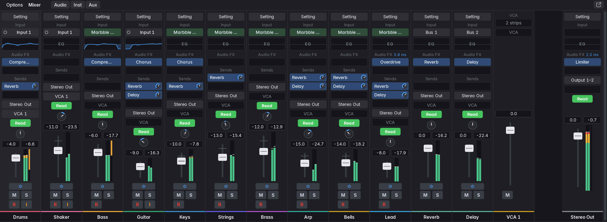

Open the Mixer with X. It shows a channel strip for every track (stacks included), then the auxes,
then the [VCA strips](#vca-faders), then Stereo Out. The **Audio**, **Inst** and **Aux** buttons
show or hide those strips (lit while shown). The **Options** menu has Create New VCA, New Aux, the
same three filters, Show Hidden Tracks (hidden tracks appear only in hide mode), the strip widths
and Reset All Clip Indicators. The Inspector shows the selected track's strip and Stereo Out.

**Stacks** show as a bracket in the stack's colour over its strips, with its name, its kind
(Folder, or Σ for a summing stack) and how many tracks it holds; a stack inside another sits
under a bracket of its own, under its parent's. The stack's own strip comes first, and every
strip in it is tinted with its colour. Click the bracket (its ▾) to collapse the stack to its own
strip and a slim **N tracks** marker; click the marker or the bracket to open it again. It is
the stack's own open state: it collapses in the Tracks area too and is saved with the project.
A summing stack's strip has Σ before its name, and its subtracks' Output slots say **→ Σ** and
the stack's name, dashed, while they play through it.

**Strip widths:** **Narrow**, **Normal** and **Wide** in the Mixer's bar (or the Options menu)
size every strip. Drag a strip's right edge to give that strip a width of its own (it keeps it
when you choose another size); double-click the edge to give it back, or choose Options › Reset
Strip Widths for all of them. The widths are remembered with the project on this computer, like
track heights. A folder stack's strip stays narrow at every size.

The strips line up across the Mixer: each shows as many insert and send slots as the strip that
needs the most (its plug-ins or sends plus an empty slot), up to 6 Audio FX rows and 4 Sends
rows, so faders, meters, pan knobs and automation buttons sit on one line. A strip with more
than that shows **+2 more** (for example) in its last row: click it for a menu of the plug-ins
or sends that don't fit, each with what its own slot offers (Open, Bypass and Remove for a
plug-in), and to add another. The Inspector's two strips line up the same way. When the strips
don't fit, the Mixer scrolls sideways.

The Mixer opens tall enough for a whole strip with its fader. Made shorter, it keeps the faders
first: the Audio FX and Sends sections show fewer rows (down to one each, sends first; the rest go
behind **+N more** in the last row); below that the strips scroll from the bottom, keeping the
faders, meters and names in view. The selected track's strip is lit, with an accent line under its
name.

### The channel strip

From top to bottom:

| Part | What it does |
|---|---|
| **Setting** | The channel strip settings menu (see [Channel strip settings](#channel-strip-settings)). |
| **Input** | Audio tracks: the mono/stereo button and the input ("No Input", "Input 1"..., "Input 1–2"...). Instrument tracks: the **instrument slot** (No Plug-in, Marbble Synth, other built-in instruments by group, or a VST3 instrument by category or vendor). A built-in instrument shows its model ("Tre", "Sampler"); the tooltip has the full name. Auxes show their bus ("Bus 1"), or the instrument output they're on ("Drums: Direct out 0", see [Multi-output instruments](#multi-output-instruments)); summing stacks show "Σ Subtracks". |
| **EQ thumbnail** | The curve of the strip's first [Channel EQ](#channel-eq); click to open it (or to insert one). |
| **Audio FX** | Insert slots (8 in all), in the rows the strips share (see above). An empty slot shows a faint **+**; click it to choose a plug-in. A filled slot's power and pop-up buttons show when you point at it. The label shows the strip's plug-in latency. |
| **Sends** | Send slots (8 in all), in the rows the strips share. Click an empty slot (**+**) to add a send. |
| **Output** | Stereo Out, the summing stack ("→ Σ Drums"), or an aux. |
| **VCA** | The VCA fader that controls the strip (see [VCA faders](#vca-faders)). |
| **Automation mode** | Off, Read, Touch, Latch, Write (see [Automation](#13-automation)). |
| **Icon** | The track's icon, as in Logic's Mixer; click it to choose another. Stereo Out shows the output's. |
| **Pan** | Drag vertically (Shift for fine); double-click to centre. The value shows under the knob: **C** at the centre, **L 1** to **L 64** or **R 1** to **R 64** either side. |
| **Readouts** | Volume in dB and the clip indicator: the highest peak since you last reset it, in dBFS, red once a peak went over 0 dBFS. Click it to reset it, Alt-click to reset every strip's (or use the key command **Reset All Clip Indicators**, unassigned at first). |
| **Fader and meter** | Drag the fader (Shift for fine), double-click for 0 dB. -96 to +6 dB. On a strip assigned to a VCA, an outlined cap marks where the strip really plays (its fader plus the VCA). The meter holds peaks for 2 s, and its top lights red while the clip indicator is on. With a Compressor, Limiter, Noise Gate or De-Esser on the strip, a thin **gain-reduction meter** beside it grows down from the top as the first one that isn't bypassed reduces the gain (up to 30 dB). |
| **Power** | Turns the track off: silent, and it runs nothing (see [Turning tracks off](#turning-tracks-off)). Not on Stereo Out. |
| **M S R I** | Mute, Solo, Record Enable, Input Monitoring. |
| **Name** | Filled with the track colour, with up to two lines of name, broken between words. Right-click it for the channel strip settings menu. Any name or slot cut short shows in full in its tooltip. |

As in Logic, playing again doesn't reset the clip indicators. They are shared by the Mixer, the
Inspector and a detached Mixer, start afresh when another project opens, and bounces and exports
don't touch them.

A folder stack's strip is narrow and darker, and shows only its fader, buttons, automation mode and
name, with the other sections left blank so its fader lines up with the others. Stereo Out has the
EQ thumbnail, Audio FX, its fader and meter, and an automation mode pop-up for the Output track's
lanes; its Input and Sends rows are left blank. A VCA strip shows its count in the Input row and the
VCA it is on in the VCA row.

Mono audio tracks pan with a -3 dB compensated pan law (unity in the centre); stereo tracks
and buses use balance.

### Channel EQ

The Channel EQ is an eight-band EQ modelled on Logic's, a built-in effect (in **EQ**) that goes
in any Audio FX slot of any strip, Stereo Out included, and more than once if you like, so it
can come after a compressor. New tracks have none; a flat one costs nothing.

- The **EQ thumbnail** above the Audio FX slots shows the strip's first Channel EQ. Click it to
  open that Channel EQ, or, on a strip without one, to put one at the top of Audio FX (the
  plug-ins there move down a slot) and open it. Its panel is a built-in effect's (see [Built-in
  effects](#built-in-effects)); click the thumbnail again to close it.
- Bands: **Low Cut** (off by default, 30 Hz), **Low Shelf** (80 Hz), **Bell 1–4** (160, 500,
  1500, 5000 Hz), **High Shelf** (10 kHz) and **High Cut** (off by default, 18 kHz). The cuts
  have 12, 24 (default) or 48 dB/oct slopes; click the slope to change it.
- **On the graph:** drag a point to set frequency and gain (Shift for fine; the cuts move only in
  frequency), scroll to change Q, double-click a point to switch its band off or on, Alt-click
  to reset its gain.
- **Below the graph:** each band's on/off button, and its frequency, gain and Q, which can be
  dragged (Shift for fine) and double-clicked to reset.
- **Toolbar:** **Analyzer** (a live spectrum of what comes out of this Channel EQ, on by
  default) and **Output** gain (±24 dB).
- **Bypass, presets, moving, copy and paste, automation and controllers** work as for any
  plug-in (see [Plug-ins](#plug-ins) and [Presets](#presets)).
- A project saved when every strip had a fixed Channel EQ ahead of its inserts opens sounding
  the same: a shaped EQ becomes a Channel EQ at the top of Audio FX, and a flat one goes.

### Channel strip settings

Click **Setting** at the top of a strip (or right-click the strip's name) for Logic's channel
strip settings menu. A channel strip setting is the strip's instrument, its Audio FX plug-ins
with all their settings (a VST3's whole state, a built-in effect's values, bypass), Channel
EQs among them. Sends, routing, volume and pan aren't part of it.

| Item | What it does |
|---|---|
| **Copy Channel Strip Settings** | Copies the strip's setting. The copy survives opening another project. |
| **Paste Channel Strip Settings** | Replaces the strip's Audio FX with the copied ones, as new instances. On an instrument track it also replaces the instrument, when the copy has one; an audio track or aux ignores the instrument. The menu shows where the copy came from. |
| **Reset Channel Strip** | Removes the instrument and every Audio FX plug-in (Channel EQs too), sets the fader to 0 dB and pan to the centre. |
| **Save Channel Strip Setting As…** | Saves the setting under a name, for any project. Side-chain sources aren't saved, since they name tracks of this project. |
| **Delete Channel Strip Setting** | Deletes a saved setting. |
| *saved settings* | Load one onto the strip, as Paste does. |

When the strip is one of several selected tracks, Paste, Reset and loading apply to all of
them, as one undo step. A folder stack has no channel strip settings. A VST3 that isn't
installed on this computer comes along as a missing plug-in (its slot keeps its settings, as
in a project from another computer). Marbble Sampler's samples come along: a saved setting
keeps a copy of them, and loading or pasting it into another project copies them into that
project's `Samples` folder. Saved settings are files, one `<name>.json` each, in the
`channel-strips` folder of the settings folder (`~/.config/marbble/channel-strips` on Linux,
`~/Library/Application Support/io.github.jackmechem.marbble/channel-strips` on macOS, `%APPDATA%\marbble\channel-strips` on
Windows), with a `<name>` folder beside one
that holds a sampler's samples.

### Plug-ins

- **Loading:** click an empty Audio FX slot, or the arrow on a filled one, for a menu of plug-ins:
  the built-in effects under **Marbble**, by category, then the VST3s under **VST3**, by category
  and **By Manufacturer**; or click a plug-in in the Library. The instrument slot works the same
  way.
- **Editing:** click the plug-in's name in its slot to open its editor window.
- **Bypass:** the power button on the slot.
- **Reordering:** drag a plug-in's name onto another Audio FX slot. On the same strip it moves
  there and the plug-ins in between shift over; it keeps running, so nothing reloads and a
  reverb tail carries on. Dropped on another strip's slot, it moves to that strip (whatever is
  in that slot shifts down) as a new instance with the same settings, and its automation lanes
  go with it (see [Automation](#13-automation)). Hold Alt as you let go to copy it instead.
  Esc cancels the drag; each move is one undo step, plug-in and lanes together.
- **Removing:** "No Plug-in" in the slot's menu.
- **Copy and paste:** right-click a slot for **Copy Plug-in**, and any slot (empty ones too) for
  **Paste Plug-in**, which loads a new instance with exactly the copied settings: a VST3's whole
  state, a built-in effect's values and side-chain (when its source exists here). With several
  tracks selected, **Paste to Selected Tracks** does them all. Each paste is one undo step, and
  the copy survives opening another project. Instruments paste only into instrument slots,
  effects only into Audio FX slots.
- **Side chain:** a VST3 with a side-chain input (LSP's Sidechain Compressor and Gate, say) has
  a **Side Chain** item at the top of its slot's menus, the arrow and the right-click, since its
  editor is a window of its own. Pick a track and it keys the plug-in as a [built-in
  effect's](#built-in-effects) Side Chain does, Pre / Post Fader included; **None** turns it off.
  The slot shows **SC**, and its tooltip the source. Choosing a source or None makes the plug-in
  fade to its dry signal and back, losing its tail; changing from one source to another doesn't.
  Set the plug-in's own key setting to external (LSP's "Sidechain type": External) to hear this
  input. Instruments can't be keyed.
- Plug-in settings are saved in the project and restored on undo, including what you change in
  a VST3's own window (see [Undo](#undo)).
- Settings › Plug-ins (the Plug-in Manager) lists every scanned plug-in and lets you switch
  some off, so they don't appear in the Library and slot menus (projects that use them still
  load them). It also takes extra VST3 folders and shows the last scan's report, including each
  bundle that failed and why.

Marbble hosts **VST3** plug-ins only. Plug-in editor windows are available on Linux (X11;
see [Troubleshooting](#plug-in-windows-and-wayland)) and macOS, where they float
above Marbble's windows like Logic's and hide while another app is in front.

### Built-in effects

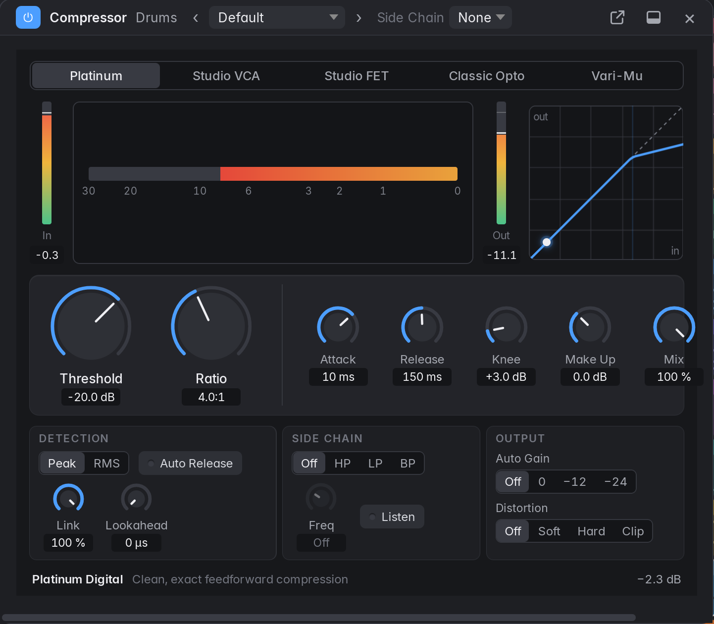

Marbble's own effects load in any Audio FX slot like a plug-in: **Compressor**, **Limiter**,
**Noise Gate** and **De-Esser** (Dynamics), **Reverb** (Reverb), **Delay** (Delay), **Chorus**,
**Flanger**, **Phaser** and **Tremolo** (Modulation), **Overdrive** and **Distortion**
(Distortion), **[Channel EQ](#channel-eq)** and **Linear Phase EQ** (EQ), **Gain** (Utility), and
**Tuner** and **Loudness Meter** (Metering). They are listed first, by category,
in the slot menu and the Library.

- **The panel:** click the effect's name in its slot to open its panel; click again, press Esc
  or click × to close it. There is one panel per slot. Every plug-in panel (effects,
  instruments, the Sampler and the Channel EQ) has the same header, docked, floating or in a
  window of its own, in this order: the power (bypass) button, the effect and track names, the
  preset pop-up, **Compare** (see [Presets](#presets)), the **Side Chain** pop-up for effects with
  a side-chain, and at the right end
  the window buttons and ×. The window buttons keep their order: **Float in Main Window** (in
  the dock) or **Dock in Bottom Section** (floating), then **Open in Separate Window** (or
  **Attach to Main Window** in that window). A panel's own switches, such as
  the Channel EQ's Analyzer, are in its toolbar under the header.
  - **Docked** (see [General](#general) settings): panels open in the bottom
    section, where the Mixer and the Editors show, with a tab for each open panel in place of
    the name. Drag the divider above to make the section taller; graphs and meters grow with
    it. Showing the Mixer or an Editor hides the panels but keeps them open: click a slot again
    to bring them back. Closing the last tab gives the section back to what it showed before.
  - **Docked tabs:** the × at the right end of the header closes the panel shown (the front
    tab); Shift-click it to close every docked panel. The other tabs show their own × when you
    point at them, a middle-click closes a tab, and a tab's right-click menu has **Close**,
    **Close Other Tabs** and **Close All Tabs**. Up to five panels stay docked: opening a sixth
    closes the one you looked at longest ago. Tabs that don't fit scroll sideways (the mouse
    wheel scrolls them), with a fade on the side that has more.
  - **Floating** (the default): Float in Main Window takes a docked panel out into a window
    over the main window (and Dock in Bottom Section puts it back). Drag a window by its title;
    drag its sides or bottom corners to resize it, down to the size of its controls. Each kind of
    effect opens at the size you last gave it.
  - **Separate windows:** each panel opens in an OS window of its own, which you can move to
    another monitor (see [Separate windows](#separate-windows)). Clicking the slot again closes
    it; Attach to Main Window in its header puts it in the main window, floating.
  - **Esc** closes the frontmost floating panel first, then the docked one on screen.
- **Knobs:** drag up and down (Shift for fine); double-click or Alt-click for the default;
  double-click the value under a knob to type one ("2.5k", "-6 dB", "1.2 s"). Every change is
  undoable, and a drag is one undo step.
- **Meters** show the effect's levels; gain reduction meters hang down from the top. Until audio
  runs through the effect (no audio device, or a slot just filled) they read −∞, and they fall
  back to −∞ when the audio device stops.
- **Automation:** every parameter appears in the track's automation lane menu under the effect's
  name, and Touch, Latch and Write record moves of the panel's knobs. While automation plays,
  the panel follows it.
- **Latency:** an effect with lookahead or oversampling reports it to [delay
  compensation](#plug-in-delay-compensation), so the track stays in time; the slot's tooltip
  shows it.
- **Freeze** renders built-in effects like any plug-in; their settings come back on unfreeze.
- **Side Chain:** pick a track in the Side Chain pop-up and its output, instead of the
  effect's own input, drives the detector: a kick opening a gate on a bass, a vocal ducking a
  pad. Pick **None** to go back. The source plays before the effect's track, and loops are
  refused. **Pre / Post** beside the pop-up picks where the key leaves the source: **Post**
  (the default) after its fader and pan, so muting the source or pulling its fader down
  silences the key, as in Logic; **Pre** before them, so a trigger track with its fader all
  the way down still keys the effect. A pre-fader key still goes silent when the source is
  muted (or soloed out), like a pre-fader send. Bounces and freezes of the effect's track play the
  source along, unheard, so the key is right. The key is taken as the source leaves its plug-ins; if
  the source's own plug-ins add latency, the key arrives that much late. The Compressor, Noise Gate
  and De-Esser have a side-chain.
- **Copy and paste** and **dragging between slots** work as for any plug-in (see
  [Plug-ins](#plug-ins)).

#### Compressor

One set of controls in front of five **circuit** types, after Logic's Compressor:

- **Platinum Digital:** clean and exact; Threshold, Ratio, Knee, Attack and Release mean
  exactly what they say.
- **Studio VCA** (SSL bus, dbx 160 style): stepped attack and release, and **Auto Release**,
  which recovers fast after transients and slowly after sustained compression.
- **Studio FET** (1176 style): a feedback design with a very fast attack; the ratio buttons are
  4, 8, 12 and 20:1 plus **All** ("all buttons in"), which over-compresses loud peaks. Adds
  odd-harmonic colour as it works harder.
- **Classic Opto** (LA-2A style): a slow optical attack and a two-stage release that depends on
  how hard and long it was driven. The threshold shows as **Peak Reduction**; **Compress** and
  **Limit** replace the ratio.
- **Vintage Vari-Mu** (Fairchild style): a very wide knee whose ratio rises with level, six
  **Time Constant** positions (5 and 6 are program-dependent) and even-harmonic tube colour.

Around every circuit: **Make Up** gain and **Auto Gain** (Off, 0 dB, -12 dB, -24 dB),
**Detection** (Peak or RMS), **Stereo Link**, **Lookahead** (up to 20 ms, reported to delay
compensation), **Distortion** (Off, Soft, Hard, Clip), **Mix** (dry/wet, for parallel
compression) and **Output**. The **Side Chain Filter** (Off, HP, LP, BP, with a frequency)
shapes what the detector hears, and **Listen** plays it. The panel shows input, output and gain
reduction meters and the transfer curve. There are 14 factory presets, from Vocal Leveler
(Opto) to Mix Bus Glue (VCA) and Side-chain Duck.

#### Limiter

A lookahead brickwall limiter, after Logic's Limiter and Adaptive Limiter: nothing passes the
**Out Ceiling** (-20 to 0 dB, default -0.1 dB).

- **Gain** (0 to 24 dB) drives the signal into the limiter.
- **Release** (1 ms to 1 s) and **Lookahead** (0 to 20 ms, default 2 ms). The lookahead is
  reported to delay compensation.
- **Mode:** **Precise** (transparent), **Smooth** (a soft knee from 6 dB under the ceiling and a
  program-dependent release) or **Adaptive** (rounds peaks with a soft saturator first, for
  loudness).
- **True Peak** (on by default) limits the 4× oversampled peak, so the ceiling holds between
  samples too.
- Meters: Input, Output and Gain Reduction. Factory presets include Master -1 dBTP Streaming
  and Master -0.1 dB CD.

#### Noise Gate

Turns the signal down by **Reduction** whenever it falls under **Threshold**, and back up when
it rises above it.

- **Attack** and **Release:** how long opening and closing take. The gain always glides, so the
  gate never clicks.
- **Hold:** how long the gate stays open after the level falls.
- **Hysteresis:** how far under the threshold the level must fall before the gate closes, so a
  signal hovering at the threshold doesn't make it chatter.
- **Lookahead** (up to 20 ms): the gate sees the signal coming and is already open when a hit
  arrives. It adds that much latency, which delay compensation makes up.
- **Side Chain Filter:** **High Cut** and **Low Cut** filter what the detector hears (not the
  audio), to key off a kick and not the hi-hat. **Monitor** plays what the detector hears.
- Meters: Input, Key (with the threshold marked) and Gain reduction, plus an Open / Closed light.
- Factory presets: Tight Kick, Snare, Tom Rumble Killer, Vocal Breath, Guitar Amp Hiss and
  Gentle Cleanup.

#### De-Esser

Turns sibilance down when the band above **Frequency** gets louder than **Threshold**, by up to
**Range**.

- **Mode:** **Split** reduces only the band above Frequency; **Wide** turns the whole signal
  down, which keeps the voice's tone but ducks it more audibly.
- **Smoothing:** how fast the reduction lets go.
- **Listen to Detector** plays the band the detector hears, to find the "s".
- The split is a Linkwitz-Riley crossover, so the de-esser is transparent while it isn't
  reducing.
- Meters: Sibilance (the detected level, with the threshold marked) and Reduction.
- Factory presets: Female Vocal, Male Vocal, Gentle, Aggressive, Wide and Smooth, Hi-Hat Tamer
  and Acoustic Guitar Squeak.

#### Reverb

An algorithmic reverb in the spirit of Logic's ChromaVerb and SilverVerb.

- **Room Type:** Plate, Room, Hall (default), Chamber, Cathedral or Ambience. Changing it fades
  out the old tail.
- **Pre-delay** (0 to 500 ms, or a note value with **Sync**), **Size**, **Decay** (0.1 to 20 s),
  **Density**, **Diffusion**, **Damping** (high-frequency decay) and **Low Decay** (low
  frequencies decay 0.5× to 2× as long).
- **Early/Late** balances the early reflections against the tail; **Mod Rate** and **Mod
  Depth** move the tail gently against metallic ringing; **Width**, **Low Cut** and **High
  Cut** shape the result.
- **Freeze** holds the current tail indefinitely and stops new input.
- **Dry** and **Wet** levels (Dry 100 %, Wet 30 % by default; turn Dry down on an aux).
- 14 factory presets, from Vocal Plate and Drum Room to Concert Hall and Frozen Pad.

#### Delay

Logic's Stereo Delay and Tape Delay in one effect.

- **Mode:** **Stereo** (separate left and right times and feedback, with **Cross-feed**),
  **Ping-Pong** (repeats bounce left and right), **Tape** (wow, flutter, saturation and a
  darkening loop; feedback can pass 100 % and self-oscillate) or **Digital** (clean, one time).
- **Sync** (on by default) sets the times as note values (1/1 to 1/32, dotted and triplet),
  following tempo changes; off, **Time L** and **Time R** are 1 ms to 4 s. **Link** makes the
  right side follow the left.
- **Feedback L/R**, **Low Cut** and **High Cut** in the loop, **Mod Rate** and **Mod Depth**
  (chorus on the repeats), and in Tape mode **Wow**, **Flutter**, **Saturation** and **Smooth**
  (how slowly a time change glides, like a varispeed tape).
- **Freeze** loops what's in the delay; **Width**, **Dry** and **Wet** set the output.
- Changing the time never clicks: the clean modes crossfade, Tape glides.
- 11 factory presets, including Quarter Note, Dotted Eighth, Slapback, Tape Echo and Dub
  Delay.

#### Chorus

A short delay swept by an LFO and mixed with the dry signal, after Logic's Chorus.

- **Rate** (0.05 to 10 Hz) and **Intensity** (how far the LFO sweeps the delay, up to 6 ms
  above **Delay**, which is 2 to 40 ms).
- **Spread** offsets the right side's LFO from the left's (up to 180°), so even a mono source
  comes out wide; **Mix** goes from dry (0 %) to only the chorused copy (100 %, a vibrato).
- The picture shows the delay over two LFO cycles, left solid and right faded, with a dot where
  the LFO is while it plays.
- Factory presets: Classic Chorus, Subtle Width, Lush Pad, 80s Clean Guitar, Doubler, Bass
  Chorus and Vibrato.

#### Flanger

A very short swept delay with feedback: the comb of notches that sweeps up and down the
spectrum, after Logic's Flanger.

- **Rate** (0.02 to 10 Hz), **Intensity** (sweeps the delay up by as much as three octaves from
  **Delay**, 0.1 to 5 ms), **Feedback** (−100 to 100 %; negative values give a hollower sound),
  **Spread** and **Mix** (50 % for the deepest notches).
- Even at ±100 % feedback the repeats die away; nothing runs off.
- Factory presets include Classic Flange, Jet Plane, Hollow Metal and Drum Bus Swirl.

#### Phaser

All-pass filters swept by an LFO and mixed with the dry signal, after Logic's Phaser.

- **Rate**, **Depth** (sweeps up to two octaves either side of **Frequency**, 100 Hz to 4 kHz),
  **Stages** (4, 6, 8 or 12: more stages, more notches), **Feedback** (−100 to 100 %, for a
  more resonant sweep), **Spread** and **Mix**.
- Changing the number of stages crossfades, so it doesn't click.
- Factory presets include Classic Four-Stage, Slow Swirl, Funky Keys and Deep Twelve.

#### Tremolo

The level moves up and down with an LFO, after Logic's Tremolo.

- **Sync** (on by default) sets the rate as a note value (1/1 to 1/32, dotted and triplet) at
  the project tempo; while playing, the LFO is locked to the bar, its peak on the beat, so
  bounces and freezes line up with what you heard. Off, **Rate** is 0.05 to 20 Hz.
- **Depth:** 0 % leaves the sound untouched; 100 % dips to silence.
- **Waveform:** Sine, Triangle or Square; **Smoothing** rounds the square's edges (they never
  click, even at 0 %).
- **Stereo Phase** offsets the right side's LFO (0 to 180°); at 180° the sound moves from side
  to side, an auto-pan.
- Factory presets include Eighth Notes, Vintage Amp, Sixteenth Chop, Auto-Pan and Helicopter.

#### Overdrive

A pedal-style soft clipper, after Logic's Overdrive.

- **Drive** (0 to 40 dB), **Tone** (a low-pass after the clipping, 500 Hz to 20 kHz) and
  **Output**.
- The clipping is slightly asymmetric for a little even-harmonic warmth, and a gentle low cut
  before it keeps the low end tight.
- Factory presets: Edge of Breakup, Classic Overdrive, Warm Bass, Bright Crunch, Thick Lead
  and Vocal Grit.

#### Distortion

Drive into a waveshaper, after Logic's Distortion.

- **Type:** **Soft** (smooth), **Hard** (clips flat), **Tube** (asymmetric, adds even
  harmonics) or **Fuzz** (very asymmetric and hard). Changing it crossfades.
- **Drive** (0 to 60 dB), **Tone** (low-pass), **Output** and **Mix** (blend in the dry signal
  for parallel distortion; the two stay in time).
- **Drive is level-compensated:** a signal around −18 dBFS comes out at about that level
  however hard you drive it, so Drive changes the character more than the loudness. The panel's
  curve is drawn to fit the box for the same reason: it shows how hard and how asymmetrically
  the signal clips.
- Both distortion effects run 4× oversampled so the harmonics they add don't fold back as
  harsh aliasing. That adds 38 samples of latency, which delay compensation makes up for.
- Factory presets include Warm Saturation, Crunch, Hard Clip, Tube Grit, Fuzz Box and Parallel
  Drum Smash.

#### Linear Phase EQ

The Channel EQ's eight bands with linear phase, after Logic's Linear Phase EQ (in the EQ
category of the slot menu and the Library). Every frequency is delayed by the same amount, so
boosts and cuts change the tone without smearing transients or shifting the phase between
tracks: useful on Stereo Out for mastering, or on parallel and multi-miked sources.

- The panel is the [Channel EQ's](#channel-eq). A drag that moves frequency and gain together
  is one undo step.
- **Quality** sets the filter's length: **Low**, **Medium** (the default) or **High**. Longer
  filters follow narrow and low-frequency bands more precisely (a low cut at 30 Hz needs High)
  and add more latency: about 21, 43 or 85 ms at 44.1 or 48 kHz, shown beside the pop-up.
  Delay compensation makes it up, so the track stays in time, but it isn't suited to tracks you
  play live through (Low Latency Mode switches it off there).
- Changes crossfade in over 20 ms, so moving a control never clicks; automation moves the
  filter in steps of about 25 ms.
- With every band flat it is an exact delay: switching it in changes nothing but the timing,
  which compensation takes out.
- Factory presets: Flat, Gentle Mastering Lift, Low End Cleanup, Mid Scoop, Vocal Presence and
  Air.

#### Gain

Level, polarity and channel tools with no latency, after Logic's Gain.

- **Gain** (−96 to +24 dB).
- **Phase Invert** **Left** and **Right** flip each side's polarity.
- **Swap L/R** exchanges the sides; **Mono** is Off, **L+R** (the average of both on each
  side), **Left** or **Right** (that side on both).
- **Balance** turns the opposite side down, never boosting.
- In that order: invert, swap, mono, balance, then gain. So Phase Invert Right with Mono L+R
  plays only what differs between the sides (and cancels a centred source).
- Every switch glides for a few milliseconds instead of clicking; at its defaults Gain passes
  the signal bit for bit.

#### Tuner

A chromatic tuner for guitar, bass and voice. The audio passes through untouched.

- The panel shows the note, how many cents off it is (a needle, or a strobe with **Display**)
  and the frequency.
- **Reference** (400 to 480 Hz, default 440), **Notation** (sharps or flats), **Transpose**
  (±24 semitones, for transposing instruments) and **Threshold** (the level below which it
  stops detecting).
- **Mute** silences the track's output while you tune.
- Factory presets: Guitar (A440), Bass, Baroque A415, Orchestra A442, B♭ Instrument,
  E♭ Instrument, Mute While Tuning and Strobe.

#### Loudness Meter

EBU R128 / ITU-R BS.1770 loudness, after Logic's Loudness Meter. The audio passes through
untouched; put it last on Stereo Out to measure the mix.

- **Momentary** (400 ms), **Short-term** (3 s) and **Integrated** loudness in LUFS, **Loudness
  Range** (LU) and **True Peak** (dBTP), plus a scrolling short-term history.
- **Target:** -23 LUFS (EBU R128), -16 (Apple Music), -14 (Spotify, YouTube), -24 (ATSC A/85) or
  a custom value; **Scale** is EBU +9 or EBU +18.
- Integrated loudness and range are measured only while the transport plays. **Reset** clears
  them; **Auto-Reset on Play** (on by default) clears them each time playback starts.
- Factory presets for each delivery target, plus Podcast (-16) and CD Master (-9).

#### Presets

Every built-in effect (the Channel EQ among them) and instrument has a preset pop-up in its
panel's header. It shows the preset loaded or saved last, with "(edited)" once something changed
("Default" or "Manual" before any preset); which one is saved with the project. The arrows step
to the previous and next preset. Loading a preset is one undo step.

- **Factory** presets come with Marbble (the Channel EQ has Flat, Low Cut 80 Hz, Vocal
  Presence, Vocal Air, Kick Punch, Snare Crack, Bass Clarity, Acoustic Guitar, Telephone and
  Master Polish). **User**
  presets are yours, and every project sees them: they are files in the `presets/<effect>/`
  folder of the settings folder (`~/.config/marbble/presets` on Linux,
  `~/Library/Application Support/io.github.jackmechem.marbble/presets` on macOS, `%APPDATA%\marbble\presets` on Windows), one `<name>.json` each.
- **Save Preset…** names and saves the current settings (or updates the user preset that is
  loaded); **Save Preset As…** saves a copy under a new name. Saving over an existing name asks
  first. **Rename Preset…** and **Delete Preset** work on the user preset that is loaded.
- **Revert** goes back to the loaded preset; **Reset to “Default”** (“Flat” for the EQ) resets
  everything.
- **Compare**, the half-filled circle after the preset pop-up, plays the settings as they were
  when a preset was last loaded or saved (or, before that, when the panel first showed them in
  this project) in place of your edits, and back again. It is dim while nothing has changed,
  lights once something has, and stays pressed while the saved settings play; changing something
  then makes that the edited settings. Each press is one undo step, as loading a preset is.
- **Copy Settings** and **Paste Settings**, at the end of the preset menu, copy one panel's
  settings (a Sampler's zones and files included) and paste them into another instance of the
  same plug-in, in this project or another, as one undo step. Unlike the slot's **Copy
  Plug-in**, the instance stays where it is. Paste Settings is greyed out until settings of the
  same plug-in are copied.
- VST3 plug-ins use their own preset browsers; Marbble saves their state with the project and
  copies it with Copy Plug-in, but has no preset files for them. Their windows are their own, so
  Compare and Copy and Paste Settings are for built-in plug-ins only.

### Sends and aux buses

An **aux** is a channel strip with no regions of its own: Audio FX, sends, pan, fader,
mute/solo and an output. It plays whatever its bus receives.

- Create one with Track › New Aux, the track menu, or **New Aux** in any send or output menu.
  New auxes are named "Aux N", are fed by "Bus N", and go at the end of the track list.
- **Sends:** every strip except folders and Stereo Out has eight send slots under Audio FX.
  Click an empty slot to pick an aux ("Bus 1 → Aux 1") or make a new one; a bus another of the
  strip's slots already sends to is greyed out and marked "Already sent". A filled slot shows
  the bus (or the aux's name) and a level knob: drag it (Shift for fine), double-click for
  0 dB. Click the name for **Pre Fader / Post Fader**, **Mute Send**, **Send to**, and **Remove
  Send**.
- Post-fader sends follow the fader and pan. Pre-fader sends tap the signal after the plug-ins
  and keep sending with the fader down. Muting or soloing-out a track silences both kinds.
- **Output:** routes a strip to Stereo Out, its summing stack, or an aux.
- Soloing a track keeps the auxes it feeds audible, and soloing an aux keeps the tracks feeding
  it audible. Muting an aux silences everything arriving there.
- Feedback loops are refused with a message (sends that would make one are greyed out).
  Deleting an aux clears the sends and outputs that pointed at it (undoable).

### Multi-output instruments

A drum sampler or similar VST3 instrument can have outputs besides its main one, each drum on its
own. As in Logic, each can get a strip of its own:

- An instrument strip whose plug-in has extra outputs shows a **+** next to its R button. Each
  click makes a new aux for the next output with no aux on it, named after the track and the
  output ("Drums Direct out 0"), with its own fader, pan, plug-ins and sends. One undo removes it.
  The + greys out when every output has an aux. An output runs only while it has an aux; adding
  or removing one fades the instrument out and back in for a few milliseconds.
- The aux's **Input** slot shows where its audio comes from ("Drums: Direct out 0"). Sends and
  outputs set to its bus still reach it too.
- The main output plays through the instrument's strip as before. Whether a sound also leaves
  through the main output or only the direct one is up to the plug-in.
- The output leaves the instrument ahead of its strip, so the instrument's Audio FX, fader, pan,
  mute and sends don't touch it. Soloing the instrument keeps its auxes audible; soloing an aux
  plays the aux without the instrument's main output.
- Delay compensation keeps the aux in step with the main output, whatever's latent on either.
- **Track On/Off:** an Off instrument leaves its auxes silent. An Off aux gets nothing, and the
  output stays switched on so it comes straight back.
- **Bounce and Export:** a bounce has the auxes in it. Export All Tracks writes each aux as its
  own file with the instrument's content.
- **Freeze** renders each output that has an aux along with the main one, as Logic does, and
  while the instrument is frozen each aux plays its output's render through its own strip (its
  Input slot says "Drums: output 2, frozen"). Unfreezing gives it the live output back.
- **Bounce in Place** bounces the main output, and the auxes play on. Tick **Instrument
  Multi-Output** in its dialog to add the auxes (through their Audio FX, and their Volume/Pan
  when that's ticked) into the bounce instead; muting the source then mutes them too.
- **Export Region as Audio File** renders the main output only.
- **Deleting the instrument** leaves the aux, with its settings, as an ordinary aux on its bus
  (undo reconnects it). **Replacing the instrument** with one that has fewer outputs, or opening
  the project where the plug-in is missing, leaves the aux silent: its Input slot says "Drums: no
  output 3" in red, and the connection comes back with the plug-in.
- **Duplicating** the instrument makes a copy with no auxes: use its + to add its own. Duplicating
  an aux makes a second strip on the same output.
- Channel strip settings leave an aux's input alone.
- Built-in instruments have one output, so they have no +.

### VCA faders

A VCA fader controls the level of a set of strips without passing any audio, as in Logic: the
strips keep their own fader positions (and their balance), and the VCA moves them all.

- **Create one** with **Options › Create New VCA** in the Mixer's bar, or **New VCA…** in a
  strip's **VCA** slot (under Output), which also assigns that strip (or every selected strip,
  when it is one of them). New VCAs are named "VCA N" and appear after the auxes, before Stereo
  Out.
- **Assign strips** in their VCA slot: pick a VCA, or **No VCA**. Audio, instrument, aux and
  summing stack strips have a VCA slot; folder stacks and Stereo Out don't.
- **The VCA strip** has a fader (-96 to +6 dB, double-click for 0 dB), its level readout, a
  **Mute** button that mutes every strip on it, and its name (double-click to rename). The slot
  at the top says how many strips (and VCAs) it controls.
- **What it does:** a strip plays at its own fader plus the VCA's level; a VCA at the bottom
  silences its strips. The strip's fader shows an outlined cap where it really plays, and its
  tooltip gives the offset. Volume automation on a strip still works: the VCA offsets the
  automated level too.
- **Nested VCAs:** a VCA strip has a VCA slot of its own. Assign it to another VCA and that
  VCA's level and mute reach its strips as well. Loops are refused.
- **Right-click a VCA strip** for Rename VCA, VCA Color, Create New VCA, **Delete VCA** (its
  strips keep their faders and leave the VCA; VCAs nested in it move up to its parent) and
  **Learn MIDI Assignment** for its fader.
- Level, name, colour, assignments and deleting are undoable; the VCA's Mute, like a track's,
  is a switch and not an undo step.
- Bounces, exports with the fader on and Bounce in Place play the VCA's level. A frozen track
  is frozen before its fader, so its VCA keeps working after freezing.
- VCA levels can't be automated yet.

### Plug-in delay compensation

Plug-ins that look ahead (limiters, linear-phase EQs, some amp models) output late. Marbble
compensates every path, as Logic's default "All" mode does, so tracks, summing stacks, auxes
and sends line up at Stereo Out.

- A bus waits for the latest of its inputs, and every other path into it is delayed to match.
  The whole mix plays that much behind the playhead, like extra output latency.
- Sends are compensated too, pre- and post-fader.
- Bypassed plug-ins still count, so switching a plug-in off doesn't shift the rest of the mix.
- Changes while playing don't click: when a latent plug-in is inserted or removed, a plug-in's
  latency changes (the Linear Phase EQ's Quality, a Compressor's Lookahead), or Low Latency
  Mode switches, each delayed path glides to its new delay with a 15 ms crossfade instead of
  jumping. Bounces always start
  with the delays settled.
- Automation, the metronome and recordings follow the compensation.
- The Audio FX label of a strip shows its plug-in latency (each slot's tooltip has its own),
  and the status line shows the total ("PDC 10.0 ms").
- Settings › Audio › **Plug-in Delay Compensation**: All (default) or Off.

**Low Latency Mode** (Settings › Audio, or Record › Low Latency Mode): while you play live,
plug-ins with more latency than the limit (5 ms by default) are switched off on record-enabled
tracks and on monitored audio tracks, and those tracks skip their compensation delay. The auxes
on a record-enabled instrument's extra outputs do the same, so they stay with its main output. An
armed audio track that is recording always skips its own compensation delay. Bounces and exports
ignore Low Latency Mode.

---

## 13. Automation

Volume, pan, mute, send levels and any plug-in parameter can be automated per track, as in
Logic. A folder stack automates its volume and mute, which reach its subtracks; a summing stack
automates like any track. Stereo Out automates its volume and its plug-ins on the Output
track.

### Showing and editing automation

**Show Automation** (A, or either View menu) draws each track's automation over its dimmed
regions. Region editing is off while it is shown.

- The track header gets a **parameter pop-up** (Volume, Pan, Mute, each used send as "Send N →
  bus", and a submenu per plug-in with its parameters; lanes holding points are marked ●) and
  the **mode pop-up**. On a one-line (short) header the mode pop-up stays and the parameters
  are in the **⋯** menu. The pop-up also has Delete *parameter* Automation and Delete All
  Automation on Track.
- **Add a point:** click empty lane space (snapped in time; the value is where you click).
- **Select:** click a point (Shift adds or removes); drag on empty lane space for a rubber band.
- **Move:** drag selected points in time and value. Hold Shift while dragging to change only the
  value.
- **Delete:** double-click or Alt+click a point, or press Backspace or Delete for the selected
  points. Right-click for Delete Selected Points, Delete *parameter* Automation, Delete All
  Automation on Track and Hide Automation.
- **Curves:** Ctrl+Shift-drag a line between two points (Control-Shift on macOS; Alt+Shift
  works too) to bend it into a curve that follows the pointer up or down: the change then comes
  early or late. Double-click the curve, or right-click › Straighten Segment, to make it a
  straight line again. A point added inside a curve keeps both halves bent the same way.
- Hovering shows the value. Volume is drawn on the fader's scale. Lanes are lines between
  points, holding the first value before them and the last one after.
- A lane is drawn faded when the track's mode is Off.

### Several lanes per track

- The **+** beside the parameter pop-up opens another lane below the track, with its own
  parameter pop-up (it starts on the next parameter that has automation, else the next of
  Volume, Pan, Mute and the sends). Each extra lane is edited exactly like the main one; its
  **+** adds another and its **−** closes it. Right-click a lane for **Show Another Lane** and
  **Close Lane**.
- **Show Used Automation** (Shift+A, View menu, or a lane's right-click menu) shows every lane
  that holds automation on the selected tracks (all tracks when none is selected), and the
  Output track's when it is shown. The main lane keeps its parameter if it has automation.
- Extra lanes are as tall as their track (at least 36 pixels), sit below any open take
  folder's rows, and appear only while automation is shown. They are saved with the project;
  opening and closing them is an undo step.

### The Output track

**Track › Show Output Track** (also in the Tracks area's Functions menu) adds a **Stereo Out**
track at the bottom of the Tracks area. It has no regions: its header has Stereo Out's volume
and, with automation shown, the automation controls. Its lanes take Volume and the parameters
of Stereo Out's plug-ins, and work like a track's (extra lanes, curves, modes, writing from the
Stereo Out fader or plug-in panels). The mode pop-up is also on the Stereo Out channel strip,
and its fader follows the lane while playing. Whether the Output track is shown is remembered
per project, like track heights.

### Automation modes

Set the mode in the track header (with automation shown) or above the pan knob on every channel
strip. The mode button is grey in Off and Read, so it only draws the eye when a track writes:
orange in Touch and Latch, red in Write.

| Mode | Behaviour |
|---|---|
| **Off** | Lanes are ignored. |
| **Read** (default) | Lanes play. The fader, pan knob and plug-in editors follow while playing. |
| **Touch** | Plays the lanes, and writes while you hold a control during playback. When you let go, the parameter glides back to the existing curve (over 0.2 s). |
| **Latch** | Like Touch, but once you have touched a control it keeps writing, holding the last value, until playback stops. |
| **Write** | From where playback started, overwrites volume, pan and every existing lane (except send lanes) with the current values. After you stop, the track switches to Latch, as Logic does by default. |

- Moves in a plug-in's own editor are written too, and undo with the pass, not as steps of
  their own.
- Group members that share volume, pan or mute write together.
- Each pass is one undo step, **Write Automation**. Undoing it takes the lane back and returns the
  control to where it was before the pass. Written passes are thinned to the points the curve
  needs.
- With plug-in delay compensation, automation follows the delayed audio.
- Lanes stay put when regions move, unless Settings › Editing › Move Automation with Regions
  says otherwise (see [Moving, trimming and snapping](#moving-trimming-and-snapping)).
- **Lanes follow their plug-in.** Moving a plug-in within its strip keeps its lanes; dragging it
  to another track's strip moves its lanes to that track, with their points, so they keep
  driving the same parameters there. They play in the new track's automation mode. A copy
  (Alt-drag, or Copy and Paste Plug-in) starts without automation, and the original keeps its
  lanes. A plug-in moved to or from Stereo Out takes its lanes along too.
- **Stacks:** a folder stack's volume and mute lanes scale and mute its subtracks on top of
  their own faders and lanes (nested folders multiply). A summing stack's lanes act on its bus.
  Bounces, exports and Bounce in Place include stack and Stereo Out automation; exported
  subtracks include their folder's.

---

## 14. Controller assignments (MIDI Learn)

A knob, fader, button or pad on a MIDI controller can drive a mixer control, a plug-in parameter,
a transport button or any key command, as with Logic's Control Surfaces › Learn Assignment and
Key Commands › Learn New Assignment. Controllers with lights or motor faders are sent the values
back (see [Feedback to the controller](#feedback-to-the-controller)).

### Learning an assignment

1. Move the control in Marbble: a fader, pan knob, send knob, Mute, Solo, Record or Input
   Monitoring button, a plug-in slot's bypass button, a VCA fader or its mute, a Channel EQ
   setting, a built-in effect's knob, or a parameter in a plug-in's own window.
2. Press **Ctrl+L** (Marbble › Control Surfaces › Learn Assignment for Last Touched
   Parameter). A banner says "Move a controller or press a pad to assign it to …".
3. Move a knob or fader (or press a button or pad) on your controller. The banner closes and a
   message names the assignment. **Cancel**, Esc or Ctrl+L again stops learning.

Or right-click the control and choose **Learn MIDI Assignment**: the channel strip's fader, pan
and send knobs, every control of a built-in effect (the Channel EQ's band buttons and fields
too) and a VCA strip (its fader). For Mute, Solo and Record, click the button and press Ctrl+L.
For a VST3
plug-in, show the parameter on an automation lane and right-click the lane's parameter pop-up in
the track header, or move it in the plug-in's window and press Ctrl+L.

Control changes (CC 0–119), pitch bend, notes and program changes can be learned, on any MIDI input
and channel. Pads and button matrices usually send notes: a note is learnt by its key (note on is
the press, note off the release). A program change is learnt by its number. High-resolution
controllers are learnt as one controller: a **14-bit** knob or fader, which sends CC 0–31 with its
fine part on CC 32–63 (the window shows **CC 1/33**), and an **NRPN** (CC 99 and 98 choose the
number, data entry CC 6 and 38 the value; the window shows **NRPN 130**). A control change from 0 to
31 that sends no fine part straight after is learnt as an ordinary controller a moment later. A
controller drives one parameter: learning it again moves it to the new one.

### Selected Track controls

A general-purpose controller can follow what you're working on, as with Logic's Selected Track
assignments. In Controller Assignments, **Learn Selected Track…** offers the selected track's
**Volume**, **Pan**, **Mute**, **Solo**, **Record Enable**, **Input Monitoring**, **Send 1–8**,
**Insert 1–8 Bypass**, and the **Focused Plug-in**'s parameters 1–16, by their position in the
plug-in's parameter list. The control acts on whichever track is selected when you move it; with
no track selected it does nothing. The focused plug-in is the one on that track whose panel or
window you last opened or whose parameter you last moved, or else the track's instrument, or
else its first Audio FX plug-in.

### How assignments behave

- A controller moves its parameter as the mouse would. Levels follow the fader's taper, so the
  controller's travel matches the fader's. Each move is an undo step (consecutive moves of one
  control make one step), except VST3 parameters, whose own edits aren't undo steps either.
- While playing in Touch, Latch or Write, controller moves are written as automation. The
  controller holds the parameter while it moves and lets go half a second after it stops,
  which ends a Touch pass.
- Mute, Solo, Record Enable, Input Monitoring, an insert's bypass, a VCA's mute, the transport
  buttons and every plug-in parameter that is only on or off (a Channel EQ band's on/off, a
  built-in effect's or instrument's switch, a VST3 parameter with two states) are **switches**. A press is a note on, a program change, or a control change or pitch bend going
  above its middle (a value above 63); the release is the note off, or the value going back
  down. What they do depends on the assignment's button mode:
  - **Toggle** (the default): each press switches it on or off; the release does nothing, so
    momentary buttons work.
  - **Momentary**: on while held, off on release (Play plays while you hold the pad).
  - **Trigger**: each press switches it on; it never switches off.

  Some controller buttons latch by themselves: on at one press, off at the next, with nothing on
  release. Marbble notices this when you learn one (no release within a second) and ticks
  **Latching** for it in Controller Assignments, where you can change it. With Latching every
  message is a press, so Toggle flips every time, and Momentary follows the button's own state.
- A note or program change on a fader, knob or plug-in parameter sets it on a press: the note's
  velocity picks the value within the assignment's range (or, with Velocity off, the top of the
  range; a program change always goes to the top). In Toggle each press goes to that value and
  the next back to the bottom of the range; in Momentary the release goes back to the bottom of
  the range; in Trigger (the default) the press sets it and the release does nothing.
- Messages from an assigned controller are taken: they don't also play the selected instrument
  or get recorded, as in Logic. That includes an assigned note's note off and its polyphonic
  aftertouch, both halves of a 14-bit controller, and on a channel with an NRPN assigned, every
  NRPN and RPN message (CC 6, 38, 96–101). They still show in Settings › MIDI › Monitor.
- An NRPN's **data increment** and **decrement** (CC 96 and 97) step its parameter up or down by
  1/127 of the range per message, as an encoder does.
- Assignments are global settings, kept when you quit and used in every project. They refer to
  tracks and plug-ins by their position in the project's numbering, so an assignment learned
  in one project acts on the same-numbered track in another.

### Key commands from a controller

Any key command, and any menu bar item with a key (Undo, Redo, Split, Duplicate, Save…; Quit
aside), can be fired from a pad, a button or a program change, so a controller can do anything
the keyboard does.

- In **Settings › Key Commands**, point at a command and click **MIDI**, then press the pad or
  button (Esc cancels). Its MIDI triggers are listed beside its keys (**Note C1 · Ch 10**); ×
  removes one. The search finds commands by their triggers too.
- Or in **Controller Assignments**, click **Learn Key Command…** and choose the command.

A trigger fires on a press: a note on, a program change, or a control change going above 63 (a
button that keeps sending 127 while held fires once). In the **Trigger** mode (the default) it
fires once per press; in **Momentary** it fires again on release, so Show/Hide Mixer shows the
Mixer while you hold the pad. The command runs as its key would, and is held back where its key
would be: while a dialog is open (Controller Assignments lets the transport and Control Surfaces
commands through) and while you type in a text field, where Undo, Redo and Select All edit the
field.

### The Controller Assignments window

**Marbble › Control Surfaces › Controller Assignments…** (Shift+Ctrl+L) lists every assignment:
the controller (CC number, Pitch Bend, a note such as **Note C1**, or **Program 5**, with the
channel and input port) and the parameter. For each one:

- **Mode**, for a knob or fader moving a continuous parameter: **Jump** (default) moves the
  parameter to the controller's value at once. **Pickup** ignores the controller until it
  reaches or passes the parameter's current value, so the value doesn't jump; once caught, it
  follows. Moving the parameter some other way (the mouse, automation, undo) lets go of it
  again.
- **Mode**, for a switch, or a note or program change: the button mode, **Toggle**,
  **Momentary** or **Trigger** (see above; a program change has no release, so it offers no
  Momentary). For a switch, what the mode does is written beside it, then **Latching** (see
  above).
- **Mode**, for a 7-bit control change, also offers the **relative** encodings of endless
  knobs (encoders), which send how far they turned rather than where they are:
  **Rel. 2's Compl.** (two's complement: 1 to 63 up, 127 down to 65 down), **Rel. Signed Bit**
  (sign-magnitude: 1 to 63 up, 65 to 127 down) and **Rel. Offset 64** (binary offset: 65 and up
  up, 63 and down down). The encoder moves the parameter from wherever it is, so there's no jump
  and no pickup. Pick the one
  your controller's manual names; a knob that only ever moves one way or jumps to the ends is
  the wrong one.
- **Sensitivity**, for a relative encoder: how far one step moves the parameter; at 1 a step is
  1/127 of the range, at 4 four times that.
- **Min %** and **Max %**: the stretch of the parameter's travel the controller sweeps. Min
  above Max turns the controller round. For a note, the stretch its velocity covers; for an
  encoder, the stretch it moves within.
- **Velocity**, for a note on a continuous parameter: off, every press goes to Max % whatever
  the velocity (a fixed value; set Min % for where Toggle and Momentary go back to).
- **Feedback**: send the parameter's value back to the controller (on by default). Greyed when
  the controller's input has no output paired with it in Settings › MIDI; the setting is kept for
  when it has. Disabled for a program change, a key command and a relative encoder, which have
  nothing to send back.
- **Delete** removes it; that controller plays the instrument again.

An assignment whose track or plug-in isn't in the open project is greyed and does nothing.
**Learn Transport Button…** assigns a button to Play / Stop, Record or Cycle; **Learn Key
Command…** to any key command (see above), listed as **Key Command › …**. Learn Assignment
(Ctrl+L) and the transport keys work while the window is open; editing keys don't.

### Feedback to the controller

Each assignment sends its parameter's value back to the controller, so a button's light shows
whether the track is muted and a motor fader stands where the fader on screen does:

- It goes out on the **output paired with the controller's input**. Most controllers have an
  input and an output of the same name, and those are paired automatically; choose another
  output, or none, under Settings › MIDI › Feedback.
- It is sent as the kind of message the controller sends: a CC value (through the assignment's
  Min and Max, on the fader's taper for levels), a 14-bit pitch bend, a 14-bit CC pair (coarse
  then fine part), an NRPN (its number, then its value by data entry), or a note on for a pad
  (velocity 127 lit, 0 out; a pad on a fader gets the level as its velocity). Switches (Mute,
  Solo, Record Enable, Input Monitoring, an insert's bypass, a VCA's mute, the transport buttons
  and plug-in on/off parameters) are sent full on or off. A Selected Track control shows the
  selected track's. Program changes, key commands and relative encoders get nothing: they have
  no position to show.
- It follows every change, whatever made it: the mouse, a plug-in's window, automation, undo,
  opening a project, editing the assignment.
  When an output is connected (a controller plugged in, or switched on in Settings › MIDI), all
  its assignments are sent at once.
- At most about 30 messages a second go to one controller, always ending on the latest value.
- Nothing is sent to a controller while you move it, nor for half a second after, so a motor
  fader doesn't fight your hand; then it is told where the parameter is (with **Pickup**, a
  fader that hadn't caught the parameter goes there). A button's light is set as soon as you
  let go of it, on or off, whatever the button itself sent (a pad's own light only shows what
  Marbble sends it).
- An assignment whose parameter isn't in the open project sends nothing.

To watch what Marbble sends, on Linux: start `aseqdump` (from alsa-utils) in a terminal. It opens
a port named "aseqdump", which Settings › MIDI lists as an output within a few seconds; choose it
under Feedback for your controller's input, and every message Marbble sends is printed.

### Control surfaces: Mackie Control and HUI

A control surface with motor faders, scribble strips and a transport section usually speaks one
of two protocols: **Mackie Control** (the Mackie Control Universal and its Extender, Logic
Control, and the "Mackie Control" or "MC" mode of surfaces such as the Behringer X-Touch, iCON
and Qcon ones) or **HUI**. Marbble drives either without any learning: its strips show your
tracks, and its buttons and displays work as Logic's do.

**Setting one up.** Switch the surface to its Mackie Control (or HUI) mode and connect it. In
Settings › MIDI › Control Surfaces, click **Add Surface**: Marbble picks the surface's ports when
their names give them away (Mackie, MCU, X-Touch, HUI…); otherwise choose them yourself.

- **Type**: Mackie Control, Mackie Control Extender or HUI.
- **Input** and **Output**: the surface's MIDI ports. Everything on them goes to the surface
  setup: they don't play the selected instrument, can't be learned in Controller Assignments,
  and don't show in the MIDI monitor.
- **First strip**: which track its first strip shows, counted from the bank's first track. A
  Mackie Control starts at 1; each Extender you add goes to its right (9, 17, …). For an
  Extender on the left, give it 1 and the Mackie Control 9.
- **Function keys F1–F8** (Mackie Control and HUI): the key command each runs, from the same list
  as Learn MIDI in Settings › Key Commands.
- The line under the ports says how it is doing: **Online** with the tracks it shows, **Waiting
  for the surface** (or **HUI**) **to answer** while its ports are there but it hasn't answered
  (a HUI that stops answering for 3.5 seconds goes back to this), or which port isn't connected.
  Whenever a surface comes online (switched on, plugged in, restarted), everything is sent to it
  again.

**The strips.** The strips show the tracks you can see in the Tracks area, in order: hidden
tracks and tracks inside a closed track stack are skipped. With an Extender, the units show one
row of strips together, banked as one.

- **Fader**: the track's volume, on the same taper as the screen's fader, in 14 bits, and it
  follows the screen's fader whatever moves it. While your hand is on a touch-sensitive fader
  nothing moves it; in Touch, Latch or Write while playing, touching it holds the volume as
  holding the mouse on the fader does. Let go, it goes to the track's level. A move is an undo
  step, as a drag is.
- **V-Pot**: the pan, unless Send or Plug-in is chosen (see below). Its ring of lights shows the
  value; pushing it puts the pan back in the centre, a send at 0 dB, a plug-in parameter at its
  default.
- **LCD** (Mackie Control): the top line names each strip's track (shortened to six characters:
  "Bass Guitar" is "BssGtr"). The bottom line shows the
  V-Pot's value (C, L32, R64; a send's level; a plug-in parameter in percent), or for a second and
  a half after you move or let go of a fader, its level in dB (as long as you touch it).
  **Name/Value** shows what the V-Pots drive instead of their values (Pan, Send1, a parameter's
  name). A HUI's four-character strips show the names, or the value while it moves.
- **Rec, Solo, Mute** switch the track's record enable, solo and mute; **Select** selects the
  track. Each is lit while on (Select: on the selected track).
- **Meters**: each strip's level, as the Mixer's meter shows it.

**Bank and Channel.** Bank ◀ ▶ moves every strip along by the number of strips (8 for one unit,
16 with an Extender), Channel ◀ ▶ by one. Banking stops when the last track reaches the last strip,
so the strips stay full when there are enough tracks.

**What the V-Pots drive** (the assignment display shows it):

| Button | V-Pots | Display |
|---|---|---|
| Pan | Each track's pan | PN |
| Send | Each track's send 1; press Send again for send 2, 3 … 8. A track without that send shows nothing | S1–S8 |
| Plug-in | The selected track's [focused plug-in](#selected-track-controls): its parameters, eight at a time. Bank and Channel move through the parameters, and the top line names them | PI |

#### Mackie Control

| Button | What it does |
|---|---|
| Rec / Solo / Mute / Select | As above |
| V-Pot (push) | Back to the default |
| Pan / Send / Plug-in | What the V-Pots drive; lit while chosen |
| Bank ◀ ▶ / Channel ◀ ▶ | Move the strips (in Plug-in mode, the parameters) |
| Name/Value | The bottom line names what the V-Pots drive |
| SMPTE/Beats | The time display shows bars, beats, divisions and ticks (Beats light) or hours, minutes, seconds and milliseconds (SMPTE light) |
| F1–F8 | The key commands chosen in Settings |
| Read/Off | The selected track's automation mode: Read, or Off if it was in Read |
| Write / Touch / Latch | The selected track's automation mode. The current mode's button is lit |
| Save | File › Save |
| Undo | Undo; with Shift held, Redo |
| Marker | Pressed on its own, Create Marker. Held with ◀◀ or ▶▶: Go to Previous or Next Marker |
| Nudge | Nudge mode (lit): ◀◀ ▶▶ and the cursor keys ◀ ▶ nudge the selected regions |
| Cycle | Cycle on or off (lit while on) |
| Drop | Autopunch Mode (lit while on) |
| Replace | Replace Mode (lit while on) |
| Click | The metronome (lit while on) |
| Solo (master section) | Clears every solo; lit, with the rude solo light, while any track is soloed |
| ◀◀ / ▶▶ | Back or forward a bar |
| Stop / Play / Record | The transport; Play and Record are lit while playing and recording, Stop while stopped |
| Cursor ▲ ▼ | Select the previous or next track; in Zoom mode, zoom out or in vertically |
| Cursor ◀ ▶ | Back or forward a bar; in Zoom mode, zoom out or in horizontally; in Nudge mode, nudge |
| Zoom | Zoom mode for the cursor keys (lit) |
| Scrub | The jog wheel moves a sixteenth note a step instead of a beat (lit). No audio plays while you turn it |
| Jog wheel | Moves the playhead a beat a step, clockwise forward |
| Master fader | Stereo Out's volume, touch-sensitive like the others |
| Not used yet | Track, EQ and Instrument assignment, Flip, Global View and its track type buttons, Trim, Group, Cancel, Enter, Option, Control, Alt, the footswitches |

The **time display** shows the playhead as the control bar does.

#### Mackie Control Extender

Eight more strips: faders, V-Pots, Rec, Solo, Mute and Select, its own LCD and meters, banked
with the Mackie Control. It has no master section.

#### HUI

| Control | What it does |
|---|---|
| Fader (touch-sensitive), Select, Mute, Solo, Rec/Rdy | As on a Mackie Control |
| V-Pot | Pan, or with Send A chosen, a send's level (press Send A again for the next send) |
| V-Sel | Back to the default |
| Pan / Send A | What the V-Pots drive |
| Bank ◀ ▶ / Channel ◀ ▶ | Move the strips |
| Rewind, Fast Fwd, Stop, Play, Record | As on a Mackie Control; lit as there |
| RTZ | Go to Beginning |
| Loop | Cycle |
| Undo, Save, Shift | As on a Mackie Control |
| Auto mode: Read, Touch, Latch, Write | The selected track's automation mode |
| Cursor keys, Scrub | As on a Mackie Control (the HUI has no Zoom) |
| F1–F8 | The key commands chosen in Settings |
| Scribble strips | Each track's name in four characters, its level or V-Pot value while it moves; above the strips, what the V-Pots drive (Pan, Snd1…, Plug) |
| Time display | Bars, beats and ticks (960 a beat) |
| Meters | Each strip's level, on both sides |
| Not used yet | Auto and Insert on the strips, Trim, Send B–E, the main display, the keypad, the edit and window buttons, the control room section |

Marbble's support was built from the protocols' documentation and tested with simulated
surfaces; if a button on your surface behaves differently, please report it with the surface's
name.

---

## 15. Bounce and export

Everything renders **offline**: the real mix runs faster than real time, so plug-ins, stacks
and channel strips sound exactly as they play. Playback is silent until the render finishes.
Plug-ins see the transport playing from the start of the range, and every instrument gets its
note-offs at the end. Delay compensation is removed from the start, so files line up with the
timeline.

### Bounce Project or Section

**File › Bounce Project or Section…** (Ctrl+B) writes the full mix through Stereo Out.

| Option | Choices |
|---|---|
| Range | Whole Project (bar 1 to the end of the last region), Cycle Range (the default when Cycle is on), or Bars from–to. |
| Audio Tail | 0 to 30 s (2 s by default), for reverbs and releases. Silence at the end is trimmed. |
| File Format | WAVE (default), AIFF, or FLAC (lossless, about half the size). |
| Resolution | 16-bit (with TPDF dither), 24-bit (default), 32-bit float. FLAC has no 32-bit float: with FLAC chosen it writes 24-bit. 32-bit float AIFF is written as AIFF-C, which most applications read. |
| Sample Rate | The project's (default), 44.1, 48, 88.2 or 96 kHz (converted with the high-quality resampler). |
| Normalize | Puts the peak at -0.1 dBFS (off by default). |

The file name defaults to the project's, next to the project folder, with the format's extension
(`.wav`, `.aif` or `.flac`). The options, format included, are remembered. MP3 and AAC are not
offered yet.

Every format holds exactly the same samples, dither included. AIFF and FLAC files import back
into Marbble like any other audio file.

### Export All Tracks as Audio Files

**File › Export All Tracks as Audio Files…** (Shift+Ctrl+E) writes one file per track into a
folder, named `<number> <track name>.wav` (or `.aif`, `.flac`) after the track's place in the
list. It has the same options as Bounce, format included.

- Each audio and instrument track plays alone through its own channel strip, fader and pan
  included and Stereo Out left out, so the files add up to the mix.
- A track's own mute and the project's solos are ignored.
- A summing stack is also exported as a whole, through its own strip, next to its subtracks.
  Folder stacks have no strip and get no file.
- Tracks without (unmuted) regions are skipped.
- Every file covers the same range plus the full tail, so they line up when imported elsewhere.

### Export Selected Tracks as Audio Files

**File › Export Selected Tracks as Audio Files…** (Ctrl+E) does the same for the selected tracks
only: one file each, rendered and named exactly as Export All Tracks would, so a few stems can be
redone without writing them all again. A selected folder stack stands for its subtracks; a
selected summing stack writes its mix (select its subtracks too for their own files). Selected
tracks without regions are skipped, and the dialog lists the files it will write.

### Bounce in Place

**Track › Bounce in Place…** (Ctrl+Alt+B on Linux and Windows, Control+B on macOS), also in
the track and region menus:

- Renders the selected tracks through their channel strips, over the span of their regions,
  into the project's `Audio Files/`. From the region menu (or when regions were the last thing
  you selected) it renders just the selected regions.
- Each result goes onto a new stereo audio track below the source, with the same colour and in
  the same stack, named "<name> (bounced)".
- Options: **Audio FX** (Channel EQ and plug-ins, on by default); **Volume/Pan** (off by
  default: the new track takes over the source's fader and pan instead); **Audio Tail** (up to
  2 s); **Source**: Leave, Mute (default; the track, or the regions when bouncing regions) or
  Delete. For an instrument with auxes on its extra outputs, **Instrument Multi-Output** (off by
  default) adds those auxes into the bounce and mutes them with the source (see
  [Multi-output instruments](#multi-output-instruments)).
- Instrument tracks bounce their MIDI to audio. A summing stack bounces its output, subtracks
  included. A folder stack bounces the mix of its subtracks, with its fader printed.
- It is all one undo step, plug-ins included when the source is deleted.

### Export Region as Audio File

**Export as Audio File…** in the region menu renders one region alone, muted or not, through its
track's Audio FX plug-ins, before the fader. It uses the same format options as Bounce. A
multi-output instrument's region is its main output; what its extra outputs send to their auxes
isn't in the file.

### MIDI files

- **File › Import MIDI File…** puts a Standard MIDI File on the selected instrument track at the
  playhead's bar, and further parts of the file on new instrument tracks. You can also drop MIDI
  files on an instrument lane, the track headers or the empty area below the tracks, or
  right-click an instrument lane › Import MIDI File Here…. An empty project takes the file's
  tempo and time signature.
- **Export:** a region (region menu › Export as MIDI File…), a whole track (track menu ›
  Export Track as MIDI File…), or the selection (File › Export Selection as MIDI File…).

---

## 16. Projects

A project is a folder ending in `.marbble`, holding `project.json` and an `Audio Files/` folder
(and `Freeze Files/` once a track is frozen, `Alternatives/` once it has project alternatives,
and `Backups/` once it has been saved twice). Projects from before Marbble was renamed end in
`.fermata`; they open and save as they are.

Before the rename the projects folder was `~/Music/Fermata`, and it stays the projects folder
until a `~/Music/Marbble` exists. Settings › General › Old Folder › **Rename to Marbble**
renames it: everything in it moves, Recent Projects and the Project Folder and Recording Folder
settings follow, and a project that uses audio files from another project in it finds them at
the new place. It refuses, moving nothing, while a project from that folder is open (open one
from elsewhere, or start a new one, first), while recording, or if anything called
`~/Music/Marbble` exists; it never copies, so it also refuses if the two are on different
drives.

### The Project Chooser

Opens at launch (by default) and from **File › New…** (Ctrl+N) and **File › Open Recent…**
(Shift+Ctrl+O).

- **New Project:** four templates:
  - **Empty Project**;
  - **Record Audio**: one audio track on input 1, record-enabled;
  - **Software Instrument**: one instrument track with Marbble Synth, record-enabled;
  - **Songwriter**: Vocals and Guitar audio tracks on inputs 1 and 2, plus a Keys instrument
    track, all record-enabled.

  Set the name, location (default `~/Music/Marbble`, or Settings › General › Project Folder),
  tempo (5 to 990 BPM), time signature and key. Double-click a template to create it at once.
- **My Templates:** the templates you saved, below the built-in ones (see
  [Project templates](#project-templates)).
- **Recent:** the last 20 projects you saved or opened, with track count, tempo and how long
  ago each was saved. Missing projects are marked and can be removed from the list (×).
- **Open…:** choose any `.marbble` folder.
- **Show at launch:** untick it to start straight into an empty project (or the most recent
  one, when Settings › General › At Launch says so).

### Open, save and close

- **File › Open…** (Ctrl+O): choose a `.marbble` folder. **Save** (Ctrl+S) and **Save As…**
  (Shift+Ctrl+S). Save As opens in the folder that holds the project, with its name filled in;
  the name you give becomes a `.marbble` folder. Save As to a new folder copies the audio files
  that were in the old project folder.
- You're asked before unsaved changes are discarded (when quitting, opening or creating
  another project), unless you turn that off in Settings › General. **Don't Save** also
  deletes the autosave.
- A project whose sample rate differs from the audio device switches the device to the
  project's rate when opened.
- You can open a project from the command line: `marbble path/to/Song.marbble`.
- **File › Revert to Saved** goes back to the last saved version, after asking (the changes
  since, and their autosave, are dropped).

### Project templates

**File › Save as Template…** saves the project as a template of your own, as in Logic: its
tracks, routing, plug-ins with their settings, tempo, time signature, key and project
settings, without regions or audio. Saving under an existing template's name asks before
replacing it.

Your templates appear under **My Templates** in the [Project Chooser](#the-project-chooser),
where a project made from one starts with all of that and no regions. Right-click a template
there to **Rename…** or **Delete** it. A template keeps a copy of Marbble Sampler's samples,
and a project made from it gets copies of its own. Templates are files in the `templates`
folder of the settings folder (`~/.config/marbble/templates` on Linux,
`~/Library/Application Support/io.github.jackmechem.marbble/templates` on macOS, `%APPDATA%\marbble\templates` on Windows), one `<name>.json` each, with a `<name>` folder
beside one that holds sampler samples.

### Project alternatives

Like Logic, a project can hold several **alternatives**: versions of the arrangement (tracks,
regions, mix, settings) in the same project folder, sharing its audio files. Try a different
edit or mix without a copy of the whole project.

- **File › Project Alternatives** lists them, with the current one ticked; choose another to
  switch to it. Switching saves the current one first (with unsaved changes, it asks first).
- **New Alternative…** saves the current one, then carries on as a copy of it under the name you
  give (the project's name is the first alternative's name).
- **Edit Alternatives…** lists them to **Switch** (or double-click), **Rename…** or
  **Delete…**. Deleting the current one switches to another without saving it. A project keeps
  at least one alternative, and deleting one also deletes its backups. These can't be undone.
- Opening the project opens the alternative you were last working on. Autosave, recovery and
  backups apply to the current alternative. A project never saved is saved first.
- **Save As…** saves just the current alternative into the new folder.

### Backups and Revert to

Each save keeps the version it replaces as a backup, separately for each alternative, up to
Settings › General › Backups (10 by default; 0 keeps only the last one, as
`project.json.bak`). **File › Revert to** lists them by when they were saved ("Today 14:32",
"Yesterday 09:10", then the date), newest first. Choosing one asks, then loads it; the
project as it was (unsaved changes included) becomes a backup itself, so reverting to it
undoes the revert.

### Autosave and recovery

- While a project has unsaved changes, Marbble writes `project.autosave.json` into its folder
  every 2 minutes (Settings › General › Autosave: Off, or every 1, 2, 5, 10 or 15 minutes). It
  isn't written while recording. Saving removes it.
- **Every take is autosaved the moment you stop recording**, as is the result of Bounce in
  Place, Freeze and importing audio files (Settings › General › After Recording, on by default;
  it works with the interval autosave off too). This writes the autosave, not your project:
  `project.json` only changes when you save, so **Don't Save** still returns to the last saved
  version. Starting to record also autosaves unsaved changes, so new tracks are recoverable along
  with their takes.
- **Crashes while recording:** while you record, Marbble keeps each take's file valid on disk
  every 2 seconds and keeps a small journal (`recording-….journal.json`) in the project folder.
  If Marbble crashes, is killed or the computer loses power mid-take, the audio recorded up to
  that moment is recovered: the file is repaired and the take goes back on its track where it
  was recorded (cycle recordings as a take folder). If the track itself was never saved, it is
  recreated. The journal goes away once the take is in the autosave or the project is saved.
- At launch, Marbble looks in the recent projects and the projects folder for autosaves newer
  than their `project.json`, and for interrupted recordings, and offers to **Recover** them (or
  **Discard**, **Open Last Saved**, or **Decide Later**, which changes nothing: projects you
  don't recover are offered again next time). The sheet says which takes on which tracks were
  being recorded. Opening such a project asks the same. Recovering puts the takes back as one
  undo step (Undo: Recover Recording). Discarding keeps the recorded files in Audio Files,
  repaired, so you can still import them by hand.
- A recovered project counts as edited; save it to keep the changes.
- **Damaged files:** saves are written to a temporary file and then renamed into place, so a
  crash during a save leaves the previous version intact, and each save keeps the previous
  version as a backup (above). If `project.json` is missing, cut short or damaged when you
  open a project, Marbble opens the autosave instead, or failing that the newest backup, and
  says so; save to repair it. A damaged autosave isn't offered for recovery.

### Project Settings

**File › Project Settings…** (Alt+P, or the LCD's chevron menu) holds what is saved with the
project:

| Tab | Settings |
|---|---|
| General | Tempo (5 to 990 BPM), Time Signature, Key, Sample Rate (with a warning when existing audio would play at the wrong speed). |
| Recording | Bit Depth: Use Settings, 24-bit integer or 32-bit float; Count-in on or off. |
| Metronome | The metronome settings and the defaults for new projects (see [Metronome](#metronome) below). |
| Notes | Free-form notes (lyrics, session notes, who played what). |

Tempo, time signature, key, bit depth, metronome settings and notes can be undone. The sample
rate change is applied to the audio device and is not an undo step.

### Metronome

Project Settings › Metronome holds the project's metronome, saved with the project.

| Setting | Choices | Default |
|---|---|---|
| Click | Metronome on (K) | Off |
| Sound | Classic, Click, Woodblock, Beep | Classic |
| Volume | -40 to +6 dB | 0 dB |
| Accent | Higher and louder on the first beat of each bar | On |
| Pitch | Bar and Beat, -12 to +12 semitones | 0, 0 |
| Subdivision | Off (beats only), Eighth notes, Triplets, Sixteenth notes | Off |
| Playing | Click while playing | On |
| Recording | Click while recording; Only during the count-in | On; off |

The count-in always clicks, even with the metronome off. Under **New Projects**, **Use for New
Projects** makes the current settings the default for new projects (kept in `settings.json`),
**Revert to Default** brings those defaults back to this project, and **Factory Settings**
brings back Marbble's own.

---

## 17. Settings reference

Open Settings with **Marbble › Settings…** (Ctrl+,), which opens on the Audio tab;
Marbble › Appearance… and Marbble › Key Commands… (Alt+K) open those tabs. Changes apply at
once, except the Audio devices (**Apply Changes**), and are kept in `settings.json`
(`~/.config/marbble` on Linux, `~/Library/Application Support/io.github.jackmechem.marbble` on macOS, `%APPDATA%\marbble` on
Windows; Marbble moves the macOS folder from `~/.config/marbble`, where versions up to
0.1.0-alpha.14 kept it, the first time it starts). The metronome is set
per project, in [Project Settings › Metronome](#metronome).

### General

| Setting | Choices | Default |
|---|---|---|
| At Launch | Show the Project Chooser; Open the most recent project; Start with an empty project | Project Chooser |
| Project Folder | Any folder (Choose…, Default) | `~/Music/Marbble` |
| Old Folder | Rename to Marbble (shown only while `~/Music/Fermata` is there and `~/Music/Marbble` isn't) | |
| Autosave | Off; every 1, 2, 5, 10 or 15 minutes | Every 2 minutes |
| After Recording | Autosave as soon as a recording, Bounce in Place, Freeze or import finishes | On |
| Backups | Versions of each project alternative that saves keep, 0 to 100 (0 keeps one, as `project.json.bak`) | 10 |
| Undo Steps | 10 to 1000 | 100 |
| Unsaved Changes | Ask before quitting or closing a project with unsaved changes | On |
| Open Effect Panels | Floating; Docked in the bottom section; Separate windows (VST3 editors always open in their own window) | Floating |
| Update Channel | Stable (final releases); Unstable (alphas, betas and release candidates too) | Follows the version you run: Unstable for a prerelease, Stable for a final release |
| Automatic Check | Check for updates at launch | On |

**Updates.** With Check for updates at launch on, Marbble asks GitHub once per launch for its
list of releases (`api.github.com/repos/JackMechem/marbble/releases`). The request says nothing
about your projects or settings; GitHub sees your IP address, as with any web page. When a newer
version is out on your channel, a notice at the bottom right says so ("Marbble 0.1.0-alpha.17 is
out"): **View Release** opens its release page in your browser, where you download it yourself,
and **Later** hides the notice until the next launch. The notice never takes the keyboard and
waits while you record. Marbble never downloads or installs anything, and when GitHub can't be
reached the check gives up silently. **Help › Check for Updates…** checks at any time and says
what it found; with the launch check off, that is the only time Marbble contacts GitHub.

### Audio

| Setting | Choices | Default |
|---|---|---|
| Driver | PipeWire, PulseAudio, JACK, ALSA on Linux; the system driver elsewhere | The first available, in that order (JACK only with a running server) |
| Output Device | System Default or a device | System Default |
| Input Device | None (playback only), System Default or a device | System Default |
| Sample Rate | Rates both devices support (44.1 to 192 kHz) | 48 kHz |
| I/O Buffer Size | 32, 64, 128, 256, 512, 1024, 2048 samples | 256 |
| Processing Threads | Automatic, 1 up to the number of hardware threads (at most 16) | Automatic |
| Render Ahead | Off, 100, 200, 500 ms | Off |
| Monitoring | Hear record-enabled tracks without pressing I | Off |
| Recording Delay | -500 to 500 ms, added to the measured latency | 0 |
| Memory (Linux) | Lock audio memory: keep Marbble's memory in RAM, so the audio doesn't drop out when the system swaps (see [Dropouts when memory runs short](#dropouts-when-memory-runs-short)) | On |
| Plug-in Delay Compensation | All, Off (applies at once) | All |
| Low Latency Mode | On, with a limit of 0 to 100 ms (applies at once) | Off, 5 ms |

Below them: the measured input and output latency and how far recordings are shifted, the
[input level check](#the-input-level-check-linux-macos) (Linux, macOS), and **Reset Audio Engine**. Everything
except the two delay compensation rows needs **Apply Changes**, or **Done**, which applies them
and closes the window (see [Choosing a driver and devices](#choosing-a-driver-and-devices)).

### Recording

| Setting | Choices | Default |
|---|---|---|
| Bit Depth | 24-bit integer, 32-bit float | 32-bit float |
| Recording Folder | A folder (recordings go into a subfolder named after the project), or the project's Audio Files | Project › Audio Files |
| Take Names | Track name and take number (Vocals#03); Track name (Vocals); Project, track and take number (Song - Vocals#03) | Track name and take number |
| Count-in | On (this project's switch, the same as Shift+K) and 1 to 4 bars | Off, 1 bar |
| Pre-roll | 0 to 30 seconds, used when Count-in is off | 0 |
| Overlapping Recordings › Audio | Create take folders; Put the new take on top; Create a new track; Replace what's underneath (see [Recording audio](#recording-audio)) | Create take folders (on top for settings saved before it existed) |
| Overlapping Recordings › MIDI | Create a new region; Merge into the existing region; Replace in the recorded range; Create take folders (see [Recording MIDI](#recording-midi)) | New region |
| Take Colors | Color takes automatically: each take in a take folder gets a colour of its own as it's recorded | Off |

With a Recording Folder outside the project, Save As copies those recordings into the new
project's Audio Files, so the new project holds everything it uses.

### MIDI

| Setting | Choices | Default |
|---|---|---|
| MIDI Inputs | A checkbox per input, with its connection status; a port switched off stays off when the device is replugged | All on |
| MIDI Outputs | A checkbox per output, with its connection status: where controller feedback goes; switched off as the inputs are | All on |
| Feedback | Per input: the output its controller assignments send their values back to: Automatic (the output of the same device, named in brackets), No feedback, or any output | Automatic |
| MIDI Thru | Play the selected instrument track live | On |
| Velocity | As played; Soft (light touch plays louder); Hard (needs a firmer touch); Fixed velocity (1 to 127) | As played (fixed: 100) |
| Chase | Notes; Controllers: when playback starts, jumps or cycles back inside a region, start the notes held there and send the controller values in effect | Both on |
| Control Surfaces | Add Surface; per unit: its type (Mackie Control, Mackie Control Extender, HUI), input, output, first strip and F1–F8's key commands, with its status (see [Control surfaces](#control-surfaces-mackie-control-and-hui)) | None |
| Monitor | The last incoming messages (C3 = middle C) | |

The velocity curve applies to MIDI inputs, not to Musical Typing.

### Editing

| Setting | Choices | Default |
|---|---|---|
| Snap | Smart (follows the zoom), Bar, Beat, Division (a quarter of a beat), Ticks, Off | Smart |
| Nudge Value | Bar, Beat, 1/8 note, 1/16 note, 1/32 note, 10 ms, 1 ms, 50, 10, 5, 2 or 1 samples | 1/16 note |
| Click Moves Playhead | Anywhere in the tracks; Empty space only; Never (a click without a drag moves the playhead there, snapped to the grid) | Empty space only (Anywhere before 0.1.0-alpha.7, which earlier settings keep) |
| Anti-click Fades | 0 to 100 ms, for new recordings and imports | 0 |
| Move Automation with Regions | Never; Always; Ask (whether moving a region along its track takes its automation along) | Never |
| Crossfade Time | 0 to 1000 ms: take folder comp boundaries, X-Fade crossfades between regions that touch, and the Crossfade menu's first entry | 20 ms |
| Crossfade Curve | -100 to 100, the shape of those crossfades (0 is a straight line, 50 a quarter sine) | 50 |
| Mouse Wheel Scrolls | Vertically (tracks); Horizontally (time), for a mouse with one wheel: the wheel scrolls through time in the Tracks area and Piano Roll, and Shift+wheel scrolls vertically | Vertically |

### Plug-ins

The Plug-in Manager: every scanned plug-in with its manufacturer, type and version; untick
**Use** to hide one from the Library and slot menus (Use All / Use None act on the filtered
list); **VST3 Folders** (the standard locations are always searched; Add Folder… adds more);
**Last Scan** (bundles, plug-ins and failures, with the reason for each failure: crashed, timed
out, no plug-ins); **Rescan Plug-ins**.

### Key Commands

Every window shortcut, searchable by name or key, in the groups Transport, Navigation, View,
Tracks, Editing, Windows, Control Surfaces and Step Input.

- Click **+** and press a key to add a shortcut; Esc cancels. **×** removes one.
- Taking a key from another command moves it (a message says so). Keys that belong to the menu
  bar can't be used.
- **Default** restores a command's own keys; **Reset All** restores everything.
- The menu bar's shortcuts are listed at the end, read-only ("Menu Bar (fixed)").
- **MIDI** learns a MIDI trigger for the command (or menu item): press a pad, button or program
  change on a controller; Esc cancels. Triggers show beside the keys, and × removes one. See
  [Key commands from a controller](#key-commands-from-a-controller).
- Shortcuts and MIDI triggers work in the main window, not while typing in a text field or while
  a sheet is open (see [The menu bar](#the-menu-bar)).

### Appearance

| Setting | Choices | Default |
|---|---|---|
| Interface Size | 90%, 100%, 110%, 125%, 150%, 175%, 200% (also View › Larger / Smaller Interface, Ctrl+= / Ctrl+-, Ctrl+0 for actual size) | 100% |
| Waveforms | Smooth (the true shape; individual cycles when zoomed in), Mirrored (loudness mirrored around the centre), Rectified (loudness rising from the bottom), Blocks (bar per bucket) | Smooth |
| Theme | Studio, Flat, Midnight, Light, High Contrast (also View › Theme) | Studio |
| CPU Meter | Status Line (at the bottom, beside memory and threads), Control Bar (at the top, after the master volume, as in Logic Pro) | Status Line |

The whole window scales and stays sharp. With Light the system's menu bar and title bar take
their light look, with the other themes their dark one; on Linux the menu bar also takes the
theme's background colour. In every theme, secondary text (captions, section labels) has a
contrast of at least 4.5:1.

Long folder paths (the Project Chooser's Location, Settings › General › Project Folder) are
shortened from the start, as in **…/Music/Marbble**; hover for the whole path.

---

## 18. Key command reference

Ctrl means ⌘ and Alt means ⌥ on macOS, except where a separate macOS key is given. The
commands in the first tables can be reassigned in Settings › Key Commands; the defaults are
shown.

### Transport

| Key | Command |
|---|---|
| Space | Play / Stop |
| R, Shift+R | Record (again to stop) |
| C | Cycle Mode |
| K | Metronome |
| Shift+K | Count-in |
| Enter (Return) | Go to Beginning |
| , | Rewind one bar |
| . | Forward one bar |
| \` | Catch Playhead |
| Alt+\` (⌥\` on macOS) | Scroll to Playhead |
| Ctrl+P (Control+⌘P on macOS) | Autopunch Mode |
| (none) | Replace Mode |
| Ctrl+. (⌘. on macOS) | Discard Last Recording |
| Alt+G (⌥G on macOS) | Mark Take as Good |
| Alt+B (⌥B on macOS) | Mark Take as Bad |

### Navigation

| Key | Command |
|---|---|
| Alt+' | Create Marker |
| Alt+, | Go to Previous Marker |
| Alt+. | Go to Next Marker |
| Ctrl+Alt+K | Open Marker List |
| (none) | Delete Marker |

### View

| Key | Command |
|---|---|
| X | Show/Hide Mixer |
| I | Show/Hide Inspector |
| Y | Show/Hide Library |
| E, P | Show/Hide Editors |
| D | Show/Hide List Editors (the Event List) |
| F | Show/Hide Browsers |
| A | Show/Hide Automation |
| Shift+A | Show Used Automation |
| G | Show/Hide Global Tracks |
| H | Show Hidden Tracks |
| Ctrl+Right / Ctrl+Left | Zoom in / out horizontally |
| Ctrl+Down / Ctrl+Up | Zoom in / out vertically (taller / shorter tracks) |

### Tracks

| Key | Command |
|---|---|
| M | Mute the selected track |
| S | Solo the selected track |
| Ctrl+R (Control+R on macOS) | Record-enable the selected track |
| Up / Down | Select previous / next track |
| Ctrl+H (Control+H on macOS) | Hide the current track and select the next |
| (none) | Toggle Track On/Off, Reset All Clip Indicators |

### Editing

| Key | Command |
|---|---|
| Ctrl+C / Ctrl+X / Ctrl+V | Copy / Cut / Paste regions (or the marquee's contents) |
| Shift+Ctrl+V | Paste Replace |
| Ctrl+M (Control+M on macOS) | Mute regions |
| Backspace, Delete | Delete regions (or selected automation points, a marker, a tempo change) |
| L | Loop regions |
| U | Set Locators by Regions |
| Alt+Left / Alt+Right | Nudge regions left / right |
| Alt+Shift+Left / Alt+Shift+Right | Nudge regions left / right by one sample |
| Ctrl+F (Control+⌘F on macOS) | Pack Take Folder |
| Alt+Shift+Up / Alt+Shift+Down | Select Previous / Next Take (in the selected take folders) |
| T | Show Tool Menu (then a tool's letter: T Pointer, P Pencil, E Eraser, I Scissors, G Glue, M Mute, A Fade, R Marquee; Esc Pointer) |
| Shift+F | Select All Following |
| Shift+L | Select Inside Locators |
| Shift+M | Select Muted Regions |
| Shift+C | Select Same Colored Regions |
| Shift+E | Select Equal Regions |
| Shift+S | Select Similar Regions |
| Shift+I | Invert Selection |
| Ctrl+Alt+Z (Control+⌘Z on macOS) | Insert Silence Between Locators |
| Ctrl+Alt+X (Control+⌘X on macOS) | Cut Section Between Locators |
| Ctrl+Alt+R (Control+⌘R on macOS) | Repeat Section Between Locators |
| Ctrl+Alt+V (Control+⌘V on macOS) | Insert Cut Section at Left Locator |
| Alt+[ / Alt+] | Trim Region Start / End to Playhead |
| ; | Move Region to Playhead |
| Shift+Alt+C | Color Regions by Track |
| (none) | Snap Edits to Zero Crossings, Select All Following of Same Track, Select Overlapped Regions, Trim Region End to Next Region, Fill Within Locators, Remove Overlaps, Resize to Same Length, Crop Regions Outside Locators or Marquee, Remove Gaps, Paste at Original Position, Delete and Shuffle, Join Regions per Track, Strip Silence…, Name Regions by Track, Name Tracks by Region, Color Tracks by Region |

With the Piano Roll or the Event List focused, the Select keys act on notes or events (see
[Edit menu](#edit-menu)).

### Windows

| Key | Command |
|---|---|
| Alt+P | Project Settings… |
| Alt+K | Key Commands… |

### Control Surfaces

| Key | Command |
|---|---|
| Ctrl+L | Learn Assignment for Last Touched Parameter (again: cancel) |
| Shift+Ctrl+L | Controller Assignments… |

### Step Input Keyboard

The keys other than the first work while the Step Input Keyboard is open (see
[Step Input](#step-input)).

| Key | Command |
|---|---|
| Shift+Ctrl+Alt+K (⌥⇧⌘K on macOS) | Show/Hide Step Input Keyboard |
| 1 – 8 | Note Value 1/1, 1/2, 1/4, 1/8, 1/16, 1/32, 1/64, 1/128 |
| 9 | Dotted Note |
| 0 | Triplet |
| N | Rest |
| Shift+Backspace | Back (Delete Last Step) |
| (none) | Chord, Sustain Inserted Notes, Quantize Step Input |

### Menu bar shortcuts (fixed)

| Key | Menu › Command |
|---|---|
| Ctrl+, | Marbble › Settings… |
| Ctrl+Q | Marbble › Quit Marbble |
| Ctrl+N | File › New… |
| Shift+Ctrl+O | File › Open Recent… |
| Ctrl+O | File › Open… |
| Ctrl+S | File › Save |
| Shift+Ctrl+S | File › Save As… |
| Shift+Ctrl+I | File › Import Audio File… |
| Ctrl+B | File › Bounce Project or Section… |
| Ctrl+E | File › Export Selected Tracks as Audio Files… |
| Shift+Ctrl+E | File › Export All Tracks as Audio Files… |
| Ctrl+Z | Edit › Undo |
| Shift+Ctrl+Z | Edit › Redo |
| Ctrl+D | Edit › Duplicate |
| Ctrl+T | Edit › Split Regions at Playhead |
| Ctrl+J | Edit › Join Regions |
| Ctrl+A | Edit › Select All |
| Ctrl+Alt+N | Track › New Tracks… |
| Ctrl+Alt+B (Control+B on macOS) | Track › Bounce in Place… |
| Shift+Ctrl+D | Track › Create Folder Stack |
| Ctrl+G | Track › Group Selected Tracks |
| Ctrl+Backspace | Track › Delete Track |
| Ctrl+K | View › Musical Typing |
| Ctrl+= / Ctrl+- / Ctrl+0 | View › Larger Interface / Smaller Interface / Actual Size |

### Tracks area mouse modifiers

| Gesture | Action |
|---|---|
| Wheel | Scroll the tracks (or through time, see Settings › Editing › Mouse Wheel Scrolls) |
| Shift+wheel | Scroll through time (or the tracks, with Mouse Wheel Scrolls set to Horizontally) |
| Ctrl+wheel | Zoom horizontally around the pointer |
| Alt+wheel | Change track heights |
| Shift+click a region | Add it to or remove it from the selection |
| Alt-drag regions | Copy them |
| Ctrl+click or Ctrl+drag (⌘ on macOS) | Use the Ctrl-click Tool (the Marquee by default) |
| Ctrl+click a track header | Add or remove the track |
| Shift+click a track header | Select a range of tracks |
| Alt-drag a header's bottom edge | Resize every track |

### Piano Roll keys

These apply after you click in the Piano Roll, and can't be reassigned. In the Piano Roll
both Ctrl and ⌘ work on macOS.

| Key | Action |
|---|---|
| Left / Right | Nudge the selected notes by the grid (Shift: by a bar) |
| Up / Down | Transpose a semitone (Shift: an octave) |
| Alt+Left / Alt+Right | Select the previous / next note |
| Backspace, Delete | Delete notes (or the selected controller points, after clicking in the lane) |
| Q | Quantize |
| T, then T P E V M I G L | Choose a tool |
| Z | Zoom to fit the region |
| Esc | Deselect all |
| Ctrl+A | Select all |
| Ctrl+C / Ctrl+X / Ctrl+V | Copy / Cut / Paste at the playhead |
| Ctrl+D | Duplicate after the selection |
| Ctrl+M | Mute / unmute notes |
| Ctrl+Left / Ctrl+Right | Zoom out / in |
| Ctrl+Up / Ctrl+Down | Shorter / taller rows |

| Mouse | Action |
|---|---|
| Ctrl+click (Pointer) | Use the Pencil |
| Alt during a note drag | Copy the notes |
| Ctrl during a move | Move without snapping |
| Alt or Ctrl while resizing | Resize without snapping |
| Ctrl+wheel / Alt+wheel | Zoom horizontally / change row height |

### Event List keys

These apply after you click in the Event List.

| Key | Action |
|---|---|
| Up / Down | Select the previous / next event (Shift: add it to the selection) |
| Enter | Type the selected event's position |
| Backspace, Delete | Delete the selected events |
| Esc | Deselect all (or cancel typing) |
| Ctrl+A | Select all the events shown |

| Mouse | Action |
|---|---|
| Drag a value up or down | Change it (every selected event of that type by the same amount) |
| Double-click a value | Type it (Enter applies, Esc cancels) |
| Shift+click / Ctrl+click | Select a range / add or remove one event |

### Audio Track Editor keys

These apply after you click in the editor; most need a range selection.

| Key | Action |
|---|---|
| Ctrl+T | Split at selection (at the playhead without one) |
| Shift+Ctrl+T | Split at transients |
| Backspace, Delete | Delete selection |
| Alt+Backspace | Silence selection |
| Alt+T | Trim region to selection |
| Alt+N | Normalize selection |
| Alt+R | Reverse selection |
| Alt+I / Alt+O | Fade in / out to selection |
| Ctrl+C / Ctrl+X | Copy / cut selection |
| Shift+Space | Play selection |
| Z | Zoom to selection or region, and back |
| Esc | Deselect |
| Ctrl+Left / Ctrl+Right | Zoom out / in |
| Ctrl+Down / Ctrl+Up | Waveform zoom in / out |

### Automation (with Show Automation on)

| Key or mouse | Action |
|---|---|
| A | Show / hide automation |
| Click empty lane | Add a point |
| Double-click or Alt+click a point | Delete it |
| Shift while dragging points | Keep them in time |
| Ctrl+Shift-drag a line (Control-Shift on macOS; Alt+Shift works too) | Bend it into a curve |
| Double-click a curve | Straighten it |
| Backspace, Delete | Delete the selected points |

### Musical Typing (while its window is open)

See [Musical Typing](#musical-typing): A to ' and W E T Y U O P play notes, Z / X change the
octave, C / V the velocity, Tab is the sustain pedal.

---

## 19. Troubleshooting

### Recordings are very quiet (or silent)

On Linux, PipeWire and PulseAudio have their own volume for each recording device, often
below 100%, and Marbble records after it: a source at 40% records about 24 dB quieter, and a
muted one records silence (see [The input level check](#the-input-level-check-linux-macos)).

- Settings › Audio warns with **Set to 100%** when the level is low, and Marbble shows a
  notice at launch.
- Or set it yourself: `wpctl get-volume @DEFAULT_AUDIO_SOURCE@` shows it, and
  `wpctl set-volume @DEFAULT_AUDIO_SOURCE@ 1.0` sets it to 100% (use the node id from
  `wpctl status` for another device). pavucontrol's Input Devices tab does the same.
- On macOS the recording device's input volume and mute do the same; Settings › Audio warns
  about them too, or set them in System Settings › Sound › Input or Audio MIDI Setup.
- Then set the recording level with the gain knob on your interface.

### Crackles, clicks or dropouts

- Raise the **I/O Buffer Size** in Settings › Audio (256 or 512 samples), then Apply Changes.
- Watch the [CPU meter](#the-cpu-meter), its peak tick above all; freeze heavy
  tracks (snowflake button).
- Leave **Processing Threads** on Automatic. If dropouts started with a change to it, set it to 1
  in Settings › Audio to see whether it makes a difference.
- Plug-ins fed silence sleep on their own: once a plug-in's input has been silent, and its output
  quiet, for 2 seconds (or its reported tail, if longer), it stops running until sound reaches it,
  so a stopped project, or a track between its regions, costs next to nothing. A plug-in that makes
  sound of its own, and any instrument, keeps running. Turn heavy tracks you aren't using **off**
  to free the rest.
- Make sure real-time scheduling is available: on Linux, rtkit must be running
  (`security.rtkit.enable = true;` on NixOS). PipeWire's own quantum can also be raised.
- Use **PipeWire** as the driver on Linux. Direct ALSA (`hw:`) devices lock the interface for
  Marbble alone.
- If dropouts come while the CPU meter reads low and the computer is short of memory, see
  [Dropouts when memory runs short](#dropouts-when-memory-runs-short).

### Dropouts when memory runs short

When the computer runs short of memory, Linux moves what a program hasn't used lately to swap,
and has to read it back from disk when the program needs it again. If that's part of a clip or a
plug-in that is playing, the audio waits for the disk and drops out, with the
[CPU meter](#the-cpu-meter)'s label red while its bar reads only a few percent.

On Linux Marbble locks its memory in RAM at startup, so nothing it has loaded is swapped out.
Settings › Audio › **Memory: Lock audio memory** turns it off and on (at once, with Apply
Changes) and says whether it worked:

- **Locked**: nothing to do.
- **Not locked: the system's memory lock limit (RLIMIT_MEMLOCK) is …**: the system only lets a
  program lock a little memory, and Marbble locks only when the limit is unlimited. Audio
  distributions and the `audio` group usually set it: add yourself to the group
  (`users.users.<you>.extraGroups = [ "audio" ];` and `security.pam.loginLimits` with
  `{ domain = "@audio"; item = "memlock"; type = "-"; value = "unlimited"; }` on NixOS; a line
  `@audio - memlock unlimited` in `/etc/security/limits.conf` elsewhere), then log out and in
  again. `ulimit -l` in a terminal says `unlimited` when it's set.

The whole project then stays in RAM: every audio file in it, about 11 MB per minute of each
mono recording at 48 kHz, including takes whose regions were deleted. A project bigger than the
memory you can spare plays better with the lock off, or with the unused takes removed. Marbble
doesn't lock memory on macOS and Windows yet, and the setting isn't shown there.

### Plug-in windows and Wayland

Plug-in editors on Linux are X11 windows, which a Wayland desktop shows through XWayland. By
default Marbble runs its own interface through XWayland too (it sets `GDK_BACKEND=x11` unless
you set it). To run the interface natively on Wayland, start it with `MARBBLE_WAYLAND=1`
(`MARBBLE_WAYLAND=1 marbble`); without a Wayland session it falls back to X11. Plug-in editors
still open as XWayland windows. It's newer and less tried than the default: the desktop decides
where windows open, so a detached Mixer or Editor doesn't reopen where you left it. If something
looks wrong, start Marbble without the variable. Setting `GDK_BACKEND=wayland` yourself has the
same effect.

### Plug-in windows are small or blurry on a HiDPI screen

On Linux, Marbble tells each plug-in editor the display's scale as it opens, and plug-ins that
support it draw at that size. The scale is the one your desktop gives X11 programs:
`GDK_SCALE`, then the desktop's GTK scale setting, then `Xft.dpi` divided by 96 (so
`Xft.dpi: 192` in `~/.Xresources` is 2x). A plug-in window opened before you changed it keeps
its size until you close and reopen it.

- **Small:** your desktop runs X11 programs at their own resolution without telling them a
  scale (Hyprland with `xwayland:force_zero_scaling`, for example). Set `Xft.dpi` (and
  `GDK_SCALE=2` for 2x, which also enlarges Marbble's interface).
- **Blurry but the right size:** the desktop enlarges X11 windows itself, as Hyprland and
  GNOME do by default. That's the desktop, not Marbble; switching it to let X11 programs scale
  themselves, as above, makes them sharp.
- A few plug-ins with bitmap panels (Zam's) open a larger window but draw at their usual size
  in its top-left corner; they do the same in any host on a scaled desktop.

On macOS the system handles it, and plug-ins draw at the screen's resolution.

### Your computer's audio is recorded, or loops back

Some USB devices (guitar pedals and multi-effects, some interfaces) loop the computer's playback
back into their recording input, so a recording picks up the backing track or system sounds,
and monitoring can feed back.

- Check the device's own settings or editor app for a **loopback**, "USB playback to input" or
  "re-amp" option and turn it off, or choose an input channel that doesn't carry the loopback.
- Make sure only one of Marbble's monitoring and the device's direct monitoring is on (Settings
  › Audio › Monitoring, and the track's I button).
- Use a different device for output than for input (Settings › Audio lets them differ), or
  turn down the device's computer-playback level.
- On PipeWire, check in `pw-top` or a patchbay (qpwgraph, Helvum) that nothing else is linked
  into the device's input.

### Recordings are early or late

Set **Recording Delay** in Settings › Audio. See [Latency compensation](#latency-compensation).

### The CPU meter

The **CPU** meter in the [status line](#status-line) (or the control bar, with Settings ›
Appearance › **CPU Meter** set to Control Bar) shows the audio load: how much of each buffer's
time Marbble takes to finish it, however many [threads](#choosing-a-driver-and-devices) work on
it.
It is not your system monitor's CPU figure, which is shared across all cores (one audio thread
at 80% on a 24-thread machine reads about 3% there). A block that takes longer than the buffer
arrives too late and drops out. More threads lower the load, down to what the slowest single
track (with whatever feeds it) takes, so one very heavy plug-in still sets the limit. Hover over
the meter for the numbers and how many threads are playing.

- **The bar** and the **figure** beside "CPU" are the average: the bar turns amber above 50% and
  red above 80%.
- **The thin tick** is the worst single block lately. It stays for two seconds, then falls. A
  low bar with a high tick means the load comes in bursts, so an average alone looks fine while
  single blocks come close to the limit.
- **The red CPU label** (in the status line, the whole meter) means at least one block went
  over 100% since you last cleared the meter, so you probably heard a dropout. The tooltip
  counts them, as does the status line; click the meter to clear it. With nothing to clear, a
  click opens the [Diagnostics window](#the-diagnostics-window).

A red label alone means a dropout, and playback carries on; a
["System overload"](#system-overload-and-playback-stops) stops playback too.

### The Diagnostics window

**Window › Diagnostics** opens a window that shows how Marbble is running, live (four times a
second), to watch while you test and to attach to a bug report. It's laid out like a system task
manager: pages down the left, each with its headline (the load, the tracks and how many plug-ins
are asleep, the log's errors), the window's buttons under them, and along the bottom the load,
its 99th percentile, late buffers, device gaps, overloads, the threads playing and the buffer.
Values worth a look are amber; red ones are going wrong now (a count that rose in the last few
seconds, real-time priority refused, memory swapped out, the device stopped). Hover over a figure
for what it means. A narrow window keeps only the pages' icons.

- **Performance:** the engine's load over the last minute, as a task manager draws CPU, with
  late buffers ticked red along the bottom (the scale grows past 100 % to show how far over a
  dropout went, with 100 % marked); hover over it to read a moment. Under it the figures: load,
  99th percentile, late buffers, gaps, overloads, threads, buffer, recent peak, median, worst
  buffer and memory. Then a graph per thread (Audio is the audio thread, DSP 1 and up the
  processing threads) of its share of each buffer, as a task manager draws one per core. Then
  the details: the audio device (driver, devices, the sample rate and buffer size it gave and
  what you asked for, latencies, gaps, device events, stream errors and automatic restarts, and
  on macOS its audio workgroup); the engine's load (average, recent peak, median, 99th
  percentile and worst buffer, late buffers, overloads, engine errors, invalid plug-in output,
  commands to the audio thread and any dropped, recording overruns); the cores and processing
  threads (performance cores, the Processing Threads setting, how many threads play, real time
  granted or refused, threads stuck in a plug-in, tracks left out); memory (what's resident; the
  lock, locked and swapped memory on Linux; the audio files in memory); and MIDI (ports in use,
  the live MIDI target, the last message).
- **Tracks:** like a task manager's list of processes, each track's thread, its share of the
  latest buffer and its peak over the last two seconds (shaded amber by how much they take), its
  plug-ins' latency and its compensation delay, its plug-ins (latency in frames in brackets), and
  whether it is off, frozen, held up by a plug-in that stopped responding, rendered ahead
  (Settings › Audio › Render Ahead), or has plug-ins asleep (fed silence, they don't run). Click a column's heading to sort by it, again for the other
  way, and a third time for the project's order.
- **Log:** what you did (each command, with what it changed; a fader drag or any run of one
  command is one line with a count), menu items, key commands and those a MIDI controller fires,
  windows coming to the front or closing, and what the engine saw (device gaps, late buffers,
  overloads, faults, device changes, play and stop, with where the playhead was), among what
  Marbble writes to the terminal (warnings, errors and what it did). Show all of it, only what
  you did, or only the log, filter by level and search. It keeps the last 2,000 lines;
  `RUST_LOG=debug` adds more detail.
- **Reset** (the arrow) counts late buffers, gaps and the other counts from now, and starts the
  load figures afresh. **Copy Report** (the two sheets) puts everything, the last 300 log lines
  included, on the clipboard as plain text. Values the system doesn't give show as —.
- **Record Everything** (the dot, red while it records) writes everything to a file as it
  happens: each command you give (every edit, with what it changed; a fader drag or any run of
  one command is one line with a count), menu items, key commands and those a MIDI controller
  fires, windows coming to the front or closing; every device gap, late buffer, overload, engine
  error, silenced plug-in output, dropped command, recording overrun, stream error, device change
  and automatic restart, with where the playhead was; play, record and stop; and every log line.
  It stays on from one launch to the next until you switch it off, so a session that ends in a
  crash is recorded up to the end. The folder button opens the files: `logs/` in Marbble's
  settings folder, one per launch (a new one past 50 MB), times in UTC and in seconds since
  Marbble started. The oldest go once they pass 200 MB in all. Attach the file to a bug report.

Watching costs the audio thread only a few stored numbers per track per buffer. The window closes
with the main window.

### "System overload" and playback stops

When the computer can't produce audio as fast as the device plays it for more than about 60 ms
in a row, Marbble silences the output for a quarter of a second so the audio thread can catch
up, stops playback or recording, and shows "System overload: the audio engine couldn't keep
up…". (Without this, the system would kill Marbble for holding the processor.) Raise the I/O
Buffer Size, bypass or freeze heavy plug-ins, and see
[Crackles, clicks or dropouts](#crackles-clicks-or-dropouts). Bounces and other offline renders
are not affected.

When the message says a processing thread "stayed in" a track, a plug-in on that track didn't
finish its work for a tenth of a second. That thread is left out, so the plug-in can't take
Marbble down even if it never finishes, and the other threads play on until **Reset Audio
Engine** in Settings › Audio brings it back.

### "… stopped responding" and a track goes quiet

When a plug-in on one of the extra processing threads (Settings › Audio › Processing Threads)
doesn't return from its work for a tenth of a second, Marbble leaves it there and, after a moment
of silence, plays on without it. The plug-in's track and anything it feeds (an aux it sends to,
the summing stack it plays through, a track it keys a side-chain for) stay silent, and a message
names the plug-in and the track (each of them, when several stop at once). Playback carries on, but a recording stops, as the take would
have a gap.

If the plug-in responds again, the track comes back by itself with the plug-in loaded afresh,
and a message says so. Otherwise **Reset Audio Engine** in Settings › Audio reloads the plug-ins
and brings the tracks and the thread back. Until then:

- Bounces, exports, Freeze and Bounce in Place are refused, as those tracks would be missing.
- Saving, and anything that loads the plug-in again (Reset Audio Engine, undoing its track's
  deletion, duplicating the track), uses the settings it had just before it stopped responding.
- Its window stops updating and won't open, its controls and automation don't reach it, resizing
  its window doesn't resize what the plug-in draws, and closing its window (or deleting its
  track) only hides the window until the plug-in responds or is unloaded.

A plug-in that stops responding on the audio thread itself can't be left like this.

### "… put out invalid audio" and a plug-in goes quiet

Marbble checks the output of every plug-in, built-in or VST3, each block. NaNs are silenced
and levels above +60 dBFS are clamped, so one unstable plug-in can't blow up the rest of the
mix or your speakers. When that happens, a message names the plug-in and the track (at most
every few seconds while it continues). A built-in effect is also reset so it recovers. Bypass
the plug-in or reset its settings; if a VST3 keeps doing it, report it to its maker.

"The audio engine hit an internal error and skipped some audio" means the engine itself failed
for a block; the block is silenced instead of crashing. Please report it with the terminal
output.

### The playhead or meters freeze during a bounce

That is expected: renders run offline and the interface waits for them. Playback is silent
until the render finishes.

### Plug-ins are missing

Check Settings › Plug-ins: the plug-in may be switched off, its folder may not be searched (add
it under VST3 Folders), or it may have failed in the last scan (expand the report). Rescan
after installing plug-ins.

- On a Mac with Apple Silicon, a plug-in built only for Intel can't load; the report says so.
  Install its Universal or Apple Silicon version.
- A project from another computer finds a plug-in installed in a different folder there by
  itself. A plug-in that isn't installed at all shows struck through in the Mixer, and opening
  the project says which ones are missing. Its settings stay in the project, so it sounds as
  before on a computer that has it, even if you save the project here.

### A blank window on Linux

Some GPU drivers need `WEBKIT_DISABLE_DMABUF_RENDERER=1`. Set it only if the window stays
blank, because WebKit then draws on the CPU.

### "File Dialogs Unavailable" on Linux

GTK's file chooser (Open, Save As, Import, Export, choosing a folder) needs GTK's settings
schema `org.gtk.Settings.FileChooser`, and without it GTK would end the program. When it isn't
installed, Marbble says so instead of opening the dialog, and your project stays open. The
packages (Nix, AppImage, .deb, .rpm) bring the schema; if you see the message, install your
distribution's GTK 3 package (on Debian and Ubuntu, `libgtk-3-common`), or start Marbble from
its package rather than a copied binary.

---

## 20. Known limitations

- **TONE3000:** the first time one of its windows opens in a session, every instance of it does
  extra work for about a second, and each instance has a heavier buffer every 8192 samples. A
  project with many instances at a small buffer size can drop out then; a larger buffer or more
  Processing Threads gives it room.
- **LSP's Multi-Sampler:** now and then one of its samples doesn't load, and that instrument stays
  silent. Load the plug-in again, or close and reopen the project. It's a bug in LSP's plug-ins,
  likelier when several of their instances load at once.
- **Platforms:** plug-in editor windows open on Linux and macOS, not yet on Windows, where
  plug-ins still load, play and can be automated. On macOS, keys a plug-in's window doesn't use
  (Space, R, other key commands, Musical Typing) go to Marbble, while typing into the plug-in's
  own fields stays there; Esc doesn't close the window. On Linux only menu shortcuts work while
  a plug-in's window is in front. The input level check works on Linux and macOS, not Windows. On Windows and macOS only
  the system's default audio driver is available (no ASIO).
- **Plug-in formats:** VST3 only; no CLAP, AU or VST2.
- **Tempo:** a region's length stays in samples when it is moved across a tempo change (only
  its start follows the bars and beats). Move MIDI Regions with Tempo doesn't move automation
  or markers, isn't applied to base-tempo edits in Project Settings, and isn't remembered
  between sessions.
- **Arrangement track and section edits:** moving, copying or deleting a section, and the
  Section Between Locators commands, leave the tempo and signature tracks as they are, and
  refuse to cut a frozen track's regions.
- **Editing:** region gain bottoms out at -96 dB (shown as −∞), not true silence. Snap Edits
  to Zero Crossings doesn't apply to fades or to take folders. The Shuffle and No Overlap
  modes don't apply to range edits in the Audio Track Editor, Repeat, or Move to New Track.
  Apply Last Fade and fading a marquee selection aren't implemented. Strip Silence leaves take
  folders alone.
- **Crossfades:** muted regions don't crossfade (they fade out as Out). A crossfade's handle
  can't be grabbed where the incoming region is drawn over it (an overlap with the newer region
  on top); use the Inspector. The Inspector's fade rows edit the one selected region.
- **Take folders:** unless Overlapping Recordings › Audio is Create take folders, an audio
  recording without Cycle over a folder doesn't add a take to it, and recording a cycle adds
  to a folder only when it covers exactly the same range. A
  folder's own fades shape only its first and last comp stretch. With Autopunch inside the
  cycle, a punch-out closer to the cycle end than the recording latency makes each take that
  much shorter. MIDI take folders play one whole take, as in Logic (no swipe comping).
- **Plug-in delay compensation:** the mix plays behind the playhead by the total latency rather
  than reading regions early, so live input on a monitored track that isn't recording is delayed
  with everything else (Low Latency Mode avoids that). Low Latency Mode only switches off
  plug-ins on the live track itself, not on the auxes or stacks it plays through. Fader
  automation written live is stored at the playhead, not compensated.
- **Mixer:** VCA levels can't be automated. A side-chain key is taken as the source leaves its
  plug-ins, so latency on the source's own plug-ins makes the key arrive that much late.
- **Built-in effects:** bounces keep the tail length set in the Bounce dialog whatever an
  effect's own tail. VST3 user presets aren't saved by Marbble (use the plug-in's own). The
  Linear Phase EQ follows automation in steps of about 25 ms.
- **Separate windows:** the analyzer follows one strip, so a Channel EQ in a separate window
  and another strip's Channel EQ in the main window take turns showing it.
- **Freeze** keeps at most 4 s of tail after the last region (a built-in effect's longer tail,
  up to 60 s). A frozen track's plug-in automation lanes stay editable but do nothing until it is
  unfrozen. An aux on a multi-output instrument's output that is off when the instrument is
  frozen gets a silent render, so switching it on stays silent until the instrument is unfrozen.
- **Imports:** a raw AAC stream (`.aac`, not in an M4A/MP4 file) and CAF files aren't trimmed
  of their encoder delay; M4A/MP4 and MP3 are.
- **Bounce:** WAV, AIFF and FLAC only (no MP3 or AAC).
- **Automation:** Move Automation with Regions works along a track, not for regions moved onto
  another track or copied; where it cuts a curved segment, the cut part is approximated.
  Automation curves are power curves only (no S-curves). A folder's automation follows the
  folder's own timing, not each subtrack's delay compensation. Stereo Out's lanes play at the
  output's delay; with latency on Stereo Out's own plug-ins, their parameters change slightly
  early.
- **Control surfaces:** Mackie Control and HUI only, and not every button of either (see
  [Control surfaces](#control-surfaces-mackie-control-and-hui)); no OSC or other protocols.
- **Controller assignments:** global; they refer to tracks and plug-ins by number, not per project
  (selected-track, transport and key command assignments work in any project).
- **Piano Roll:** no Score. Controller curves are drawn as ramps of points; a curve between
  two points isn't kept as a shape that can be bent later.
- **Event List:** lists MIDI regions only (not the regions of the project, or audio), on one
  track at a time. Marbble stores no MIDI channel, program changes, polyphonic aftertouch,
  release velocity or SysEx, so the Ch column always reads 1 and those types have no filter.
- **Step Sequencer and Step Input:** the Piano Roll and the Event List don't show a pattern
  region's notes (convert it to a MIDI region to edit them there). Step Input works only while
  the transport is stopped.
- **Undo:** the metronome and count-in switches and the project sample rate are not undoable,
  and switching the metronome doesn't mark the project as edited.
